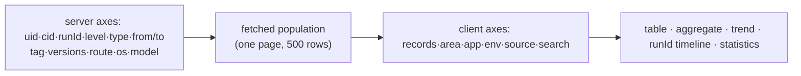

# report-logs

**The log console: one screen over three record kinds that share one store — user issue reports
(`reportIssue` → `/hello/report`), app-uploaded structured logs and statistics
(`/hello/report-bulk`), and what the retired automatic error reporter (`reportError`, 2026-09) left
behind.** All three land in `/mocks/0/list`, and log entries share `stereo='log'` with the retired
error reports; the console tells them apart. Feature code: `apps/admin-v2/src/app/features/report-logs/`.

Its readers are not only developers. Planning, operations and support use it to follow up a user's
complaint, watch errors, read issue reports and check performance and usage. So the console opens on
what someone came to do — five tabs — and the developer's full log view is the last of them, with
every feature it had. The nav item and the page title are the same name: "로그 콘솔" / "Log Console".

## The five tabs

| Tab (`tab=`)                  | Question it answers                         | What it fetches                                                                                                                                                       |
| ----------------------------- | ------------------------------------------- | --------------------------------------------------------------------------------------------------------------------------------------------------------------------- |
| Find a user (`user`, default) | "A user says it broke — what happened?"     | The user's records (`uid` on the server); the period's issue reports, matched to the user by the reporter id inside them; before a user is chosen, everyone's records |
| Errors (`errors`)             | "Is something breaking, for how many?"      | `level=error` records, plus the server's counts per tag, per hour or day, and distinct users; an opened incident fetches its own cases with `tag` on the server       |
| Issue reports (`reports`)     | "Who wrote in, and what was going on then?" | `type=issue` records                                                                                                                                                  |
| Statistics (`stats`)          | "Are we fast enough, how many use it?"      | One fetch per goal statistic (`tag` on the server), plus the server's distinct-user and app-open counts per day                                                       |
| All logs (`all`)              | The developer's view, unchanged in reach    | As before — see [the full-log tab](#the-full-log-tab)                                                                                                                 |

- **Find a user.** Type a user ID and press Find (an exact server lookup), or pick from the people seen
  in the period's fetched records — typing narrows that list by ID or by a name an issue report
  carried. The user card shows the device, OS and app version from their newest record, and counts of
  app sessions (distinct `runId`), errors and reports. Below it, one card per run, newest first; a
  card opens into a timeline of plain sentences ("채팅 · send failed"), errors on a pale red with
  "Details" (the record's full detail panel), reports on a pale blue with "Open report". Debug lines
  and performance measurements are hidden unless "Show detailed records" is ticked. **A uid is per
  cloud** — each cloud numbers its users from the start, and the log `uid` is whichever session was
  active (the relay user outside a cloud, the cloud's own user inside one) — so when one id's records
  span several clouds, the tab says they may be different people and offers a cloud row that narrows
  the fetch on the server (`cid`).
- **Errors.** Incidents grouped by tag, ranked by count, each with users affected, first and last
  time and a sparkline over the period. An incident opens into its cases; each case leads to that
  user's timeline at that moment.
- **Issue reports.** An inbox (title, reporter, app and version, time, attachment count). An opened
  report shows its text, screenshots and device, a folded "Developer details" with the full record,
  and **"See this user's logs at that time"**, which opens the user tab on the reporter with the
  period set to 30 minutes either side of the report.
- **Statistics.** Goal cards against the product's targets — app start (1.5 s at p95), cloud/place
  switch (1 s at p95), FCP (1.8 s at p75), LCP (2.5 s at p75), and room entry, which has no target yet
  and shows its numbers without a verdict. Usage: distinct users, app opens (`usage.session_start`)
  and users per day. With no statistics in the period, the tab says why and when there will be (the
  web app's built-in sampling policy — see `apps/web/docs/observability/telemetry.md`).

## Shared rules

- **The header never collapses.** Title, the production/development switch (`stage`), the tab bar and
  "Copy link to this view" are visible at every width. The switch changes what every number means,
  so it is in the header, colour-coded, not in a filter column.
- **Every screen is a link.** Tab, server, period, user, open run, open incident and open report are
  URL parameters; the language is not (see [docs/i18n](../i18n/README.md)). Switching tabs pushes a
  history entry and keeps only the server, so a period chosen on one tab does not silently carry into
  another. A link from before the tabs — any full-log parameter (`mode`, `kind`, `runId`, a date
  range, a facet) without `tab` — opens the full-log tab, where it means what it meant; a bare
  `?uid=` opens the user tab.
- **Developer identifiers stay out of the way.** The default screens speak in names: an area's
  display name instead of its tag, "사용자 1000123" or the reporter's name instead of a bare uid,
  dates instead of run ids. Raw values sit in tooltips, the detail panel and the full-log tab.
- **Times are shown both ways, in Korean time.** An absolute time with `KST`, plus how long ago;
  seconds in the tooltip.
- **An empty screen says what to do next** — usually a "Widen the period" button that steps to the
  next wider preset.
- **One layout vocabulary** (`components/console/ui.tsx`): content centred and capped in width, one
  card per group of related facts, a heading with a one-line explanation per section, numbers with
  their label above them, and colour only where it means something — errors red, reports blue. In a
  timeline the colour goes to the line's edge and a label chip, never to the sentence itself, so the
  lines that matter most keep full contrast. Everything uses the theme tokens or a colour paired with
  its `dark:` twin, so the tabs read the same in light and dark.

| Parameter               | Tab                             | Meaning                                                                            |
| ----------------------- | ------------------------------- | ---------------------------------------------------------------------------------- |
| `tab`                   | all                             | `user` (default) · `errors` · `reports` · `stats` · `all`                          |
| `stage`                 | all                             | `d1` for development; absent means production (`v1`)                               |
| `period`                | user · errors · reports · stats | `1h` · `24h` · `today` · `yesterday` · `7d` · `custom`; absent = the tab's default |
| `from`, `to`            | user · errors · reports · stats | `custom` only, `YYYY-MM-DD`                                                        |
| `at`                    | user                            | an instant (epoch ms); the period becomes 30 minutes either side                   |
| `uid`, `run`, `verbose` | user                            | the user, the open run card, detailed records shown                                |
| `cloud`                 | user                            | narrow a uid to one cloud (sent to the server as `cid`)                            |
| `event`                 | errors                          | the open incident (its tag)                                                        |
| `report`                | reports                         | the open report's id                                                               |

## Periods against a server that filters by day

The server's range filter is whole Korean days on **arrival** time (`from`/`to`, `YYYY-MM-DD`). A
period button resolves to two things (`lib/period.ts`): the exact window the screen shows, narrowed in
the browser by **occurrence** time, and the covering days sent to the server. For `today`,
`yesterday`, `7d` and `custom` the two coincide; for `1h`, `24h` and `around` the days are wider, and
the resolved period says so (`exact: false`). Each tab's default: user and reports `7d`, errors
`24h`, statistics `7d`.

## Counting: the server's numbers or the fetched rows

A fetch stops at one page (500 rows, newest arrival first), so counting fetched rows answers "how
many in the newest 500". Where the console reports counts it decides per screen (`lib/errorGroups.ts`):

- **The fetched rows are exact** when they hold the whole window: the fetch was not cut short, or it
  reaches back past the window's start. Then count, users, first/last time and the trend are all
  computed from rows, by occurrence time, at the minute.
- **Otherwise the server counts** (`groupBy`, `interval`, `users` on the list call → `stats`;
  `hooks/use-log-stats.ts`, one record per answer). It counts the whole match, but over whole days
  by arrival, and it cannot give per-tag users or first/last times — those still come from the rows
  and are marked partial ("7명 이상"). When the window is narrower than the days, a line under the
  numbers names the days they cover.
- **A backend without the aggregation** answers without `stats`; the screen falls back to rows and
  says the count may be short. Never zeros.

## The readable timeline

`lib/describeRow.ts` turns a record into a sentence from its own words: the area's display name plus
the app's message for a log, a frame for a report ("Reported a problem: …"), a screen view, a session
start or end, or a timed statistic ("Room entry · took 1.3s · shown"). Messages are not translated —
they are the app's diagnostic text and what an engineer will search for. Display names for areas
(the lower-cased old tag, or the part before a dot) and for statistics tags are a map per language in
`i18n/locales/{ko,en}/events.ts`; a tag in neither shows as itself.

## Not possible yet (needs the server)

- A period filter by the hour and on occurrence time, so "last hour" is a server question and server
  counts match the window.
- Finding a user's ID by name or by the last four digits of a phone number.
- Issue reports carrying the reporter's `uid` as a top-level, filterable field, so a user's reports
  come back with a `uid` query instead of being matched within the period's fetched reports.

## The full-log tab

Everything below describes the developer's view, which is the console as it was before the tabs.
Its filter rail shows level, the date range and search; kind (`kind` → `type`), records (`record`)
and the facets are under a folded "Advanced filters", open when any of them is set. Below `xl` the
rail opens as a drawer from a "Filters" button instead of disappearing.

## Design principles

- **The screen states plainly which axes the server can filter and which it can't**, rather than
  quietly slicing on the client and calling it a filter. See [server boundary](#server-filter-boundary).
- **The three axes that make tracing possible — `uid`, `cid`, `runId` — are promoted to server
  filters.** Clicking one onto a "pin" is the screen's central action; everything else narrows a
  population already fetched.
- **The working population is fetched explicitly, with its boundary always visible.** This is not
  search-that-pretends-to-cover-everything: the server narrows by date range first, pages accumulate
  up to a cap, and hitting the cap tells the operator to narrow the range rather than silently
  truncating.
- **The screen doesn't shift under an operator mid-analysis.** New logs arrive as a banner, not an
  automatic re-render; when they get folded in is the operator's call.
- **Occurrence order is preserved despite batched arrival.** Uploads land in batches, so `createdAt`
  (when a batch was received) clumps. Every ordering, timeline and trend in this screen sorts by
  `timestamp` (when the entry actually happened) instead.
- **Parsing binds defensively to the storage format.** A record's payload can live in `meta` (object
  or string) or in `SlackReportBody.message`; `parseReportLog` checks both and falls back to the raw
  JSON on failure — a parse failure never drops a row, only degrades its rendering.
- **Filter state lives in the URL.** A refresh or a shared link has to reproduce the exact same
  trace, following the `useSearchParams` convention `MembershipsPage` already established.

## Server filter boundary

`GET /mocks/0/list` only ever reaches the fields `saveLogEntry` copies to the top of the document;
everything else lives inside `meta` and is invisible to the query.

| Axis                                                                        | Server-filterable | Note                                                                                                                                                          |
| --------------------------------------------------------------------------- | ----------------- | ------------------------------------------------------------------------------------------------------------------------------------------------------------- |
| `uid`, `sid`                                                                | yes               | handled specially by the backend's search-param packer                                                                                                        |
| `cid`, `runId`, `level`                                                     | yes               | copied to the top of the stored record                                                                                                                        |
| `type` (`stereo`)                                                           | yes               | added directly as an ES term filter                                                                                                                           |
| `from`/`to`                                                                 | yes               | a `createdAt` range, day boundaries in KST, `to` inclusive                                                                                                    |
| `page`/`limit`/`offset`                                                     | yes               |                                                                                                                                                               |
| `sort`                                                                      | **never sent**    | see the trap below                                                                                                                                            |
| `tag`, `appVersion`, `webVersion`, `route`, `os`, `osVersion`, `model`      | yes               | copied to the top of the stored record; exact match only, and only on records stored after that backend change                                                |
| `kind`, `area`, `durationMs`, `attrs`, `metrics`, `sr`, `source`, `message` | no                | only inside the `meta` JSON — client-only                                                                                                                     |
| aggregation                                                                 | partly            | counts per field, per time bucket (by arrival) and distinct users — used by the errors and statistics tabs; no percentiles, and nothing per tag beyond counts |

**The sort trap:** omitting `sort` gets the default, `createdAt desc`. Sending `sort=createdAt` alone
does **not** mean "the same, but explicit" — it flips the order to ascending, because the backend
treats an unpaired sort field as `asc`. This client deliberately never sends `sort` at all.

## Fetching the working population

Paging logic lives in `lib/corpusPaging.ts`, separated from the fetch loop itself (which is
ordinary `react-query`) because the two behaviors worth pinning down are the stop condition and
deduplication:

- **Stop conditions**, checked in order: a short page (the server _returned_ fewer rows than the page
  size — trusting the returned count, not a possibly-stale `total`, is what stops an infinite walk
  when the underlying set shrank mid-walk and a page full of duplicates would otherwise read as "not
  done yet"); the cap; or `distinct >= total`.
- **500 rows per page, capped at one page (500).** The page size bounds the tail risk of a handful of
  screenshot-carrying report records landing in one response (a page of reports can run several MB).
  With the cap at one page, any set of axes costs **one round trip**, which is what a screen left
  open all day, refetching on every filter change, can reasonably spend. A bigger population makes
  tag/version counts more accurate at the cost of more requests, memory and first-paint time; either
  way the counts are scoped to the fetched population and the screen says so, so the answer to "not
  enough" is a narrower date range (or, on the new tabs, the server's own counts), not a bigger cap.
- `from = limit * page`, and with one page only `from=0` is ever sent — far inside
  Elasticsearch's default `max_result_window` (10,000). Pinned by a test.

## Logs and statistics

**Two different "kinds".** The `kind` URL parameter is the _report type_ (log entry, issue, legacy
error report) and is sent to the server as `type`. A log-pipeline entry's own `kind` (log, trace,
sample, event) is a different field, filtered here under **Records** (`record`).

The same store holds logs and statistics — performance traces, samples and usage events, told apart
by the entry's `kind` (absent means a log). The server cannot filter on `kind`, so the split is a
client axis over the fetched rows:

- **Records** (`record` in the URL) — `Logs` by default, so statistics never bury the log lines this
  console is for; `All statistics`, one kind, or `Everything` on request. Reports and errors have no
  `kind` and count as logs.
- **Area** — the tag's area, as the clients derive it: before the first dot of an event tag
  (`socket.reconnect_failed` → `socket`), the whole old tag lower-cased otherwise (`SOCKET` →
  `socket`). It keeps a feature's old and new tags under one filter while call sites move over.
  Newer clients store `area` on the entry; for older entries it is derived here the same way.

### The run timeline

A pinned run shows its logs, traces, samples and events on one line, in occurrence order — the run's
own record of what it did and how long it took. A trace carries a bar against the run's longest one
(its `timestamp` is when it ended), a statistic's attributes and metrics are shown inline, and once the
run holds any statistic there is a toggle per kind (`show` in the URL). The record filter does not
apply here: the timeline is about one run, all of it.

### The statistics view

`Statistics` reads one statistic over the fetched rows — a trace by its duration or a metric, a sample
by a metric, an event by its count — split by an attribute or a context axis (app version, platform,
host, OS, route template). Per group: `n`, an estimated count weighed by each record's sampling rate
(`Σ 1/sr`), distinct users, and p50 / p75 / p95 / p99 by linear interpolation between ranks (the spreadsheet `PERCENTILE.INC`:
`h = (n − 1) × p`), the mean, and a distribution. State
is in the URL (`stat`, `measure`, `by`).

It is honest about what it is: **numbers over the fetched rows**, exact for a narrow question (one
trace, one version, a few days) and marked "Partial sample" when the fetch stopped at its cap. With no
statistic in view it says so instead of showing zeros — no data and zero are different answers.
Overviews over weeks, trends and version comparisons need the server to aggregate the statistics
fields, which it does not store at the top of a record yet.

## Occurrence-time handling

`lib/eventTime.ts` defines `eventAt(row) = row.timestamp ?? row.createdAt` and an ingest-lag
calculation that badges a row once the gap between the two crosses a threshold (60s by default).
Because the server's date-range filter is on `createdAt`, not `eventAt`, rows can leak in or out
right at a range boundary — this function is the one place that fact is computed, and the screen
surfaces it rather than hiding the discrepancy.

## Two filter tiers, one population



`level` is counted as a facet for display but filtered server-side — it is deliberately excluded
from the "clear client filters" action, because including it there would also clear a server axis
and force a full re-fetch for what looked like a client-only reset.

## State ownership

| State                                              | Owner                   | Persisted in                                |
| -------------------------------------------------- | ----------------------- | ------------------------------------------- |
| Server-axis filters + pins                         | `use-log-console-state` | URL query                                   |
| Client-axis filters + view mode                    | `use-log-console-state` | URL query                                   |
| Fetched population (rows, progress)                | `use-log-corpus`        | memory, discarded on any server-axis change |
| New-log count                                      | `use-new-log-probe`     | memory                                      |
| Selected row                                       | each tab                | memory                                      |
| Tab, server, period, open user/run/incident/report | `use-console-nav`       | URL query                                   |
| Server counts (`stats`)                            | `use-log-stats`         | react-query cache, same freshness as rows   |
| Language                                           | `app/i18n`              | browser storage (`admin-v2.language`)       |
| Resolved stack trace                               | `StackSection`          | memory                                      |

## Known unknown: does a report record carry `uid`?

Unconfirmed against live data. Reading the backend's report-creation path, it appears a Slack report
is written without a `uid` field at all — if so, a `uid` pin narrows batched log entries but does not
pull in that same user's own reports. The screen is built to stay honest about this either way: when
a `uid` pin is active and the type filter includes reports, it shows a caveat that report records
carry no `uid` axis and won't match the pin. If live data later confirms `uid` is in fact present,
only that caveat needs to come out — `parseReportLog` already reads `mock.uid` as a fallback, so no
code change would be needed.

## Verifying

```bash
npx vitest run --root apps/admin-v2 src/app/features/report-logs src/app/i18n
```

Coverage worth calling out specifically, for the tabs: the default tab and old links opening the
full-log tab; each tab's state surviving the URL; the hops (a report to its user's timeline around
the report time, an incident to its cases and on to a user); the empty states' next step; the
language switch changing copy while leaving the URL alone; Korean and English having the same keys
and slots; the coverage rule choosing between rows and server counts; and period resolution against
the Korean calendar. For the full-log tab: the corpus-paging stop conditions (short page, cap, distinct
== total, a full page of only duplicates does **not** stop the walk, the single-round-trip default
path); occurrence-time fallback and clamping against a device clock running ahead; facet
count-then-alphabetical ordering so a tie doesn't reorder as pages arrive; URL round-tripping of
filters and pins including out-of-range values; and, only visible at the assembled-page level, that a
server-axis change re-fetches while a client-axis change does **not**.

Request-count is a designed property of this screen and is pinned by tests:

| Situation                                            | Requests                                                         |
| ---------------------------------------------------- | ---------------------------------------------------------------- |
| Server axes already narrow the result to one page    | 1                                                                |
| Intermediate values while typing a date              | 0                                                                |
| A previously-seen axis combination, within cache TTL | 0                                                                |
| Same, but past TTL                                   | shows cached rows immediately, then re-fetches in the background |
| Background-tab new-log probe                         | 0                                                                |

**Still to confirm against real data** (the screen sits behind the admin OAuth gate, so none of this
is checkable without a live login): how often a real day's log volume hits the 500-row cap, and
whether that means narrowing the default range or raising the cap; memory and response size after
switching axes repeatedly within `gcTime` (react-query has no row-count cap, only a time-based one);
the `uid`-on-reports question above; whether the deployed backend already answers `stats` (the tabs
fall back to rows when it does not); the layout at real widths (checked by hand with a fake-data
harness at 390, 800 and 1280px in both themes; untestable in `jsdom`, which has no CSS); and focus
handling when the detail panel or the filter drawer is an overlay and gets dismissed.
