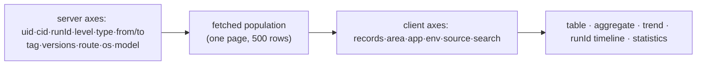

# report-logs

**The log console: one screen over three record kinds that share one store — user issue reports
(`reportIssue` → `/hello/report`), app-uploaded structured logs and statistics
(`/hello/report-bulk`), and what the retired automatic error reporter (`reportError`, 2026-09) left
behind.** All three land in `/mocks/0/list`, and log entries share `stereo='log'` with the retired
error reports; the console tells them apart. Feature code: `apps/admin/src/app/features/report-logs/`.

Its readers are not only developers. Planning, operations and support use it to follow up a user's
complaint, watch errors, read issue reports and check performance and usage. So the console opens on
what someone came to do — five tabs — and the developer's full log view is the last of them, with
every feature it had. The nav item and the page title are the same name: "로그 콘솔" / "Log Console".

## The five tabs

| Tab (`tab=`)                  | Question it answers                         | What it fetches                                                                                                                                                       |
| ----------------------------- | ------------------------------------------- | --------------------------------------------------------------------------------------------------------------------------------------------------------------------- |
| Find a user (`user`, default) | "A user says it broke — what happened?"     | The user's records (`uid` on the server); the period's issue reports, matched to the user by the reporter id inside them; before a user is chosen, everyone's records |
| Errors (`errors`)             | "Is something breaking, for how many?"      | `level=error` records, plus the server's counts per tag, per hour or day, and distinct users; an opened incident fetches its own cases with `tag` on the server       |
| Issue reports (`reports`)     | "Who wrote in, and what was going on then?" | `type=issue` records                                                                                                                                                  |
| Statistics (`stats`)          | "Are we fast enough, how many use it?"      | Five views over one period: one fetch per statistic (`tag` on the server) for timings, the server's counts for people, opens and versions — see below                 |
| All logs (`all`)              | The developer's view, unchanged in reach    | As before — see [the full-log tab](#the-full-log-tab)                                                                                                                 |

- **Find a user.** Type a user ID and press Find (an exact server lookup), or pick from the people seen
  in the period's fetched records — typing narrows that list by ID or by a name an issue report
  carried. The user card shows the device, OS and app version from their newest record, and counts of
  app sessions (distinct `runId`), errors and reports. Below it, one card per run, newest first; a
  card opens into a timeline of plain sentences ("채팅 · send failed"), errors on a pale red with
  "Details" (the record's full detail panel), reports on a pale blue with "Open report". Debug lines
  and performance measurements are hidden unless "Show detailed records" is ticked. **A uid is per
  cloud** — each cloud numbers its users from the start, and the log `uid` is whichever session was
  active (the relay user outside a cloud, the cloud's own user inside one) — so when one id's records
  span several clouds, the tab says they may be different people and offers a cloud row that narrows
  the fetch on the server (`cid`).
- **Errors.** Incidents grouped by tag, ranked by count, each with users affected, first and last
  time and a sparkline over the period. An incident opens into its cases; each case leads to that
  user's timeline at that moment.
- **Issue reports.** An inbox (title, reporter, app and version, time, attachment count). An opened
  report shows its text, screenshots and device, a folded "Developer details" with the full record,
  and **"See this user's logs at that time"**, which opens the user tab on the reporter with the
  period set to 30 minutes either side of the report.
- **Statistics.** One period, five views (`view=`):
    - **Overview** — goal cards against the product's targets (app start 1.5 s at p95, cloud/place
      switch 1 s at p95, FCP 1.8 s at p75, LCP 2.5 s at p75; room entry has no target yet and shows its
      numbers without a verdict), with a bar against the target; users, app opens and users per day.
      App start leaves out a phone app's `restart` boots — a JS context the app started over itself
      after a sign-out or an owner switch, which no one tapped and which starts warm.
      With no statistics in the period it says why and when there will be.
    - **By version & device** (`perf`, `goal`, `by`) — one goal split by app version, OS, device or
      platform: p50/p75/p95 per group (groups under 5 measurements dimmed), the newest version marked,
      the goal's value per day, its distribution with the target, and the ten slowest cases leading to
      that user's timeline.
    - **Usage patterns** (`usage`) — people, app opens, opens per person, median session length and
      screens; people and opens per day (per hour for two days or less); opens by hour of day; the most
      used screens (route templates) with median time spent; how sessions start (cold/warm/resume,
      icon/push/link/browser).
    - **Performance details** (`detail`, `by`) — room entry outcomes, cache use and time per entry
      path; server requests per endpoint (estimated count, median and p95 time, failure rate, relay or
      cloud); message send by thread or kind; stalls (long tasks) per screen; INP, CLS and TTFB.
    - **Version adoption** (`versions`, `dim`) — users per app version, OS, device or web version (one
      server query per top value, since `groupBy` counts records, not users), the newest version and
      when it appeared, the share of app users on a build that sends statistics (0.29.2+), and the top
      versions' share per day.

    Statistics records come from fetches narrowed to their tag on the server (≤500 each, marked when
    cut short). Performance records other than the goals are sampled one run in five, so their counts
    are estimates (`Σ 1/sr`) and say so; goal records and usage events come from every run. Server
    counts (people, opens, versions) cover whole days by arrival, which the views state for a period
    narrower than its days. Where collection comes from: the web app's built-in sampling policy
    (`apps/web/docs/observability/telemetry.md`).

## Shared rules

- **The header never collapses.** Title, the production/development switch (`stage`), the tab bar and
  "Copy link to this view" are visible at every width. The switch changes what every number means,
  so it is in the header, colour-coded, not in a filter column.
- **Every screen is a link.** Tab, server, period, user, open run, open incident and open report are
  URL parameters; the language is not (see [docs/i18n](../i18n/README.md)). Switching tabs pushes a
  history entry and keeps only the server, so a period chosen on one tab does not silently carry into
  another. A link from before the tabs — any full-log parameter (`mode`, `kind`, `runId`, a date
  range, a facet) without `tab` — opens the full-log tab, where it means what it meant; a bare
  `?uid=` opens the user tab.
- **Developer identifiers stay out of the way.** The default screens speak in names: an area's
  display name instead of its tag, "사용자 1000123" or the reporter's name instead of a bare uid,
  dates instead of run ids. Raw values sit in tooltips, the detail panel and the full-log tab.
- **Times are shown both ways, in Korean time.** An absolute time with `KST`, plus how long ago;
  seconds in the tooltip.
- **An empty screen says what to do next** — usually a "Widen the period" button that steps to the
  next wider preset.
- **One layout vocabulary** (`components/console/ui.tsx`): content centred and capped in width, one
  card per group of related facts, a heading with a one-line explanation per section, numbers with
  their label above them, and colour only where it means something — errors red, reports blue. In a
  timeline the colour goes to the line's edge and a label chip, never to the sentence itself, so the
  lines that matter most keep full contrast. Everything uses the theme tokens or a colour paired with
  its `dark:` twin, so the tabs read the same in light and dark.

| Parameter                   | Tab                             | Meaning                                                                            |
| --------------------------- | ------------------------------- | ---------------------------------------------------------------------------------- |
| `tab`                       | all                             | `user` (default) · `errors` · `reports` · `stats` · `all`                          |
| `stage`                     | all                             | `d1` or `v1`; absent means the build's stage (`v1` in production, `d1` otherwise)  |
| `period`                    | user · errors · reports · stats | `1h` · `24h` · `today` · `yesterday` · `7d` · `custom`; absent = the tab's default |
| `from`, `to`                | user · errors · reports · stats | `custom` only, `YYYY-MM-DD`                                                        |
| `at`                        | user                            | an instant (epoch ms); the period becomes 30 minutes either side                   |
| `uid`, `run`, `verbose`     | user                            | the user, the open run card, detailed records shown                                |
| `cloud`                     | user                            | narrow a uid to one cloud (sent to the server as `cid`)                            |
| `view`, `goal`, `by`, `dim` | stats                           | the statistics view and its choices; switching views drops the previous view's     |
| `event`                     | errors                          | the open incident (its tag)                                                        |
| `report`                    | reports                         | the open report's id                                                               |

## How the statistics are read

Definitions the views rely on, for anyone checking a number:

- **A group needs five measurements before it is judged.** A percentile over a handful of values is
  mostly noise (one slow launch moves a p95 of four values by seconds), so smaller groups show their
  percentiles with no verdict. Versions order by `x.y.z`, ignoring a pre-release or build suffix; the
  same rule is used by the adoption view so the two never disagree about which version is newest, and
  ties in the table put the newest version first.
- **The distribution leaves out the slowest 1%.** Bins run from the fastest measurement to the 99th
  percentile, so one minute-long launch does not squeeze every other value into the first bar; the
  clipped count is named under the chart. Under 20 measurements nothing is clipped. The target line is
  drawn only where the target falls inside the drawn range.
- **Failure and highlight rules (performance details).** A request or send failed when its
  `status_class` starts with 4 or 5, or its `outcome` is anything but `ok`/`success`; a record with
  neither says nothing and counts as not failed. An endpoint is highlighted when it has at least five
  records and a failure share of 5% or more, or a p95 of one second or more — one sampled failure is
  not a 100% failure rate. Stall records exist only for screen visits that had a long task, so the
  counts are visits with stalls; a `max_ms` of 0 means the stall was not the screen's own and is
  skipped. CLS is stored times 1000 to stay an integer and divided back for display. INP is read
  against the product's own reference (200 ms); CLS (0.1) and TTFB (800 ms) show the web-vitals "good"
  thresholds for orientation only. Room-entry outcomes list `shown`, `empty`, `timeout`, `background`,
  `left` first and any other value after them.
- **Screen time comes from the next view.** A view does not know how long it will last; the following
  one reports it as `prev_dwell_ms` for `prev_screen`. So a screen's time is read from the views that
  followed it, and a session's last screen has none — time-spent counts can be below the view count.
- **Server buckets are filled in, folded and never summed for people.** Empty buckets the server left
  out are filled so a quiet day is a short column, unless a bucket sits off the expected boundary, in
  which case they are shown as they came. The hour-of-day chart adds counts across days; distinct
  users do not add, so only counts are folded. Charts use days for periods over two days and hours
  otherwise.
- **Version adoption counts people per value.** Someone who updated during the period is counted under
  both versions, so sums run high and shares are approximate; the bars never draw past full. The view
  asks the server for every version it will count (not just the busiest few), because a release in its
  first hours has few records and would otherwise never be found as the newest, and then asks for
  distinct users of the top values plus the newest app version. Every app version sends logs but
  statistics exist only from 0.29.2, so counting statistics alone would hide the people still on an
  older version. Records lacking the field being split on (the browser web has no app version) fall in
  no row, so rows need not add up to the total.
- **Reports are placed in the run they were sent during.** Issue reports carry no `runId`, so a report
  joins the run whose span, widened by two minutes either side, holds it (the nearest edge wins when
  runs overlap) and otherwise stands alone. A user card's device is the newest value of each device
  field, so a run that changed mid-way shows where it ended.

## Periods against a server that filters by day

The server's range filter is whole Korean days on **arrival** time (`from`/`to`, `YYYY-MM-DD`). A
period button resolves to two things (`lib/period.ts`): the exact window the screen shows, narrowed in
the browser by **occurrence** time, and the covering days sent to the server. For `today`,
`yesterday`, `7d` and `custom` the two coincide; for `1h`, `24h` and `around` the days are wider, and
the resolved period says so (`exact: false`). Each tab's default: user and reports `7d`, errors
`24h`, statistics `7d`.

That server answers any other shape — a datetime such as `2026-11-17T03:45:00`, or an impossible day
such as `2026-02-30` — by failing the whole request, so a `from`/`to` from the URL is checked
(`isKstDate`) before it is used. A period tab treats a bad value as no custom range and falls back to
today; the full-log tab treats it as no bound.

## Counting: the server's numbers or the fetched rows

A fetch stops at one page (500 rows, newest arrival first), so counting fetched rows answers "how
many in the newest 500". Where the console reports counts it decides per screen (`lib/errorGroups.ts`):

- **The fetched rows are exact** when they hold the whole window: the fetch was not cut short, or it
  reaches back past the window's start. Then count, users, first/last time and the trend are all
  computed from rows, by occurrence time, at the minute.
- **Otherwise the server counts** (`groupBy`, `interval`, `users` on the list call → `stats`;
  `hooks/use-log-stats.ts`, one record per answer). It counts the whole match, but over whole days
  by arrival, and it cannot give per-tag users or first/last times — those still come from the rows
  and are marked partial ("7명 이상"). When the window is narrower than the days, a line under the
  numbers names the days they cover.
- **A backend without the aggregation** answers without `stats`; the screen falls back to rows and
  says the count may be short. Never zeros.

## Reading stored records

- **Screenshots live in the payload carried by `message`.** The client first sent them as the report's
  `meta.images`, but the backend discards a client-supplied `meta`; only `message` survives. The parser
  still probes the `meta` shapes so older records, and any backend that keeps `meta`, still show their
  images. Only values an `` can render are kept.
- **A batch log entry is recognised by `level` and `tag` together**, which a Slack report never sets, and
  skips the title and payload unwrap. A record with `meta: null` is "nothing stored", not corrupt.
- **Axes are read from `meta` first, then the record's own copy.** The server hoists some fields to the
  top of the document and a re-sent entry may have dropped either half, so both places are read.
  Records written before the hoist have the `meta` half only.
- **OS name and version stay apart** (`ios` and `18.0`) because they are stored and filtered
  separately; joining them into a facet value would send `ios 18.0` at a field holding `ios` and match
  nothing. A joined label is built only for display and CSV.
- **A report's version and route come from its context.** The attached version info is the
  `{ appVersion, webVersion, … }` object from the bridge messages (the unrelated `{ version, buildTime }`
  type elsewhere in the repo does not reach here). The `path` of a report is always the feedback
  screen itself, so the screen in question is the second-to-last `routeTrail` entry.
- **Error categories are a frozen reader.** The `[app] <category>` title tokens come from records
  written before the automatic reporter was retired; the list is not extended.
- **Free-text search and facets are cheap by design.** A query matches when every whitespace-separated
  term appears somewhere in the row (AND, not phrase); each row's search text is cached per row since it
  includes full stack traces and runs on every keystroke. Facet values count most frequent first, ties
  alphabetical so the list does not reshuffle as pages arrive; rows missing an axis are skipped rather
  than counted under a placeholder. A facet with fewer than two values is hidden unless it is the
  selected one, which a server-narrowed axis always is, so the control never disappears under the
  operator. Facets are counted over the whole corpus, not the filtered rows, so choosing a value never
  strands you without the others. `app`/`env` exist only on reports and `tag`/`source`/`os` only on
  batch entries.

## The readable timeline

`lib/describeRow.ts` turns a record into a sentence from its own words: the area's display name plus
the app's message for a log, a frame for a report ("Reported a problem: …"), a screen view, a session
start or end, or a timed statistic ("Room entry · took 1.3s · shown"). Messages are not translated —
they are the app's diagnostic text and what an engineer will search for. Display names for areas
(the lower-cased old tag, or the part before a dot) and for statistics tags are a map per language in
`i18n/locales/{ko,en}/events.ts`; a tag in neither shows as itself.

## Not possible yet (needs the server)

- A period filter by the hour and on occurrence time, so "last hour" is a server question and server
  counts match the window.
- Finding a user's ID by name or by the last four digits of a phone number.
- Issue reports carrying the reporter's `uid` as a top-level, filterable field, so a user's reports
  come back with a `uid` query instead of being matched within the period's fetched reports.

## The full-log tab

Everything below describes the developer's view, which is the console as it was before the tabs.
Its filter rail shows level, the date range and search; kind (`kind` → `type`), records (`record`)
and the facets are under a folded "Advanced filters", open when any of them is set. Below `xl` the
rail opens as a drawer from a "Filters" button instead of disappearing.

The monitor strip above it counts levels in severity order and appends any other level the app emits,
so a level introduced next release never becomes invisible. Its spike flag compares the newest time
bucket with the median of the buckets before it, not the mean (which the spike itself would drag up)
and not the previous bucket alone (ordinary jitter), and needs a minimum count so one row against a
zero baseline is not a spike. The group (aggregate) view counts over the collected rows, groups by
whitespace-collapsed message and shows the most frequent type per group, not the first seen.

## Design principles

- **The screen states plainly which axes the server can filter and which it can't**, rather than
  quietly slicing on the client and calling it a filter. See [server boundary](#server-filter-boundary).
- **The three axes that make tracing possible — `uid`, `cid`, `runId` — are promoted to server
  filters.** Clicking one onto a "pin" is the screen's central action; everything else narrows a
  population already fetched.
- **The working population is fetched explicitly, with its boundary always visible.** This is not
  search-that-pretends-to-cover-everything: the server narrows by date range first, pages accumulate
  up to a cap, and hitting the cap tells the operator to narrow the range rather than silently
  truncating.
- **The screen doesn't shift under an operator mid-analysis.** New logs arrive as a banner, not an
  automatic re-render; when they get folded in is the operator's call.
- **Occurrence order is preserved despite batched arrival.** Uploads land in batches, so `createdAt`
  (when a batch was received) clumps. Every ordering, timeline and trend in this screen sorts by
  `timestamp` (when the entry actually happened) instead.
- **Parsing binds defensively to the storage format.** A record's payload can live in `meta` (object
  or string) or in `SlackReportBody.message`; `parseReportLog` checks both and falls back to the raw
  JSON on failure — a parse failure never drops a row, only degrades its rendering.
- **Filter state lives in the URL.** A refresh or a shared link has to reproduce the exact same
  trace, following the `useSearchParams` convention `MembershipsPage` already established.

## Server filter boundary

`GET /mocks/0/list` only ever reaches the fields `saveLogEntry` copies to the top of the document;
everything else lives inside `meta` and is invisible to the query.

| Axis                                                                        | Server-filterable | Note                                                                                                                                                          |
| --------------------------------------------------------------------------- | ----------------- | ------------------------------------------------------------------------------------------------------------------------------------------------------------- |
| `uid`, `sid`                                                                | yes               | handled specially by the backend's search-param packer                                                                                                        |
| `cid`, `runId`, `level`                                                     | yes               | copied to the top of the stored record                                                                                                                        |
| `type` (`stereo`)                                                           | yes               | added directly as an ES term filter                                                                                                                           |
| `from`/`to`                                                                 | yes               | a `createdAt` range, day boundaries in KST, `to` inclusive                                                                                                    |
| `page`/`limit`/`offset`                                                     | yes               |                                                                                                                                                               |
| `sort`                                                                      | **never sent**    | see the trap below                                                                                                                                            |
| `tag`, `appVersion`, `webVersion`, `route`, `os`, `osVersion`, `model`      | yes               | copied to the top of the stored record; exact match only, and only on records stored after that backend change                                                |
| `kind`, `area`, `durationMs`, `attrs`, `metrics`, `sr`, `source`, `message` | no                | only inside the `meta` JSON — client-only                                                                                                                     |
| aggregation                                                                 | partly            | counts per field, per time bucket (by arrival) and distinct users — used by the errors and statistics tabs; no percentiles, and nothing per tag beyond counts |

**The sort trap:** omitting `sort` gets the default, `createdAt desc`. Sending `sort=createdAt` alone
does **not** mean "the same, but explicit" — it flips the order to ascending, because the backend
treats an unpaired sort field as `asc`. This client deliberately never sends `sort` at all.

## Fetching the working population

Paging logic lives in `lib/corpusPaging.ts`, separated from the fetch loop itself (which is
ordinary `react-query`) because the two behaviors worth pinning down are the stop condition and
deduplication:

- **Stop conditions**, checked in order: a short page (the server _returned_ fewer rows than the page
  size — trusting the returned count, not a possibly-stale `total`, is what stops an infinite walk
  when the underlying set shrank mid-walk and a page full of duplicates would otherwise read as "not
  done yet"); the cap; or `distinct >= total`.
- **500 rows per page, capped at one page (500).** The page size bounds the tail risk of a handful of
  screenshot-carrying report records landing in one response (a page of reports can run several MB).
  With the cap at one page, any set of axes costs **one round trip**, which is what a screen left
  open all day, refetching on every filter change, can reasonably spend. A bigger population makes
  tag/version counts more accurate at the cost of more requests, memory and first-paint time; either
  way the counts are scoped to the fetched population and the screen says so, so the answer to "not
  enough" is a narrower date range (or, on the new tabs, the server's own counts), not a bigger cap.
- `from = limit * page`, and with one page only `from=0` is ever sent — far inside
  Elasticsearch's default `max_result_window` (10,000). Pinned by a test.

- **The walk also has two backstops** so it always ends: a hard ceiling on requests per set of axes
  (eight), and a stall rule that gives up after two consecutive pages add no new distinct rows. One
  repeated page is tolerated, because a full page means the server has more and the offset window
  over a non-unique `createdAt` can hand back a band it already gave (a batch upload stamps its whole
  batch with one `createdAt`). A full page of repeats forever would otherwise keep "collecting" true,
  which disables both the re-collect button and the new-log probe. Whenever the walk stops early for
  any reason, the truncation notice shows; it is not tied to hitting the cap.
- **Requests cannot be aborted.** The relay transport's request builder exposes no abort signal, so
  cancellation is cooperative: the walk stops between pages, and a response for axes that have since
  changed lands under the old query key and is never shown. The cost is at most one wasted in-flight
  page per filter change.
- **The corpus is cached by its axes.** The axes are the query key, so pin, unpin and re-pin are served
  from cache. A held corpus is served for two minutes and then still renders at once while it
  refetches behind the rows (old rows beat a blank screen); an unused one is dropped after five
  minutes, because an issue row carries its screenshots as base64 and holding many is real memory.
  The app's client never goes stale by default, so this screen overrides that. Axes settle for a
  quarter of a second before a walk starts, and while they settle the query for the previous axes does
  not run, so choosing a user never paints the old, user-less rows under the new one. **Recollect
  throws away what is held**: other cached corpora are removed, the one on screen refetches behind its
  rows — otherwise a corpus collected before the refresh would come back after an unpin, quietly older
  than the server. Rows merged from the new-logs banner are kept outside the cache, so a cache hit is
  always what a fresh walk would return.
- **Counting from the server asks for one record.** The count queries send `limit=1`: the counts do not
  depend on the page size, and one record keeps the answer small even when the match holds
  screenshot-laden reports. The server can count records per value but not people per value, so
  per-value distinct users cost one query each.

## Logs and statistics

**Two different "kinds".** The `kind` URL parameter is the _report type_ (log entry, issue, legacy
error report) and is sent to the server as `type`. A log-pipeline entry's own `kind` (log, trace,
sample, event) is a different field, filtered here under **Records** (`record`).

The same store holds logs and statistics — performance traces, samples and usage events, told apart
by the entry's `kind` (absent means a log). The server cannot filter on `kind`, so the split is a
client axis over the fetched rows:

- **Records** (`record` in the URL) — `Logs` by default, so statistics never bury the log lines this
  console is for; `All statistics`, one kind, or `Everything` on request. Reports and errors have no
  `kind` and count as logs.
- **Area** — the tag's area, as the clients derive it: before the first dot of an event tag
  (`socket.reconnect_failed` → `socket`), the whole old tag lower-cased otherwise (`SOCKET` →
  `socket`). It keeps a feature's old and new tags under one filter while call sites move over.
  Newer clients store `area` on the entry; for older entries it is derived here the same way.

### The run timeline

A pinned run shows its logs, traces, samples and events on one line, in occurrence order — the run's
own record of what it did and how long it took. A trace carries a bar against the run's longest one
(its `timestamp` is when it ended), a statistic's attributes and metrics are shown inline, and once the
run holds any statistic there is a toggle per kind (`show` in the URL). The record filter does not
apply here: the timeline is about one run, all of it.

### The statistics view

`Statistics` reads one statistic over the fetched rows — a trace by its duration or a metric, a sample
by a metric, an event by its count — split by an attribute or a context axis (app version, platform,
host, OS, route template). Per group: `n`, an estimated count weighed by each record's sampling rate
(`Σ 1/sr`), distinct users, and p50 / p75 / p95 / p99 by linear interpolation between ranks (the spreadsheet `PERCENTILE.INC`:
`h = (n − 1) × p`), the mean, and a distribution. State
is in the URL (`stat`, `measure`, `by`).

It is honest about what it is: **numbers over the fetched rows**, exact for a narrow question (one
trace, one version, a few days) and marked "Partial sample" when the fetch stopped at its cap. With no
statistic in view it says so instead of showing zeros — no data and zero are different answers.
Overviews over weeks, trends and version comparisons need the server to aggregate the statistics
fields, which it does not store at the top of a record yet.

## Watching for new logs

`hooks/use-new-log-probe.ts` looks for rows that arrived after the corpus was collected without
touching it. Every 15 seconds it asks for page 0 with a limit of 50, which works because the default
order is newest arrival first; it never writes to the corpus, and the operator's click on the banner
merges the rows it found. Rules that keep it from losing data:

- **An overflowed window is not merged.** If every row of a full page is newer than the corpus
  watermark, more arrived than one page holds and the count is only a floor. Merging would move the
  watermark past the rows that did not fit and they could never be probed again, so the banner offers a
  fresh walk instead.
- **An empty corpus is a valid starting point.** With no watermark everything in range counts as new, so
  a view that was empty (a run that had not logged yet) still notices later arrivals.
- **The banner counts what will actually show up.** The probe knows only the server axes, so its finds
  are counted through the client-side filters; every fetched row is still merged. Recollecting also
  resets the probe, since its finds were measured against the corpus being replaced.
- **It is quiet when nobody looks.** It skips a hidden tab (the watermark does not move meanwhile, so
  nothing is missed) and a corpus that is still walking, and it does not probe on mount — the walk has
  just delivered the newest rows, and an immediate probe would cost a request per mount and per axis
  change. Finds are cleared when the axes change, not when the corpus refetches, so returning to the
  tab does not wipe a pending banner.

## Reading a minified stack

A report keeps its stack as text, so frames read like `index-<hash>.js:2:845134`. Source maps are not
deployed (serving them would publish the sources), so the operator brings one:

- **"Trace to IDE"** copies the stack with a one-line header (`# chatic-report` followed by
  `key=value` pairs: id, app, web version, time) that `yarn trace` uses to find the build's map itself.
  The two facts it needs are which CI build produced the bundle (taken from the app) and when the
  error happened. Values with whitespace are underscored, because the header is split on whitespace.
- **"Choose source map"** resolves in the browser, with a map taken from the build's `sourcemaps-*` CI
  artifact. It is read locally and never uploaded. The decoder is inline (base64-VLQ); a 5 MB map
  decodes in about 60 ms.
- **The stack and its `Caused by:` chain are one block**, so one pass resolves both. The cause's
  frames are usually the ones worth reading, since the outer stack points at whoever re-threw.
- **A map only speaks for its own bundle.** A line and column lookup succeeds against any map, so when
  a trace spans several bundles the map is pinned to the one named after its file name, and other
  frames stay minified. A map whose name matches none of the stack's bundles is called out, because
  column offsets shift between builds and a wrong map gives plausible wrong lines without failing.
  Frames a map cannot place are left as they were.
- **Screenshots are kept out of text.** An attached screenshot is a base64 data URL of about 100 KB, so
  the raw JSON block and the copied record replace them with a short marker; the images themselves open
  full size from the thumbnails. Failed requests, when a record has one, read endpoint, then what was
  sent, then what came back, so a client bug and a server bug can be told apart.

## Occurrence-time handling

`lib/eventTime.ts` defines `eventAt(row) = row.timestamp ?? row.createdAt` and an ingest-lag
calculation that badges a row once the gap between the two crosses a threshold (60s by default).
Because the server's date-range filter is on `createdAt`, not `eventAt`, rows can leak in or out
right at a range boundary — this function is the one place that fact is computed, and the screen
surfaces it rather than hiding the discrepancy.

A clock value counts as real only between 0 and 9,999,999,999,999 ms (about the year 2286), for both
clocks. A client stamping microseconds would otherwise make `toISOString` throw during CSV export and
stretch the trend chart over a year-55000 span, so one bad row would break every view; an implausible
value is ignored and the other clock is used. Negative lag (a device clock ahead of the server) is
shown as no lag. Sorting treats clockless rows as last in either direction and never subtracts, since
`NaN` comparisons leave the order undefined. The CSV export writes both `eventAt` and `createdAt`, so
re-sorting in a spreadsheet cannot silently use the wrong clock, and a `createdAt` that cannot be
formatted is exported blank rather than failing the download.

## Two filter tiers, one population



`level` is counted as a facet for display but filtered server-side — it is deliberately excluded
from the "clear client filters" action, because including it there would also clear a server axis
and force a full re-fetch for what looked like a client-only reset.

## State ownership

| State                                              | Owner                   | Persisted in                                |
| -------------------------------------------------- | ----------------------- | ------------------------------------------- |
| Server-axis filters + pins                         | `use-log-console-state` | URL query                                   |
| Client-axis filters + view mode                    | `use-log-console-state` | URL query                                   |
| Fetched population (rows, progress)                | `use-log-corpus`        | memory, discarded on any server-axis change |
| New-log count                                      | `use-new-log-probe`     | memory                                      |
| Selected row                                       | each tab                | memory                                      |
| Tab, server, period, open user/run/incident/report | `use-console-nav`       | URL query                                   |
| Server counts (`stats`)                            | `use-log-stats`         | react-query cache, same freshness as rows   |
| Language                                           | `app/i18n`              | browser storage (`admin.language`)          |
| Resolved stack trace                               | `StackSection`          | memory                                      |

## Known unknown: does a report record carry `uid`?

Unconfirmed against live data. Reading the backend's report-creation path, it appears a Slack report
is written without a `uid` field at all — if so, a `uid` pin narrows batched log entries but does not
pull in that same user's own reports. The screen is built to stay honest about this either way: when
a `uid` pin is active and the type filter includes reports, it shows a caveat that report records
carry no `uid` axis and won't match the pin. If live data later confirms `uid` is in fact present,
only that caveat needs to come out — `parseReportLog` already reads `mock.uid` as a fallback, so no
code change would be needed.

## Verifying

```bash
npx vitest run --root apps/admin src/app/features/report-logs src/app/i18n
```

Coverage worth calling out specifically, for the tabs: the default tab and old links opening the
full-log tab; each tab's state surviving the URL; the hops (a report to its user's timeline around
the report time, an incident to its cases and on to a user); the empty states' next step; the
language switch changing copy while leaving the URL alone; Korean and English having the same keys
and slots; the coverage rule choosing between rows and server counts; and period resolution against
the Korean calendar. For the full-log tab: the corpus-paging stop conditions (short page, cap, distinct
== total, a full page of only duplicates does **not** stop the walk, the single-round-trip default
path); occurrence-time fallback and clamping against a device clock running ahead; facet
count-then-alphabetical ordering so a tie doesn't reorder as pages arrive; URL round-tripping of
filters and pins including out-of-range values; and, only visible at the assembled-page level, that a
server-axis change re-fetches while a client-axis change does **not**.

Request-count is a designed property of this screen and is pinned by tests:

| Situation                                            | Requests                                                         |
| ---------------------------------------------------- | ---------------------------------------------------------------- |
| Server axes already narrow the result to one page    | 1                                                                |
| Intermediate values while typing a date              | 0                                                                |
| A previously-seen axis combination, within cache TTL | 0                                                                |
| Same, but past TTL                                   | shows cached rows immediately, then re-fetches in the background |
| Background-tab new-log probe                         | 0                                                                |

**Still to confirm against real data** (the screen sits behind the admin OAuth gate, so none of this
is checkable without a live login): how often a real day's log volume hits the 500-row cap, and
whether that means narrowing the default range or raising the cap; memory and response size after
switching axes repeatedly within `gcTime` (react-query has no row-count cap, only a time-based one);
the `uid`-on-reports question above; whether the deployed backend already answers `stats` (the tabs
fall back to rows when it does not); the layout at real widths (checked by hand with a fake-data
harness at 390, 800 and 1280px in both themes; untestable in `jsdom`, which has no CSS); and focus
handling when the detail panel or the filter drawer is an overlay and gets dismissed.
