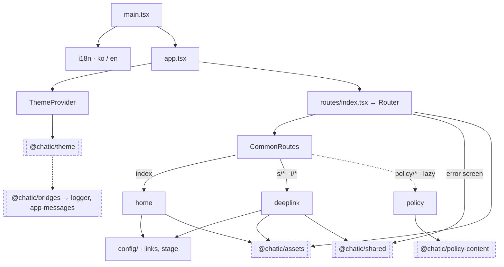

# @chatic/landing

**The public site, and the origin the mobile app's links point at.** One React + Vite SPA serving
three unrelated jobs from `app.chatic.io`: the marketing home page, the `/policy/*` URLs an app store
listing and the app's own My Page both cite, and the `/s/*` + `/i` bounce page that sends an
invite link into the installed app or into the web app. It has no session, no data layer and no backend call of
its own.

52 TypeScript files under `src/` plus nine test files, in three features over one app-level
`config/` and the route table.

## Purpose

This app answers one question: **what does a stranger with no account see?** Every other frontend in
the repo assumes a signed-in user and a working socket. This one assumes nothing — a first-time
visitor, a crawler, a reviewer opening a privacy policy from a store listing, or a phone that
followed a shared link before the app was ever installed.

It does **not** own:

- the legal text it renders — that is [`@chatic/policy-content`](../../libs/policy-content/README.md),
  shared with `apps/web` so the two never disagree; that document also covers version selection and
  what a version bump does and does not trigger
- the product itself — the web app lives at `dou.chatic.io` (`apps/web`) and is a separate build on
  a separate bucket
- the invite code — `/s/*` and `/i` read the URL and forward; they never resolve, validate or store
  one

### Why it is a separate app

Three things are true of it and of nothing in `apps/web`, and each is checkable:

1. **It deploys to its own origin.** `scripts/deploy-landing.sh` targets `app.chatic.io` (prod) and
   `app-dev.chatic.io` (dev); the web app's domains are `dou.chatic.io` and `dou-dev.chatic.io` (see
   `WEB_CONFIG` in `src/app/config/links.ts`). Separate S3 buckets, separate
   CloudFront distribution, separate `package.json` version.
2. **The origin is the deep-link origin.** `public/.well-known/apple-app-site-association` and
   `public/.well-known/assetlinks.json` are what make iOS Universal Links and Android App Links
   resolve to `io.chatic.dou`. They must be served from the domain the links use, and the deploy
   script refuses to run without them. That alone forces a site at this origin. The AASA file
   claims only the link paths (`/i`, `/s`, `/s/*`), the same ones the Android manifest
   filters on: the rest of the origin is this site, and a wider claim hands `/` to the app on any
   device that has it — a Mac running the iPhone app included.
3. **It loads with no session.** Its entire `@chatic` surface is four packages, and none of them is
   an auth, data or socket module:

```bash
grep -rho "@chatic/[a-z-]*" apps/landing/src | sort | uniq -c
```

## Design principles

1. **No session, ever.** Nothing here reads a token, a user or a cache. A page that needs to know who
   is reading it belongs in `apps/web`.
2. **No network call to our own backend.** The only `fetch` in the app is an orphan (see
   [Traps](#traps)); `/s/*` and `/i` redirect the browser and let the destination do the work.
3. **Legal text is imported, never typed.** `src/app/features/policy/consts/index.ts` is a
   two-line re-export of the `@chatic/policy-content` barrel. A paragraph written into a page
   component here is a second copy of a policy, which is the failure that library exists to prevent.
4. **The routes are public URLs with external references.** `/policy/terms`, `/policy/privacy`,
   `/policy/child`, `/s/...` and `/i?t=...` are cited by store listings, `public/sitemap.xml` and links already
   sent to people. Renaming one breaks something this repo cannot see.
5. **The English copy names the product's objects the way the app does.** Cloud, place, chat room
   and Self Chat are the nouns the app's own English interface uses, and the four feature cards
   render app screenshots (`assets/src/images/landing_en_*.png`) carrying those same words — a
   friendlier synonym reads fine in isolation and then contradicts the screenshot beside it.
   `place` is therefore reserved for the container between a cloud and a chat room; where a line
   means an ordinary safe space it says space. Two limits on this principle: the pricing card has
   no screenshot to check against, and its two plan names are not the app's — the app badges the
   tiers `FREE` and `PRO` but names them after clouds (`DoU Home`, `My Cloud`), which does not read
   as a tier on a pricing card, so the site says Free Plan and Pro Plan after the badges. The
   principle covers nouns, not the numbers beside them (see [Traps](#traps)). The Korean copy
   predates all of this and still uses looser wording (`공간` / `대화공간`).
6. **Nothing depends on this app.** It is a leaf: no lib and no other app imports it, so its only
   blast radius is the site itself.

## Scope

**In** — the marketing home page, the three policy pages with their version selector, the deep-link
bounce page, the `.well-known` association files, SEO metadata (`index.html`, `sitemap.xml`,
`robots.txt`, OG images).

**Out** — policy content (`libs/policy-content`), theming (`libs/theme`), shared illustrations and
icons (`assets`), everything a signed-in user does (`apps/web`).

## Structure



The dashed arrow out of `@chatic/theme` is the one the diagram cannot explain: **no file in this app
imports `@chatic/bridges`, `@chatic/logger` or `@chatic/app-messages`** — see
[Dependencies](#dependencies-why-a-marketing-site-pulls-a-bridge-and-a-logger).

### Routes

`src/app/routes/index.tsx` builds the one router from `CommonRoutes` plus a catch-all that sends any
other path home, and gives every top-level route the same `errorElement` (`RouteErrorFallback`).
`CommonRoutes.tsx` mounts home at the root and splits on `/s`, `/i` and `/policy`; each feature owns
its own subtree. Home and the bounce page are in the entry chunk — home is most visitors' first
screen, and the bounce page tries the app as soon as it mounts — while the policy pages, the bulk of
the bundle's text, load lazily.

| URL               | Renders                                           |
| ----------------- | ------------------------------------------------- |
| `/`               | `HomePage` — hero, features, pricing, CTA         |
| `/policy/terms`   | `TermsOfServicePage`                              |
| `/policy/privacy` | `PrivacyPolicyPage`                               |
| `/policy/child`   | `ChildPolicyPage`                                 |
| `/policy/*`       | redirect to `/policy/terms`                       |
| `/s/*`            | `DeepLinkPage` — any path under `/s` reaches it   |
| `/i/*`            | `DeepLinkPage` — the encoded invite link `/i?t=…` |
| anything else     | redirect to `/`, dropping the query               |

`src/app/routes/CommonRoutes.test.tsx` holds this table as data — every row, its final URL and
whether the query survives — so a row that changes fails a test before it breaks a link.

`createBrowserRouter` means every one of these is served by S3 as `index.html`; the CloudFront
distribution has to rewrite unknown paths to it or `/policy/terms` 404s on a hard refresh.

### Directories

```text
apps/landing/
├── index.html                  English-only metadata, canonical https://app.chatic.io/
├── vite.config.mts             build, dev server on :5004, window-injected VITE_* vars
├── tsconfig.app.json           the app; tsconfig.spec.json type checks the tests
├── public/.well-known/         apple-app-site-association, assetlinks.json
├── public/                     sitemap.xml, robots.txt, two OG images
└── src/
    ├── main.tsx                initialises i18n and renders <App /> — nothing else
    ├── i18n/                   i18next, ko + en, detector key `@landing.language`
    └── app/
        ├── app.tsx             the provider assembly: ThemeProvider around the Router
        ├── routes/             the router, the route table, ROUTES (paths.ts), the error screen
        ├── config/             stage.ts (hostname and import.meta), links.ts (store, web, contact)
        └── features/
            ├── home/           sections, Header, Footer, StoreButton
            ├── policy/         3 pages over one PolicyPageLayout + VersionSelector
            └── deeplink/       1 page, 4 hooks, the app-launch and web-redirect logic
```

### Layering

This app follows the web app's layering contract, and that document is the canon:
[`apps/web/docs/README.md`](../web/docs/README.md) (where a file goes, what a feature folder holds,
which way an import may point). It is not restated here. What it comes to in an app this size:

- **Features do not import each other.** What two features share moves up to the app level —
  `app/config/` today: `links.ts` is the site's one list of outside addresses, and it sits there
  because the store listings are read by both home and the deep-link page; `app/ui/`,
  `app/hooks/` or `app/utils/` when a component, hook or helper is the shared thing. The app level
  imports no feature; only `app.tsx` and `routes/` do.
- **No `shared/` folder, and nothing promoted ahead of time.** A file moves up on its second
  consumer. `Header`, `Footer` and `StoreButton` have one consumer, so they live in `home`.
- **Absolute paths come from `ROUTES`** in `app/routes/paths.ts`, never a typed string — the web
  app's design principle 5. The route table's own patterns (`policy/*`) stay spelled out, as the web
  app's do.
- **`import.meta` and the hostname are read in `app/config/stage.ts` only.** No barrel re-exports
  it; import it by path.
- **A feature is reached through its `index.ts`**, which exports its `<Name>Routes`. Inside, a feature
  uses the subset of `pages/ components/ hooks/ lib/ utils/ types/ consts/ routes/` it needs.
- **Copy lives in one file per language** (`src/i18n/locales/{ko,en}.json`); `localeParity.test.ts`
  fails when a key exists in one language and not the other, for every pair under `locales/`.

Two things differ from the web app on purpose: the copy is bundled JSON rather than fetched (a
crawler and a first-time visitor get it with the page), and the route error screen is this app's
own, because the shared one is built from UI-kit components whose design tokens this site's
Tailwind config does not define. There is no `docs/feature/` tree here; this README is the app's
documentation.

**Checking it.** The rules above are checked by grep, as the web app checks its own. Each command
prints nothing when the rule holds:

```bash
# a feature importing another feature (keep the feature list current)
git grep -n -E "from '(\.\./)+(home|policy|deeplink)(/|')" -- apps/landing/src/app/features/

# the app level importing a feature
git grep -n -E "from '.*features/" -- apps/landing/src/app/config apps/landing/src/app/ui \
    apps/landing/src/app/hooks apps/landing/src/app/utils

# import.meta or the hostname read outside app/config (the locale parity test globs the locale files)
git grep -n -E 'import\.meta|location\.hostname' -- apps/landing/src ':!apps/landing/src/app/config' \
    ':!apps/landing/src/i18n/*.test.ts'

test ! -d apps/landing/src/app/shared   # no shared/ wrapper
```

Give the first command the features folder itself, as above. A pathspec with a trailing glob such
as `'apps/landing/src/app/features/*/'` matches no file at all, so the command prints nothing
whatever the code imports.

**Adding a feature.** Create `src/app/features/<name>/` with an `index.ts` that exports
`<Name>Routes`, add `<name>` to the first command above, give it an entry in `CommonRoutes.tsx` (lazy
unless something is timed against its mount, as the bounce page's app launch is)
and a row in the table in `CommonRoutes.test.tsx`, and put every absolute path it links to in
`ROUTES`. Its copy goes under a top-level key of its own in the locale files.

There is no `project.json`: Nx infers every target from `vite.config.mts` and the package name, so
`build`, `test`, `typecheck`, `lint` and `dev` exist without being declared anywhere. `nx show
project landing` and `nx show project @chatic/landing` both resolve to it.

## Dependencies: why a marketing site pulls a bridge and a logger

Nx's graph gives this app nine libraries under `libs/` plus the root `assets` project. Only four of
the ten are imported by a file here:

| Library                  | Reached how               | Used for                                                    |
| ------------------------ | ------------------------- | ----------------------------------------------------------- |
| `@chatic/policy-content` | direct, 1 file            | the three policy tables and their types                     |
| `@chatic/theme`          | direct, 2 files           | `ThemeProvider` in `app.tsx`, the theme toggle in `Header`  |
| `@chatic/assets`         | direct, 6 files           | illustrations and icons (also a Vite alias to `assets/src`) |
| `@chatic/shared`         | direct, 3 files           | invite-link decoding, the error screen's English defaults   |
| `@chatic/bridges`        | via `theme` and `shared`  | nothing here calls it                                       |
| `@chatic/logger`         | transitive, via `bridges` | nothing here calls it                                       |
| `@chatic/app-messages`   | transitive, via `bridges` | nothing here calls it                                       |
| `@chatic/ui-kit`         | transitive, via `shared`  | nothing here calls it                                       |
| `@chatic/config`         | transitive, via `shared`  | nothing here calls it                                       |
| `@chatic/device-utils`   | transitive, via `shared`  | nothing here calls it                                       |

`shared` is a wide barrel and this app takes two pure functions and one table of strings from it; the
libraries behind it are in the graph for the rest of that barrel. On the theme's side, the bridge chain
hangs off one import inside `libs/theme/src/provider/ThemeProvider.tsx`:

```ts
import { isNative, webClient } from '@chatic/bridges';
```

`ThemeProvider` mirrors the theme into native storage by posting a `SavePreference` message, but only
when `isNative()` is true — that is, only when the page is running inside the mobile app's WebView.
On `app.chatic.io` in an ordinary browser it is false, the effect returns immediately, and the bridge
is never used. `@chatic/logger` and `@chatic/app-messages` arrive only because `bridges` uses them
internally.

**So the finding is: the bridge, the logger and the message types are inherited, not needed.** They ship in the bundle
and no landing code path reaches them. This is worth knowing for two reasons. Bundle size on a page
whose job is to load fast for a stranger is a real cost. And the lever is not in this app — trimming
it means making `libs/theme`'s native sync optional, not editing anything under `apps/landing`.

```bash
grep -rn "@chatic/bridges\|@chatic/logger\|@chatic/app-messages" apps/landing/src   # 0 hits
```

The landing app's own diagnostics are plain `console.log` / `console.error` calls in
`useWebRedirect.ts` and `RouteErrorFallback.tsx` — it does not use the repo's logger.

## Usage

```bash
yarn landing:start                 # nx serve landing → http://localhost:5004
yarn landing:build:dev             # vite build → dist/apps/landing
yarn landing:deploy:dev            # build, then scripts/deploy-landing.sh dev
yarn landing:deploy:prod           # build, then scripts/deploy-landing.sh prod
```

`apps/landing/package.json` carries a name, a version and `private: true` — no scripts and no
dependencies. Everything resolves from the workspace root.

### Build and deploy

CI is [`.github/workflows/deploy-dev.yml`](../../.github/workflows/deploy-dev.yml) and its prod twin.
A push touching `apps/landing/src/**`, `public/**`, `index.html`, `vite.config.mts`, the tsconfigs or
the Tailwind/PostCSS configs sets the `landing` filter output, which:

1. bumps `apps/landing/package.json` version,
2. adds `landing` to the build-and-deploy matrix with prefix `LANDING`, so the `LANDING_DEV_*`
   secrets are written to `apps/landing/.env`,
3. runs `yarn landing:deploy:dev`,
4. uploads the build's source maps as a CI artifact (the S3 sync excludes `*.map`),
5. announces the deploy to Slack with the new version.

[`scripts/deploy-landing.sh`](../../scripts/deploy-landing.sh) does the rest: it refuses to proceed
unless `dist/apps/landing/index.html` and both `.well-known` files exist, syncs in four passes so
`index.html` and `version.json` get `no-cache` while hashed assets do not, substitutes
`REDACTED_TEAM_ID` in the AASA file with `$APPLE_TEAM_ID` before uploading it as
`application/json`, and invalidates CloudFront.

The `.env` is mostly theatre for this app: the only `import.meta.env` reference in `src/app` is the
`DEV` flag in `src/app/config/stage.ts`. Environment selection at runtime is done by sniffing the
hostname for `-dev` in that same file, which is what picks the `chatic-dev` URL scheme, the
`io.chatic.dou.dev` package id and the dev web origin.

## Scenarios

### 1. A store reviewer opens the privacy policy

`/policy/privacy` → `PolicyRoutes` → `PrivacyPolicyPage`, which reads `PRIVACY_CONTENTS` through the
local two-line barrel and renders the language i18next detected, with `VersionSelector` offering the
older versions the library carries. No request is made; the text is in the bundle.

### 2. Someone taps an invite link on a phone with the app installed

The OS matches the URL against the `.well-known` files served from this origin and opens
`io.chatic.dou` directly — this site never loads. That is the success case, and it is entirely the
deploy script's two uploads.

That only holds when the tap reaches the OS. SMS and most mail apps hand the URL to the system; an
in-app browser (KakaoTalk, Naver, Instagram, Facebook, Line) loads it itself, and a browser that
opens a URL typed or pasted into it, or one handed to it explicitly by another app ("open in
Chrome"), does too. In those cases neither a Universal Link nor an App Link fires, the
association files are not consulted, and the page loads here even though the app is installed —
which is scenario 3, with the app present.

### 3. The same link, opened in a browser

The browser lands on `/s/...` or `/i?t=...` → `DeepLinkPage`. `useDeviceDetect` classifies the
device, and the page tries the app **as soon as it loads** where that is safe
(`utils/appLaunch.ts`, `shouldAutoLaunch`):

- **Android, always.** An `intent://` URL opens the app if it is installed. Its
  `browser_fallback_url` is this same page with `#app-missing` appended, so a phone without the
  app comes back here marked, does not try again, and is offered the store with the web as the
  other choice. Only the marker counts as "app missing": a page still showing without it may just
  mean the browser declined to open the app, and someone who has it gets the buttons, not an
  install prompt.
- **iOS, only inside an in-app browser** (matched by user agent). Safari and Chrome on iOS answer a
  custom scheme the device cannot open with an "invalid address" alert, which an invitee without
  the app would see on every visit, so there the page waits for the "Open app" tap.

Only an invite the app can read (`/i?t=...`, `/s?code=...`) is tried automatically; a retired
`/s/<code>` short link would open the app onto its "invalid link" screen. A launch shows the store
dialog after 2.5s only if the page is still in the foreground — a page that went to the background
handed the user to the app. A tapped launch on
Android uses the Play Store as its intent fallback instead of this page, since the tap already asked
for the app. For "Continue in browser", `useWebRedirect` decodes an `/i?t=...` link with
`@chatic/shared`'s `decodeInviteLink` and rewrites it, or a `/s?code=...` link,
into `https://dou.chatic.io/auth/login?code=...&provider=invite&version=2&...` — appending `relay=1`
when the link carries no backend address, or `_backend=<url>` when it does.

### 4. Someone edits a policy paragraph

Nothing in this app changes. The edit lands in `libs/policy-content`, and both this site and
`apps/web` pick it up on their next build — two builds, two deploys. The
[policy-content README](../../libs/policy-content/README.md) is the canon for what that does and does
not trigger.

## Traps

- **CI gates this app's typecheck and tests; until the layering change it did not.**
  [`.github/workflows/verify.yml`](../../.github/workflows/verify.yml) left `@chatic/landing` out of
  both runs, and the typecheck sat at 32 errors that Vite, which never type checks, built and deployed
  straight past. Two of the causes are easy to reintroduce. React 19 removed the global `JSX`
  namespace, so a component annotated `: JSX.Element` needs `import { type JSX } from 'react'` (29
  of the 32). And `tsconfig.app.json` has to `include` the locale JSON it imports, or `tsc -b`
  reports TS6307 for each file.

    ```bash
    npx tsc -b apps/landing/tsconfig.json   # the app and the tests — what nx's typecheck target runs
    ```

- **Test files are type checked by `tsconfig.spec.json`, not by `tsconfig.app.json`.** The app config
  excludes `*.test.ts(x)`; `tsconfig.json` references both projects, which is what puts the tests
  under `nx typecheck`. The spec project keeps its own build info: two projects sharing one
  `tsBuildInfoFile` let the second read the first one's state as its own and skip the tests.
- **A missing error-screen key does not show.** `RouteErrorFallback` looks its copy up under
  `error.screen.unknown.*` with English as the default, the same rule the shared error screens
  follow, so a key dropped from `ko.json` makes Korean readers see English rather than a raw key.
  The parity test catches a key missing from one language only; the values match the web app's.
- **Nine test files, and they cover routing, config, copy and the app launch only.** The route
  table, the stage and link config, ko/en key parity, the i18n language handling, and the app launch
  (`utils/appLaunch`, `hooks/useAppLauncher`) have tests; the components and the other deep-link
  hooks have none.

    ```bash
    npx nx test @chatic/landing   # 66 tests
    ```

- **`src/app/features/deeplink/utils/fingerprint.ts` is dead.** `generateFingerprint` calls out to
  `api.ipify.org`, is exported from no barrel (`utils/index.ts` re-exports only `appLaunch.ts`) and
  is called from nowhere. Deleting it removes a third-party request that the file's mere existence
  suggests the site makes.
- **Both deploy workflows filter on `apps/landing/project.json`, which does not exist.** The path
  simply never matches; every other pattern in the filter does, so this is harmless until someone
  adds a `project.json` and expects it to trigger a deploy.
- **`index.html` is English-only, deliberately** — `lang="en"`, an English title and description,
  English OG/Twitter tags, `og:locale` `en_US` with `ko_KR` as the alternate. A link-preview crawler
  never runs JS, so one static language is all a single-page app at one URL can offer a crawler, and
  this is the one it offers; per-language previews would need language-specific URLs each serving
  their own HTML. Readers are a separate path, and one the attribute no longer influences: the
  `htmlTag` detector is out of `detection.order` (see below), and `src/i18n/index.ts` rewrites
  `<html lang>` on every language change, so the document stops claiming English the moment the page
  switches to Korean.
- **`htmlTag` is deliberately absent from `detection.order`, and putting it back hands the
  reader's language to a crawler-facing attribute.** It is a detector like any other and it reads
  the same `lang` this app rewrites, while i18next takes the first exactly-supported code out of
  the whole detected list before it tries stripping a region from any of them. So `lang="ko"`, which
  this file carried until the metadata went English, outranked `navigator` for every browser that
  reports only a regional code — en-US and ja-JP visitors were served Korean. Without it, `ko-KR`
  strips to `ko` and Korean browsers still get Korean. `src/i18n/languageDetection.test.ts` measures
  all four cases and fails if the detector returns.
- **The copy's counts are not the app's.** `features.private` and `pricing.subscription.detail2` say
  5 places with 5 chat rooms each, in both locales and since before this was documented, while
  `apps/web/src/app/utils/consts.ts` — which calls itself the single source of truth — has
  `MAX_PLACES = 10` and `MAX_CHANNELS_PER_PLACE = 100`, and the app's own English copy says 10
  places. Design principle 5 covers the nouns and stops at the numbers for exactly this reason:
  which figure the marketing page should carry is a product question, not a copy fix.
- **The `.well-known` files are load-bearing and untestable from here.** A wrong `appID` or `paths`
  entry does not break the build, does not break the site, and silently stops every Universal Link
  from opening the app. Anything that changes the domain, the bundle id, or the AASA content needs a
  real device check after the CloudFront invalidation lands.

## How to verify

```bash
npx nx run-many -t typecheck --projects=@chatic/landing   # 0 errors, app and tests; in CI
npx nx lint @chatic/landing                               # passes (one warning); in CI
npx nx test @chatic/landing                               # 66 tests pass; in CI
npx nx build @chatic/landing                              # passes — the build the deploy wraps
yarn landing:start                                        # http://localhost:5004
```

Then the boundary commands in [Layering](#layering).

Nothing imports this app, so a change here reaches no other project — the reverse is not true:
`libs/policy-content`, `libs/theme`, `libs/shared` and `assets` all reach it, and
`tsconfig.app.json` and `tsconfig.spec.json` both reference exactly those four.
