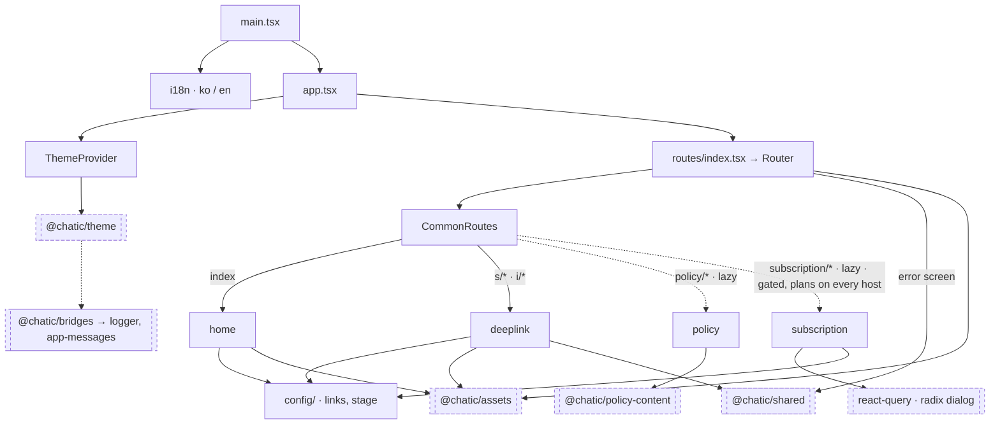

# @chatic/landing

**The public site, and the origin the mobile app's links point at.** One React + Vite SPA serving
`app.chatic.io`. Its **public surface** does three unrelated jobs: the marketing home page, the
`/policy/*` URLs an app store listing and the app's own My Page both cite, and the `/s/*` + `/i`
bounce page that sends an invite link into the installed app or into the web app — with no session,
no data layer and no backend call of its own. Its **account surface**, `/subscription/*`, is where a
signed-in account holder buys and manages a subscription outside the stores; it is open only on
local and dev hosts, and runs against the subscription server, with the mock answering what that server
does not yet (see [Two surfaces](#two-surfaces) and [The server](#the-server)) —
except `/subscription/plans`, which lists the published plans on every host from a fixed catalog (see
[Plans before checkout opens](#plans-before-checkout-opens)).

Four features over the app-level `config/`, `hooks/`, `ui/` and the route table.

## Purpose

This app answers two questions. The first, which its public surface answers: **what does a stranger
with no account see?** Every other frontend in the repo assumes a signed-in user and a working socket.
This one assumes nothing — a first-time visitor, a crawler, a reviewer opening a privacy policy from a
store listing, or a phone that followed a shared link before the app was ever installed.

The second, which its account surface answers: **where does someone who subscribed outside the app
stores manage that subscription?** The buyer arrives from the public price page, may never have used
the web app, and needs plans, checkout, payment methods, invoices and cancelling — nothing else.

It does **not** own:

- the legal text it renders — that is [`@chatic/policy-content`](../../libs/policy-content/README.md),
  shared with `apps/web` so the two never disagree; that document also covers version selection and
  what a version bump does and does not trigger
- the product itself — the web app lives at `dou.chatic.io` (`apps/web`) and is a separate build on
  a separate bucket
- the invite code — `/s/*` and `/i` read the URL and forward; they never resolve, validate or store
  one
- any use of the product from the account surface — clouds, chats and friends are `apps/web`'s, even
  for a signed-in subscriber

### Why it is a separate app

Three things are true of it and of nothing in `apps/web`, and each is checkable:

1. **It deploys to its own origin.** `scripts/deploy-landing.sh` targets `app.chatic.io` (prod) and
   `app-dev.chatic.io` (dev); the web app's domains are `dou.chatic.io` and `dou-dev.chatic.io` (see
   `WEB_CONFIG` in `src/app/config/links.ts`). Separate S3 buckets, separate
   CloudFront distribution, separate `package.json` version.
2. **The origin is the deep-link origin.** `public/.well-known/apple-app-site-association` and
   `public/.well-known/assetlinks.json` are what make iOS Universal Links and Android App Links
   resolve to `io.chatic.dou`. They must be served from the domain the links use, and the deploy
   script refuses to run without them. That alone forces a site at this origin. The AASA file
   claims only the link paths (`/i`, `/s`, `/s/*`), the same ones the Android manifest
   filters on: the rest of the origin is this site, and a wider claim hands `/` to the app on any
   device that has it — a Mac running the iPhone app included.
3. **Its public surface loads with no session.** Outside the account surface its entire `@chatic`
   surface is four packages, and none of them is an auth, data or socket module. The account surface
   is a lazy chunk the public pages never download (see [Two surfaces](#two-surfaces)):

```bash
grep -rho "@chatic/[a-z-]*" apps/landing/src --exclude-dir=subscription | sort | uniq -c
```

Why the account surface is here and not in `apps/web`: a purchase starts on this site's public price
page, often from someone who has never opened the web app; a payment provider's review asks for the
refund policy and business details on the same site as the sales pages, and the policy pages are here;
and the payment provider's script and the billing pages stay out of the product app's bundle and
origin. ADR-0227 records the decision.

## Design principles

Principles 1–6 were written for the public surface and keep their numbers; 1 and 2 now say so.
7–10 are the account surface's, and the boundary between the two.

1. **The public surface does not know who is reading.** Nothing outside `/subscription` reads a
   token, a user or a cache. A screen that needs to know who is reading belongs on the account
   surface if it is about the subscription, and in `apps/web` if it is about using the product.
2. **The public surface calls no backend of ours.** The only `fetch` in the app is an orphan (see
   [Traps](#traps)); `/s/*` and `/i` redirect the browser and let the destination do the work.
3. **Legal text is imported, never typed.** `src/app/features/policy/consts/index.ts` is a
   two-line re-export of the `@chatic/policy-content` barrel. A paragraph written into a page
   component here is a second copy of a policy, which is the failure that library exists to prevent.
4. **The routes are public URLs with external references.** `/policy/terms`, `/policy/privacy`,
   `/policy/child`, `/s/...` and `/i?t=...` are cited by store listings, `public/sitemap.xml` and links already
   sent to people. Renaming one breaks something this repo cannot see. `/policy/refund` joins them
   the day it is linked, `/subscription/plans` already has — it is the price page a payment provider
   reviews — and the other `/subscription` paths join the day the account surface opens.
5. **The English copy names the product's objects the way the app does.** Cloud, place, chat room
   and Self Chat are the nouns the app's own English interface uses, and the four feature cards
   render app screenshots (`assets/src/images/landing_en_*.png`) carrying those same words — a
   friendlier synonym reads fine in isolation and then contradicts the screenshot beside it.
   `place` is therefore reserved for the container between a cloud and a chat room; where a line
   means an ordinary safe space it says space. Two limits on this principle: the pricing card has
   no screenshot to check against, and its two plan names are not the app's — the app badges the
   tiers `FREE` and `PRO` but names them after clouds (`DoU Home`, `My Cloud`), which does not read
   as a tier on a pricing card, so the site says Free Plan and Pro Plan after the badges. The
   principle covers nouns, not the numbers beside them (see [Traps](#traps)). The Korean copy
   predates all of this and mostly still uses looser wording (`공간` / `대화공간`); only the
   private-community card and the matching pricing line name `클라우드` and `플레이스`.
6. **Nothing depends on this app.** It is a leaf: no lib and no other app imports it, so its only
   blast radius is the site itself.
7. **One boundary between the surfaces.** The public surface reaches the account surface only through
   the lazy import of `SubscriptionRoutes` in `routes/CommonRoutes.tsx`; the session, the query
   client and the subscription copy are provided inside that chunk. The account surface may use the
   app level (`app/ui`, `app/hooks`, `app/config`) — never the other way round.
8. **The account surface only does subscription** — plans, checkout, payment methods, invoices,
   billing addresses, cancelling. A screen for using the product does not go here; it goes in
   `apps/web`. This is what keeps landing from becoming a second web app.
9. **The account surface talks to a server through one port.** Pages, hooks and components call
   `SubscriptionPort` (`features/subscription/lib/port/`) and nothing else — no `fetch`, no HTTP
   client. Of its implementations, only the HTTP one (`lib/port/http/`) reaches the network, and it
   does so through the runtime's subscription repository (`libs/data`, over `libs/http`'s gateway),
   as every other app's server calls do: the session runtime and the payment SDK are imported there
   and nowhere else (ADR-0248).
10. **The account surface is not pointed at until it opens.** Where `isSubscriptionAccountEnabled` is
    false (every host but `localhost`, `127.0.0.1` and `-dev` ones) its routes are not registered,
    and the public pages' links into it render only where the gate is open — today the home header's
    "Sign in". It goes in no sitemap, email or outside link before then. **The plans page is the one
    exception**: it is registered on every host, because a payment provider reviews the prices on the
    live site before any payment can be taken. Where the gate is shut it runs on the catalog port —
    the published plans, no session, nothing to buy — and offers the store links in place of
    checkout. It is linked from the home header's "View plans" everywhere and given to the provider's
    review; it goes in the sitemap only when checkout opens.

Principles 1, 2, 7 and 9 are checked by the boundary commands in [Layering](#layering); 10 by the
route table test.

## Scope

**In** — the marketing home page, the policy pages with their version selector (and the refund
policy's place), the deep-link bounce page, the `.well-known` association files, SEO metadata
(`index.html`, `sitemap.xml`, `robots.txt`, OG images), and the account surface: buying and managing a
subscription bought outside the stores.

**Out** — policy content (`libs/policy-content`), theming (`libs/theme`), shared illustrations and
icons (`assets`), everything a signed-in user does with the product (`apps/web`), and — until a
later change — the real payment provider, the real social sign-in and the subscription server.

## Structure



The dashed arrow out of `@chatic/theme` is the one the diagram cannot explain: **no file in this app
imports `@chatic/bridges`, `@chatic/logger` or `@chatic/app-messages`** — see
[Dependencies](#dependencies-why-a-marketing-site-pulls-a-bridge-and-a-logger).

### Routes

`src/app/routes/index.tsx` builds the one router from `CommonRoutes` plus a catch-all that sends any
other path home, and gives every top-level route the same `errorElement` (`RouteErrorFallback`).
`CommonRoutes.tsx` mounts home at the root and splits on `/s`, `/i`, `/policy` and `/subscription` —
all of it where the gate is open, `/subscription/plans` alone where it is shut; each feature owns its
own subtree. Home and the bounce page are in the entry chunk — home is most visitors' first screen,
and the bounce page tries the app as soon as it mounts — while the policy pages, the bulk of the
bundle's text, and the account surface load lazily. `createAppRoutes({ subscriptionAccount })` builds
the table for either side of the gate, which is how the test covers both.

| URL               | Renders                                           |
| ----------------- | ------------------------------------------------- |
| `/`               | `HomePage` — hero, features, pricing, CTA         |
| `/policy/terms`   | `TermsOfServicePage`                              |
| `/policy/privacy` | `PrivacyPolicyPage`                               |
| `/policy/child`   | `ChildPolicyPage`                                 |
| `/policy/refund`  | `RefundPolicyPage` — proposal text, on every host |
| `/policy/*`       | redirect to `/policy/terms`                       |
| `/s/*`            | `DeepLinkPage` — any path under `/s` reaches it   |
| `/i/*`            | `DeepLinkPage` — the encoded invite link `/i?t=…` |
| `/subscription/*` | the account surface — gated, see below            |
| anything else     | redirect to `/`, dropping the query               |

Where the gate is shut, `/subscription/plans` lists the plans with the store links (any deeper path
returns to it) and the rest of `/subscription/*` is "anything else". The account surface's own routes
are in [Two surfaces](#two-surfaces).

`src/app/routes/CommonRoutes.test.tsx` holds this table as data — every row, its final URL and
whether the query survives — so a row that changes fails a test before it breaks a link.

`createBrowserRouter` means every one of these is served by S3 as `index.html`; the CloudFront
distribution has to rewrite unknown paths to it or `/policy/terms` 404s on a hard refresh.

### Directories

```text
apps/landing/
├── index.html                  English-only metadata, canonical https://app.chatic.io/
├── vite.config.mts             build, dev server on :5004, window-injected VITE_* vars
├── tsconfig.app.json           the app; tsconfig.spec.json type checks the tests
├── public/.well-known/         apple-app-site-association, assetlinks.json
├── public/                     sitemap.xml, robots.txt, two OG images
└── src/
    ├── main.tsx                initialises i18n and renders <App /> — nothing else
    ├── i18n/                   i18next, ko + en, detector key `@landing.language`
    └── app/
        ├── app.tsx             the provider assembly: ThemeProvider around the Router
        ├── routes/             the router, the route table, ROUTES (paths.ts), the error screen
        ├── config/             stage.ts (hostname, import.meta, the subscription gate), links.ts,
        │                       subscriptionServer.ts (the account surface's server addresses, from .env)
        ├── hooks/              useDeviceDetect — the bounce page
        └── features/
            ├── home/           sections, Header, Footer, StoreButton
            ├── policy/         4 pages over one PolicyPageLayout; the 3 versioned ones add a VersionSelector
            ├── deeplink/       1 page, 3 hooks, the app-launch and web-redirect logic
            └── subscription/   the account surface — see Two surfaces
```

### Layering

This app follows the web app's layering contract, and that document is the canon:
[`apps/web/docs/README.md`](../web/docs/README.md) (where a file goes, what a feature folder holds,
which way an import may point). It is not restated here. What it comes to in an app this size:

- **Features do not import each other.** What two features share moves up to the app level —
  `app/config/` today: `links.ts` is the site's one list of outside addresses, and it sits there
  because the store listings are read by both home and the deep-link page; `app/ui/`,
  `app/hooks/` or `app/utils/` when a component, hook or helper is the shared thing. The app level
  imports no feature; only `app.tsx` and `routes/` do.
- **No `shared/` folder, and nothing promoted ahead of time.** A file moves up on its second
  consumer. `Header`, `Footer` and `StoreButton` have one consumer, so they live in `home`;
  `useDeviceDetect` sits at the app level for the bounce page, which no feature owns.
- **Absolute paths come from `ROUTES`** in `app/routes/paths.ts`, never a typed string — the web
  app's design principle 5. The route table's own patterns (`policy/*`) stay spelled out, as the web
  app's do.
- **`import.meta` and the hostname are read in `app/config/` only** — the hostname in `stage.ts`,
  `import.meta` there and in `subscriptionServer.ts`. No barrel re-exports either; import them by path.
- **A feature is reached through its `index.ts`**, which exports its `<Name>Routes`. Inside, a feature
  uses the subset of `pages/ components/ hooks/ lib/ utils/ types/ consts/ routes/` it needs.
- **Copy lives in one file per language** (`src/i18n/locales/{ko,en}.json`); `localeParity.test.ts`
  fails when a key exists in one language and not the other, for every pair under `locales/`.

Two things differ from the web app on purpose: the copy is bundled JSON rather than fetched (a
crawler and a first-time visitor get it with the page), and the route error screen is this app's
own, because the shared one is built from UI-kit components whose design tokens this site's
Tailwind config does not define. There is no `docs/feature/` tree here; this README is the app's
documentation.

**Checking it.** The rules above are checked by grep, as the web app checks its own. Each command
prints nothing when the rule holds:

```bash
# a feature importing another feature (keep the feature list current)
git grep -n -E "from '(\.\./)+(home|policy|deeplink|subscription)(/|')" -- apps/landing/src/app/features/

# the app level importing a feature
git grep -n -E "from '.*features/" -- apps/landing/src/app/config apps/landing/src/app/ui \
    apps/landing/src/app/hooks apps/landing/src/app/utils

# import.meta or the hostname read outside app/config (the locale parity test globs the locale files)
git grep -n -E 'import\.meta|location\.hostname' -- apps/landing/src ':!apps/landing/src/app/config' \
    ':!apps/landing/src/i18n/*.test.ts'

test ! -d apps/landing/src/app/shared   # no shared/ wrapper

# the public surface reaching into the account surface, or into a session or data module
# (the route table's lazy import of the barrel is the one allowed crossing; a public feature's
# relative import of ../../subscription is the feature-to-feature command's to catch)
git grep -n -E "from '.*features/subscription/|@tanstack/react-query|@chatic/(http|data|app-runtime|auth-sign)" \
    -- apps/landing/src ':!apps/landing/src/app/features/subscription' ':!apps/landing/src/app/routes'

# the account surface reaching the network, a session or the payment SDK outside the HTTP port
# (`[^[:alnum:]_]` before fetch: `window.fetch(` is caught, react-query's `refetch(` is not; the one
# hit outside the account surface is the orphan in deeplink/utils/fingerprint.ts — see Traps)
git grep -n -E "@chatic/(http|data|app-runtime|auth-sign)|@portone/|(^|[^[:alnum:]_])fetch\(|axios" \
    -- apps/landing/src ':!apps/landing/src/app/features/subscription/lib/port/http'
```

Give the first command the features folder itself, as above. A pathspec with a trailing glob such
as `'apps/landing/src/app/features/*/'` matches no file at all, so the command prints nothing
whatever the code imports.

**Adding a feature.** Create `src/app/features/<name>/` with an `index.ts` that exports
`<Name>Routes`, add `<name>` to the first command above, give it an entry in `CommonRoutes.tsx` (lazy
unless something is timed against its mount, as the bounce page's app launch is)
and a row in the table in `CommonRoutes.test.tsx`, and put every absolute path it links to in
`ROUTES`. Its copy goes under a top-level key of its own in the locale files.

There is no `project.json`: Nx infers every target from `vite.config.mts` and the package name, so
`build`, `test`, `typecheck`, `lint` and `dev` exist without being declared anywhere. `nx show
project landing` and `nx show project @chatic/landing` both resolve to it.

## Two surfaces

|                  | Public surface                                                                        | Account surface                                                                                  |
| ---------------- | ------------------------------------------------------------------------------------- | ------------------------------------------------------------------------------------------------ |
| Paths            | `/`, `/policy/*`, `/s/*`, `/i`                                                        | `/subscription/*`                                                                                |
| Who              | anyone — no account, a crawler, a store reviewer, a phone before the app is installed | a DoU account holder signed in with Google or Apple (W-01: any visitor)                          |
| Does             | introduces the product, serves the policies, hands invite links on                    | buys and manages a subscription bought outside the stores                                        |
| Session, backend | none (principles 1, 2)                                                                | yes — through one port (principle 9)                                                             |
| Bundle           | the entry chunk (policy lazily)                                                       | its own lazy chunk                                                                               |
| Hosts            | every host                                                                            | `localhost`, `127.0.0.1`, `-dev` hosts only (`isSubscriptionAccountEnabled`); W-01 on every host |

**The billing-email screens are hidden** — W-16 and the email step W-24 — until their server exists
(ADR-0248, `lib/screens.tsx`). Their rows are kept in the table, marked _hidden_: the routes are not
registered, every link into them is gone, and the port methods, the HTTP port and the mock are left as
they were. What that costs: receipts go to the sign-in address alone.

**The card screen, W-12, is open** (ADR-0250). `MANAGEMENT_SCREENS_OPEN` is two values, `{ cards, emails }`,
and only `emails` is shut. W-12 lists the cards the payment service holds, the default marked as the
server marks it; every other card has [Make default] and [Remove], and [Add card] opens the payer's name
and number (`PayerFields`) and then the provider's window. A card added this way is not charged until it
is made the default. The payment service decides what may be removed: the default card has no [Remove],
and a refusal of any other card is the card a subscription in use is charged to, which W-12 says. It is
reached from the account menu, from W-18's card tile and from a failed payment's button. On a phone the
provider's window comes back to W-12 with its result in the query, and the payer waits in
`sessionStorage` meanwhile (`savePendingCardChange`, read by `pages/billing/useCardWindowReturn.ts`).
Retrying a failed payment has no server, so W-12 does not offer to charge the overdue amount on the
server; against the mock it still does.

Every screen below runs on the server where the build has its addresses, and on the mock otherwise or
with `?mock=` (see [The server](#the-server)). None is open on the production host yet except W-01,
which runs there on the catalog port (see [Plans before checkout opens](#plans-before-checkout-opens)).
Screen ids (`W-01`, `W-18`, …) are the names of the design frames each screen is drawn from; the route
table below is their key. `W-23`, the desktop-only notice, is retired: every screen is laid out for a phone too.

### The account surface

Everything lives in `src/app/features/subscription/`, laid out like a web app feature:

```text
features/subscription/
├── index.ts          SubscriptionRoutes — the only thing the route table imports, lazily
├── routes/           the nested <Routes>, the session and store-subscriber guards
├── types/            the view types the screens draw (Plan, Subscription, PaymentMethod, …)
├── lib/port/         SubscriptionPort, SubscriptionPortError, PortProvider (+ the clock)
├── lib/port/http/    the HTTP port: the server's shapes, the sign-in, the card window — the only network
├── lib/mock/         the mock port: state machine, scenarios, policy values, storage
├── lib/catalog.ts    the published plans and prices, read by both ports
├── lib/catalogPort.ts the port where the account surface is shut: the plans, no session
├── lib/              decisions as pure functions: sceneOf, changeKindOf, ddayOf,
│                     canRemovePaymentMethod, safeNext / landingAfterSignIn, sessionEnded
├── utils/            formatMoney, formatDate, cn, countdowns, isEmailAddress
├── hooks/            one react-query hook per port method, useCurrentSubscription, useNow
├── components/       PublicShell (logo + account bar, SiteFooter), AccountShell (sidebar; on a phone a
│                     back/title bar and a row of tabs), PageHeader, AccountMenu, StatusBadge, PlanCard,
│                     SummaryTile, ConfirmDialog, EmailVerificationForm, BillingEmailChangeDialog,
│                     MockPaymentWindow, DevScenarioPanel, …
├── components/ui/    Button, Card, Badge, Banner, Table, Dialog, Spinner, Toast — landing tokens
└── pages/            entry/ checkout/ manage/ billing/ (the screens), dev/ (mock-only pages)
```

`SubscriptionRoutes` provides the query client, the port and a toast host at its root — nowhere
above it. The primitives use this site's Tailwind tokens (plus the `status-*` colours in
`tailwind.config.js` / `styles.css`), not the UI kits, which expect tokens this site does not define.

| URL                                                              | Screen                                                                                                   | Shell   | Guard                                                         |
| ---------------------------------------------------------------- | -------------------------------------------------------------------------------------------------------- | ------- | ------------------------------------------------------------- |
| `/subscription/plans`                                            | W-01 plans                                                                                               | public  | — (every host; gate shut: catalog port, store links)          |
| `/subscription/login?next=&reason=`                              | W-02 sign-in                                                                                             | public  | signed in → on to `next` (or W-01)                            |
| `/subscription/login/callback`                                   | W-02 sign-in return                                                                                      | public  | —                                                             |
| `/subscription/login/no-account`                                 | W-02b no linked account                                                                                  | public  | —                                                             |
| `/subscription/store-managed`                                    | W-17 billed by a store                                                                                   | public  | signed in                                                     |
| `/subscription/checkout/email?plan=`                             | W-24 email step _(hidden)_                                                                               | public  | signed in, not store-billed                                   |
| `/subscription/checkout?plan=`                                   | W-08 checkout                                                                                            | public  | signed in, not store-billed; no verified primary email → W-24 |
| `/subscription/checkout/payment?plan=`                           | W-05 card registration                                                                                   | public  | 〃                                                            |
| `/subscription/checkout/status?attempt=` · `?plan=&outcome=`     | W-09 payment in progress — or, with `outcome`, a payment window that closed or failed before any attempt | public  | 〃                                                            |
| `/subscription/checkout/complete?attempt=` · `?change=downgrade` | W-06 done — a downgrade is scheduled without an attempt (nothing is charged)                             | public  | 〃                                                            |
| `/subscription/change?plan=`                                     | W-14 plan change                                                                                         | public  | 〃                                                            |
| `/subscription`                                                  | W-10 subscriptions                                                                                       | account | 〃                                                            |
| `/subscription/:subscriptionId`                                  | W-18 one subscription                                                                                    | account | 〃                                                            |
| `/subscription/:subscriptionId/cancel`                           | W-15 cancel                                                                                              | account | 〃                                                            |
| `/subscription/payment-methods`                                  | W-12 cards                                                                                               | account | 〃                                                            |
| `/subscription/history`                                          | W-13 invoices                                                                                            | account | 〃                                                            |
| `/subscription/billing-info`                                     | W-16 billing emails _(hidden)_                                                                           | account | 〃                                                            |
| `/subscription/login/mock-provider`                              | stand-in consent page                                                                                    | —       | mock port only                                                |
| `/subscription/mock-receipt?invoice=`                            | stand-in receipt                                                                                         | —       | mock port only                                                |
| any other `/subscription/…`                                      | redirect to `/subscription` (gate shut: see [Routes](#routes))                                           |         |                                                               |

Every one of these is laid out for a phone as well as a computer: the shells stack, grids fall to a
single column under the `md` breakpoint (768 px), tables scroll sideways inside their card. A reader on
a phone signs in and pays in the mobile browser like anyone else; the store-subscriber page (W-17)
and the double-payment notes still tell someone already billed through a store to manage it there.
Without a session a guarded page sends the reader to `/subscription/login?next=<the page>`; a
store subscriber is sent to W-17. A `next` is only ever a path under `/subscription` that is not a
sign-in page (`lib/safeNext.ts`) — anything else falls back to the subscription list.

**Session end is handled once.** Any port call that rejects with `unauthenticated` reaches the query
client's error hook at the route root, which sends the reader to
`/subscription/login?reason=session-ended&next=<the page>`. No page catches it.

**Sign-in is a redirect round trip.** `startSignIn` returns the provider's address and the browser
leaves for it; the provider sends it back to `/subscription/login/callback`, whose query goes to
`completeSignIn`. Against the server the provider is the OAuth relay and the code becomes the same
relay session the web app uses; the mock walks the same trip through its stand-in consent page. Signing
out against the server lands on the home page, and the server makes an account for a sign-in it does
not know, so W-02b is the mock's alone today.

### Plans before checkout opens

Where `isSubscriptionAccountEnabled` is false — the production host — the route table mounts
`SubscriptionRoutes` at `/subscription/plans` alone, with `account={false}`. `createPortSetup` then
returns the catalog port (`lib/catalogPort.ts`) instead of the mock: `getSession` answers no session,
`listPlans` answers `lib/catalog.ts`, and every other method rejects as it would for a visitor. The
mock is never created there, so nothing reads `?mock=` or session storage on that host.

The pages read the same flag where it changes what they offer:

- W-01 is a price list: all five cards at full strength with no tag (the entry-plan and "after
  subscribing" tags are rules of the web checkout, and a plan greyed by them would read as
  unavailable), none pickable, the subscribe button replaced by "web checkout is coming" with the App
  Store and Google Play links, and the note about not paying twice on the web left out.
- `PublicShell`'s bar keeps the logo alone and drops "Sign in", which leads to a page that does not
  exist on that host; its footer is the same everywhere and carries the refund policy link.

`lib/catalog.ts` is therefore a published price list, not mock data: the mock sells exactly this
catalog, and a price changes there together with the stores' prices. When the server and the payment
provider arrive, the account surface opens by the gate and the catalog port is no longer used.

One cost is accepted: the production visitor to this page downloads the whole account-surface
chunk, mock code included, though the mock is never run there.

### The server

`createPortSetup({ account })` (`lib/createPortSetup.ts`) is where the port is chosen, and the only
place. Where the account surface is open and the build carries the server's addresses, a tab runs on
the server alone. The methods it answers (`lib/port/http/methods.ts`) come from the HTTP port; every
other one — billing emails, invoices, undoing a cancellation or a scheduled downgrade,
retrying — refuses, and nothing stands in for it. The port's `supports` says which methods are
real (`PortSupports`, read with `useSupports()`), and the screens leave out what would call the rest:
the billing history (its menu entry and route, and the recent billing on W-18), "Undo cancellation" on
W-18 and after cancelling, and "Cancel the change" for a scheduled downgrade. Where the copy promised
the undo — the list's status line, the cancel confirmation, W-14's notice for an ending subscription —
a `…NoUndo` line says only what holds. `?mock=<scenario>` switches the tab to the mock alone and
`?mock=off` back; the choice holds for the tab. Without the addresses it is the mock, whole.

The addresses are the build's `VITE_*` values — copy `.env.example` to `.env` with the dev ones, as for
the web app — read in `config/subscriptionServer.ts` and nowhere else; the session runtime takes the
relay's address from them too. The card window is the payment provider's (PortOne V2, KG Inicis),
opened with the values the server's `issue` returns. The HTTP port and the session runtime load on
first use, as a chunk of their own.

The server's calls themselves live in the shared libraries, not here: `libs/http`'s subscription
gateway names the eight `/subscriptions/0/*` requests and declares their shapes, and `libs/data`'s
`SubscriptionRepository` (`fetchMySubscription`, `startSubscription`, `cancelSubscription`, …) is what
`lib/port/http/runtime.ts` hands the port as its `SubscriptionApi`. What stays in this app is the
translation into the screens' view types and the rules around the calls (`createHttpPort.ts`,
`wire.ts`, `errors.ts`).

What the screens get from the server differs from the mock in a few places, all in `lib/port/http/wire.ts`:

- The web products are `dou-web-tier-0N` on the server and `pro-tier-0N` on the screens, matched by tier.
- The server keeps one subscription per account. A first payment it has not settled reads `pending`:
  W-18 says the payment is being confirmed and offers nothing until it settles.
- It answers a checkout or an upgrade with the subscription; the attempt W-09 follows is made from it,
  and a `pending` one is settled by reading the subscription again.
- W-14's charge for an upgrade is an estimate with the server's own proration; the copy says so. The
  server upgrades a paid period only, so a trial can move down but not up — W-14 says so before
  anything is tried, and the mock refuses the same way.
- Its cards carry no expiry, so none is drawn. A card is named to the server by its id (`billkeyId`).
- Plans are listed to a signed request only, so a visitor sees the published catalog on W-01.
- The payment provider's window opens in the page (an iframe) on a computer, not as a pop-up, about
  0.8 s after the click. On a phone it is the provider's own page: the browser leaves for it and comes
  back to W-05 (or the card list, for a card added alone) with the result in the query — `billingKey`,
  or `code` and `message`. The checkout W-08 settled does not survive that trip, so `lib/pendingCheckout.ts`
  keeps it in `sessionStorage` from the click until the return is read (taken away on use, stale after
  15 minutes); W-05 reads it, `completePaymentMethodRegistration` turns the query into the same result
  the window would have answered, and the charge goes on as usual. A return with no saved checkout goes
  back to W-08. The window opens with `offerPeriod: { interval: '1m' }`, which KG Inicis requires for its
  mobile page. On a computer, closing the window and confirming the card company's "cancel?" question answers `FAILURE_TYPE_PG`
  — the code a refused card also gets — with a message that the user cancelled; `windowReturn.ts`
  tells the two apart by that message, for the window's answer and for a phone's query alike, so a
  closed window reads as cancelled, not as a declined card.
- The payer's name and mobile number, which the card company requires with every card, are asked for
  on W-08 and in W-12's add-card dialog. They travel with that checkout or card and
  are not stored. The payer's address is the account's own while the billing-email screens are hidden.

### The mock

The mock is an in-memory server holding one account — its
subscriptions, cards, invoices and billing emails — kept in `sessionStorage` (memory if that fails),
so a reload keeps what a flow changed. Each method moves that state the way the server should:
cancelling schedules an end, a payment attempt settles 1.5 s after it starts (a successful upgrade
then changes the plan), a retry restores a failing subscription. Calls take 300 ms. Every period and
count it uses is in `lib/mock/policy.ts`; the price and the trial come from `lib/catalog.ts`.

Pick the state with the URL; each query is applied once per tab, so a reload keeps the state and a
one-shot flag is spent once:

| Parameter          | Effect                                                                                                                                                                                                                                                                                 |
| ------------------ | -------------------------------------------------------------------------------------------------------------------------------------------------------------------------------------------------------------------------------------------------------------------------------------- |
| `?mock=<scenario>` | start that scenario (below); the same scenario again keeps the current state                                                                                                                                                                                                           |
| `&fail=<flag>`     | `card-declined`, `attempt-limit`, `closed` (the payment window), `network` and `session-ended` (each fails the next call only), `signin-canceled`, `signin-expired` (the consent page's preselected answer), `code-expired` (the next code check) and `resend-limit` (the next resend) |
| `&now=2026-11-20`  | the mock's today; scenarios have fixed dates, so this is how the same-day cases are reached                                                                                                                                                                                            |
| `&cards=0`         | the scenario with no payment method                                                                                                                                                                                                                                                    |
| `&panel=0`         | hide the dev panel, for screenshots                                                                                                                                                                                                                                                    |

Scenarios: `visitor` (the default, signed out), `new` (Google, no billing email yet), `new-apple` (no address shared), `new-trial-used`, `no-linked-account`,
`no-linked-account-apple`, `store-ios`, `store-android`, `trial`, `active`, `active-card-expiring`,
`past-due`, `restricted`, `cancel-scheduled`, `downgrade-scheduled`, `expired`, `history-mixed`,
`email-pending`. Their data is in `lib/mock/scenarios.ts`; each scenario's today is 2026-11-01.

The **dev panel** (bottom right) changes the scenario, the fail flag and today, and resets the state.
The **payment window** is a dialog standing in for the payment provider's card window:
`startPaymentMethodRegistration` opens it and resolves with the outcome the reader picks
(registered, failed, closed), the fail flag's outcome marked. Billing email codes are `123456`; a code
lives 5 minutes, resends are 60 seconds apart and 5 at most, then the address locks for 10 minutes
(`lib/mock/policy.ts`). Those run on the wall clock, not on `?now=`, which moves only the day. The
panel, the consent page and the receipt page are developer tools: English, not in the copy files.

### Copy

`src/i18n/locales/subscription/{ko,en}.json` holds every account-surface string under the top-level
key `subscription`, with `common` for the shells and shared components and one key per screen group
(`entry`, `checkout`, `manage`, `billing`). `lib/i18n.ts` adds it to the `translation` namespace when
the chunk loads, so the public pages never carry it. `localeParity.test.ts` covers the pair like any
other.

The Korean copy is in the formal polite register (`~합니다`, `~했습니다`, requests as `~해 주세요`),
not the softer `~해요`. `src/i18n/subscriptionTone.test.ts` fails on a softer sentence ending
anywhere in the subscription copy.
Figma frames drawn before that rule still show the softer register — the copy does not follow them.

**Sign-in lands on the plans.** Without a `next`, a completed sign-in goes to W-01: a subscriber sees
the plan in force and its neighbours there, and reaches the subscription list from the account menu.
A cancelled or timed-out sign-in keeps its `next` (the port returns it with the error).

**Billing emails (hidden).** While the billing-email screens are hidden, a checkout skips all of this: W-08
has no billing-email block and hands the card company the signed-in account's own address, and an account
with none cannot start one. The rest of this paragraph is what opening them restores. A first checkout verifies its billing address on the email step (W-24) before
the payment details (W-08): a Google sign-in address can be used as it is (`adoptSignInEmail`), any
other address is verified by code, and W-08 sends a reader without a verified primary address
(`primaryVerifiedEmail`) back to W-24. W-24, the add flow on W-16 and the change popup all use
`EmailVerificationForm`; every countdown, count and lock it shows comes from the port's
`EmailCodeTicket` or error detail — a dead code or a locked address shuts the code field until a new
code can be sent. `BillingEmailChangeDialog`, opened from W-08 and W-16, swaps a verified new address
in at once (`replaceEmail`) — there is nothing to save afterwards — and removes one it added if the
reader walks away.

## Dependencies: why a marketing site pulls a bridge and a logger

Most of the libraries Nx's graph gives this app are not called from it. The public surface imports
four; the account surface's HTTP port adds two more, `@chatic/app-runtime` (which reaches the server
through `libs/data` and `libs/http`) and `@chatic/config`, with
`@portone/browser-sdk` from the workspace root, inside a chunk of their own that loads on first use (see
[The server](#the-server)) — and through the runtime, much of `libs/` reaches that chunk. The account
surface also imports `@tanstack/react-query`, `@radix-ui/react-dialog`, `clsx` and `tailwind-merge` from
the workspace root, inside its own chunk. The table is about the public pages.

| Library                  | Reached how               | Used for                                                       |
| ------------------------ | ------------------------- | -------------------------------------------------------------- |
| `@chatic/policy-content` | direct, 1 file            | the three policy tables and their types                        |
| `@chatic/theme`          | direct, 2 files           | `ThemeProvider` in `app.tsx`, the theme toggle in `Header`     |
| `@chatic/assets`         | direct, 6 files           | illustrations and icons (also a Vite alias to `assets/src`)    |
| `@chatic/shared`         | direct, 3 files           | invite-link decoding, the error screen's English defaults      |
| `@chatic/bridges`        | via `theme` and `shared`  | nothing here calls it                                          |
| `@chatic/logger`         | transitive, via `bridges` | nothing here calls it                                          |
| `@chatic/app-messages`   | transitive, via `bridges` | nothing here calls it                                          |
| `@chatic/ui-kit`         | transitive, via `shared`  | nothing here calls it                                          |
| `@chatic/config`         | direct, 1 file            | the account surface's HTTP port configures the session runtime |
| `@chatic/app-runtime`    | direct, 2 files           | the account surface's HTTP port: sign-in, session, repository  |
| `@chatic/device-utils`   | transitive, via `shared`  | nothing here calls it                                          |

`shared` is a wide barrel and this app takes two pure functions and one table of strings from it; the
libraries behind it are in the graph for the rest of that barrel. On the theme's side, the bridge chain
hangs off one import inside `libs/theme/src/provider/ThemeProvider.tsx`:

```ts
import { isNative, webClient } from '@chatic/bridges';
```

`ThemeProvider` mirrors the theme into native storage by posting a `SavePreference` message, but only
when `isNative()` is true — that is, only when the page is running inside the mobile app's WebView.
On `app.chatic.io` in an ordinary browser it is false, the effect returns immediately, and the bridge
is never used. `@chatic/logger` and `@chatic/app-messages` arrive only because `bridges` uses them
internally.

**So the finding is: the bridge, the logger and the message types are inherited, not needed.** They ship in the bundle
and no landing code path reaches them. This is worth knowing for two reasons. Bundle size on a page
whose job is to load fast for a stranger is a real cost. And the lever is not in this app — trimming
it means making `libs/theme`'s native sync optional, not editing anything under `apps/landing`.

```bash
grep -rn "@chatic/bridges\|@chatic/logger\|@chatic/app-messages" apps/landing/src   # 0 hits
```

The landing app's own diagnostics are plain `console.log` / `console.error` calls in
`useWebRedirect.ts` and `RouteErrorFallback.tsx` — it does not use the repo's logger.

## Usage

```bash
yarn landing:start                 # nx serve landing → http://localhost:5004 (.env: see The server)
yarn landing:build:dev             # vite build → dist/apps/landing
yarn landing:deploy:dev            # build, then scripts/deploy-landing.sh dev
yarn landing:deploy:prod           # build, then scripts/deploy-landing.sh prod
```

`apps/landing/package.json` carries a name, a version and `private: true` — no scripts and no
dependencies. Everything resolves from the workspace root.

### Build and deploy

CI is [`.github/workflows/deploy-dev.yml`](../../.github/workflows/deploy-dev.yml) and its prod twin.
A push touching `apps/landing/src/**`, `public/**`, `index.html`, `vite.config.mts`, the tsconfigs or
the Tailwind/PostCSS configs sets the `landing` filter output, which:

1. bumps `apps/landing/package.json` version,
2. adds `landing` to the build-and-deploy matrix with prefix `WEB`, so the web app's `WEB_DEV_*`
   secrets are written to `apps/landing/.env` (the `LANDING_*` secrets are only its bucket and
   distribution),
3. runs `yarn landing:deploy:dev`,
4. uploads the build's source maps as a CI artifact (the S3 sync excludes `*.map`),
5. announces the deploy to Slack with the new version.

[`scripts/deploy-landing.sh`](../../scripts/deploy-landing.sh) does the rest: it refuses to proceed
unless `dist/apps/landing/index.html` and both `.well-known` files exist, syncs in four passes so
`index.html` and `version.json` get `no-cache` while hashed assets do not, substitutes
`REDACTED_TEAM_ID` in the AASA file with `$APPLE_TEAM_ID` before uploading it as
`application/json`, and invalidates CloudFront.

The public pages read nothing from the `.env` but the `DEV` flag in `src/app/config/stage.ts`;
environment selection there is done by sniffing the hostname for `-dev`, which is what picks the
`chatic-dev` URL scheme, the `io.chatic.dou.dev` package id and the dev web origin. The account
surface reads its server addresses from it (`src/app/config/subscriptionServer.ts`). They are the web
app's own (`WEB_DEV_*` / `WEB_PROD_*`), as desktop-web's are: the account surface signs in to the web
app's relay session, so its OAuth, relay and socket addresses must be the web app's. Without the four
addresses a build runs the account surface on the mock.

## Scenarios

### 1. A store reviewer opens the privacy policy

`/policy/privacy` → `PolicyRoutes` → `PrivacyPolicyPage`, which reads `PRIVACY_CONTENTS` through the
local two-line barrel and renders the language i18next detected, with `VersionSelector` offering the
older versions the library carries. No request is made; the text is in the bundle.

### 2. Someone taps an invite link on a phone with the app installed

The OS matches the URL against the `.well-known` files served from this origin and opens
`io.chatic.dou` directly — this site never loads. That is the success case, and it is entirely the
deploy script's two uploads.

That only holds when the tap reaches the OS. SMS and most mail apps hand the URL to the system; an
in-app browser (KakaoTalk, Naver, Instagram, Facebook, Line) loads it itself, and a browser that
opens a URL typed or pasted into it, or one handed to it explicitly by another app ("open in
Chrome"), does too. In those cases neither a Universal Link nor an App Link fires, the
association files are not consulted, and the page loads here even though the app is installed —
which is scenario 3, with the app present.

### 3. The same link, opened in a browser

The browser lands on `/s/...` or `/i?t=...` → `DeepLinkPage`. `useDeviceDetect` classifies the
device, and the page tries the app **as soon as it loads** where that is safe
(`utils/appLaunch.ts`, `shouldAutoLaunch`):

- **Android, always.** An `intent://` URL opens the app if it is installed. Its
  `browser_fallback_url` is this same page with `#app-missing` appended, so a phone without the
  app comes back here marked, does not try again, and is offered the store with the web as the
  other choice. Only the marker counts as "app missing": a page still showing without it may just
  mean the browser declined to open the app, and someone who has it gets the buttons, not an
  install prompt.
- **iOS, only inside an in-app browser** (matched by user agent). Safari and Chrome on iOS answer a
  custom scheme the device cannot open with an "invalid address" alert, which an invitee without
  the app would see on every visit, so there the page waits for the "Open app" tap.

Only an invite the app can read (`/i?t=...`, `/s?code=...`) is tried automatically; a retired
`/s/<code>` short link would open the app onto its "invalid link" screen. A launch shows the store
dialog after 2.5s only if the page is still in the foreground — a page that went to the background
handed the user to the app. A tapped launch on
Android uses the Play Store as its intent fallback instead of this page, since the tap already asked
for the app. For "Continue in browser", `useWebRedirect` decodes an `/i?t=...` link with
`@chatic/shared`'s `decodeInviteLink` and rewrites it, or a `/s?code=...` link,
into `https://dou.chatic.io/auth/login?code=...&provider=invite&version=2&...` — appending `relay=1`
when the link carries no backend address, or `_backend=<url>` when it does.

### 4. Someone edits a policy paragraph

Nothing in this app changes. The edit lands in `libs/policy-content`, and both this site and
`apps/web` pick it up on their next build — two builds, two deploys. The
[policy-content README](../../libs/policy-content/README.md) is the canon for what that does and does
not trigger.

## Traps

- **CI gates this app's typecheck and tests; until the layering change it did not.**
  [`.github/workflows/verify.yml`](../../.github/workflows/verify.yml) left `@chatic/landing` out of
  both runs, and the typecheck sat at 32 errors that Vite, which never type checks, built and deployed
  straight past. Two of the causes are easy to reintroduce. React 19 removed the global `JSX`
  namespace, so a component annotated `: JSX.Element` needs `import { type JSX } from 'react'` (29
  of the 32). And `tsconfig.app.json` has to `include` the locale JSON it imports, or `tsc -b`
  reports TS6307 for each file.

    ```bash
    npx tsc -b apps/landing/tsconfig.json   # the app and the tests — what nx's typecheck target runs
    ```

- **Test files are type checked by `tsconfig.spec.json`, not by `tsconfig.app.json`.** The app config
  excludes `*.test.ts(x)`; `tsconfig.json` references both projects, which is what puts the tests
  under `nx typecheck`. The spec project keeps its own build info: two projects sharing one
  `tsBuildInfoFile` let the second read the first one's state as its own and skip the tests.
- **A missing error-screen key does not show.** `RouteErrorFallback` looks its copy up under
  `error.screen.unknown.*` with English as the default, the same rule the shared error screens
  follow, so a key dropped from `ko.json` makes Korean readers see English rather than a raw key.
  The parity test catches a key missing from one language only; the values match the web app's.
- **The public surface's tests cover routing, config, copy and the app launch only.** The route
  table, the stage and link config, ko/en key parity, the i18n language handling, the home header's
  subscription links and the app launch (`utils/appLaunch`, `hooks/useAppLauncher`) have tests; the
  other home and policy components and the other deep-link hooks have none. The account surface tests its rules, its mock, its routes,
  every screen (a render per scenario), and its HTTP port against the server's response shapes —
  not against a running server.

    ```bash
    npx nx test @chatic/landing   # 545 tests
    ```

- **The account-surface gate is the hostname, not the build.** `isSubscriptionAccountEnabled` is true on
  `localhost`, `127.0.0.1` and any host containing `-dev`, whatever the build mode — a dev build served
  from `app.chatic.io` still keeps the pages shut. In tests (jsdom's `localhost`) it is open; the route
  table test builds both sides with `createAppRoutes`. To see the shut side in a browser, serve the
  production build under a host that is neither, mapping one to the local server in Chromium with
  `--host-resolver-rules="MAP app.chatic.test 127.0.0.1"`. `?mock=` does nothing there, by design.
- **A phone on the local network needs a `-dev` name, not the machine's IP.** The gate reads the
  hostname, so `http://192.168.x.y:<port>` shows the plans page alone. Reach the dev server by a name
  that contains `-dev` and resolves to the machine (for example `app-dev.192.168.x.y.nip.io`, served
  with the dev server's host allow-list opened for it), and the sign-in, the checkout and the provider's
  redirect back all run in the phone's browser. Stop that server when the test is over: it serves the
  source and the build's `VITE_*` values to everyone on the network.
- **The mock reads the URL once per query.** Opening the same `?mock=…` again does not reset the
  state (it is how a reload keeps a flow's changes); use the dev panel's Reset, or a different
  scenario.

- **`src/app/features/deeplink/utils/fingerprint.ts` is dead.** `generateFingerprint` calls out to
  `api.ipify.org`, is exported from no barrel (`utils/index.ts` re-exports only `appLaunch.ts`) and
  is called from nowhere. Deleting it removes a third-party request that the file's mere existence
  suggests the site makes.
- **Both deploy workflows filter on `apps/landing/project.json`, which does not exist.** The path
  simply never matches; every other pattern in the filter does, so this is harmless until someone
  adds a `project.json` and expects it to trigger a deploy.
- **`index.html` is English-only, deliberately** — `lang="en"`, an English title and description,
  English OG/Twitter tags, `og:locale` `en_US` with `ko_KR` as the alternate. A link-preview crawler
  never runs JS, so one static language is all a single-page app at one URL can offer a crawler, and
  this is the one it offers; per-language previews would need language-specific URLs each serving
  their own HTML. Readers are a separate path, and one the attribute no longer influences: the
  `htmlTag` detector is out of `detection.order` (see below), and `src/i18n/index.ts` rewrites
  `<html lang>` on every language change, so the document stops claiming English the moment the page
  switches to Korean.
- **`htmlTag` is deliberately absent from `detection.order`, and putting it back hands the
  reader's language to a crawler-facing attribute.** It is a detector like any other and it reads
  the same `lang` this app rewrites, while i18next takes the first exactly-supported code out of
  the whole detected list before it tries stripping a region from any of them. So `lang="ko"`, which
  this file carried until the metadata went English, outranked `navigator` for every browser that
  reports only a regional code — en-US and ja-JP visitors were served Korean. Without it, `ko-KR`
  strips to `ko` and Korean browsers still get Korean. `src/i18n/languageDetection.test.ts` measures
  all four cases and fails if the detector returns.
- **The copy's counts are not read from the app.** `features.private` and
  `pricing.subscription.detail2` say up to 5 clouds and 5 places, in both locales. Neither number
  comes from code: the cloud limit is each plan's `maxClouds` in the server's plan catalog, and
  `apps/web/src/app/utils/consts.ts` — which calls itself the single source of truth — has
  `MAX_PLACES = 5`. Until this copy changed it said 5 places with 5 chat rooms each, while the
  same file has `MAX_CHANNELS_PER_PLACE = 100`. Design principle 5 covers the nouns and stops at
  the numbers for exactly this reason: which figure the marketing page should carry is a product
  question, not a copy fix — so a plan change has to be carried here by hand.
- **The `.well-known` files are load-bearing and untestable from here.** A wrong `appID` or `paths`
  entry does not break the build, does not break the site, and silently stops every Universal Link
  from opening the app. Anything that changes the domain, the bundle id, or the AASA content needs a
  real device check after the CloudFront invalidation lands.

## How to verify

```bash
npx nx run-many -t typecheck --projects=@chatic/landing   # 0 errors, app and tests; in CI
npx nx lint @chatic/landing                               # passes (one warning); in CI
npx nx test @chatic/landing                               # 545 tests pass; in CI
npx nx build @chatic/landing                              # passes — the build the deploy wraps
yarn landing:start                                        # http://localhost:5004
```

Then the boundary commands in [Layering](#layering).

Nothing imports this app, so a change here reaches no other project — the reverse is not true:
`libs/policy-content`, `libs/theme`, `libs/shared`, `assets`, and — for the account surface's HTTP port —
`libs/config` and `libs/app-runtime` all reach it, and `tsconfig.app.json` and `tsconfig.spec.json`
both reference exactly those six.
