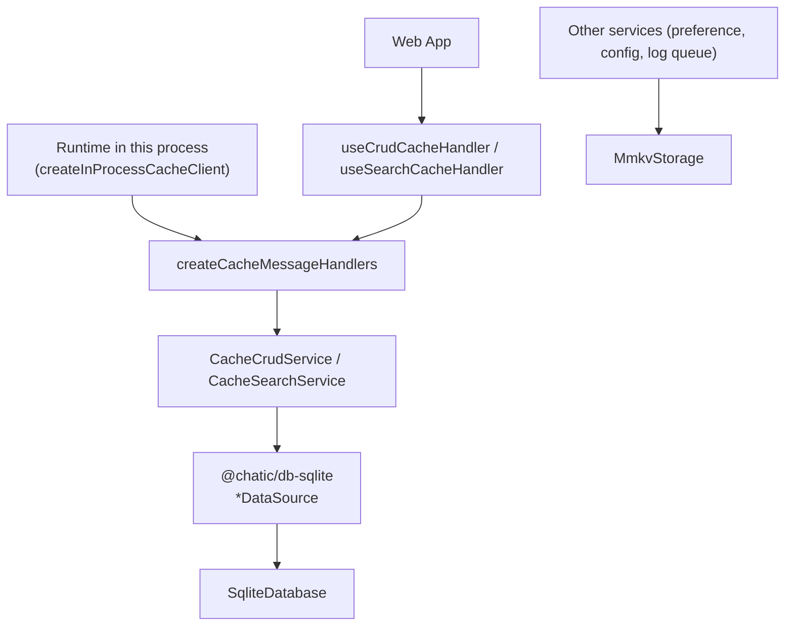
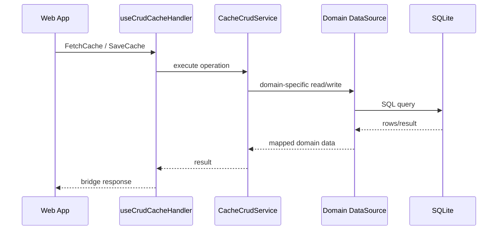

# Cache

The local persistence the app owns: two storage engines, a data-source layer per domain over
SQLite, and the WebView-facing cache service that answers the web client's cache messages.

## Storage

| Store  | Location                                                                                        | Holds                                                                                     |
| ------ | ----------------------------------------------------------------------------------------------- | ----------------------------------------------------------------------------------------- |
| SQLite | `@chatic/db-sqlite` (schema, data sources, cache services) on `@chatic/db-sqlite-op` (the file) | Structured records — one table per cache domain, plus the room media index (`chat_media`) |
| MMKV   | `@chatic/storage-mmkv`                                                                          | Small key-value state — preferences, config, the log upload queue                         |

The runtime the app can run the session in has three MMKV files of its own
(`services/runtime/runtimeStorageFiles.ts`): `chatic-runtime-plain` and `chatic-runtime-device` hold its
stores as plain strings, and `chatic-runtime-mode` holds only which side owns the session
([../runtime/README.md](../runtime/README.md)). None is opened through `MmkvStorage`, which JSON-encodes
and shares the app's default file — see
[`@chatic/runtime-mobile`](../../../../libs/runtime-mobile/README.md#the-stores-and-the-cache).

```bash
grep -cE "^    [A-Z_]+: '" libs/db/sqlite/src/tables.ts
```

Eleven tables: one per cache domain, plus `chat_media`, the room media index beside `chats`. MMKV is not used for structured lists or
queries — that scope stays with SQLite, and expanding an MMKV key into a query surface belongs in a
data source instead.

## Structure



## Data sources

`services/provider.ts` builds ten `*DataSource` instances from [`@chatic/db-sqlite`](../../../../libs/db/sqlite/README.md)
lazily, all over the same `SqliteDatabase` handle that `openSqliteDatabase` from `@chatic/db-sqlite-op` opens (see [../boot/boot-optimization.md](../boot/boot-optimization.md)):

| File                       | Domain                                                     |
| -------------------------- | ---------------------------------------------------------- |
| `ChatDataSource.ts`        | Chat records                                               |
| `ChannelDataSource.ts`     | Channel records                                            |
| `JoinDataSource.ts`        | Channel–user membership                                    |
| `SiteDataSource.ts`        | Site/place records                                         |
| `UserDataSource.ts`        | User profile records                                       |
| `ProfileDataSource.ts`     | Per-site display profiles                                  |
| `MetaDataSource.ts`        | Sync cursors                                               |
| `InviteCloudDataSource.ts` | Invite-cloud records                                       |
| `InviteDataSource.ts`      | Sent relay 1:1 invite cards (ADR-0052)                     |
| `TestRecordDataSource.ts`  | Debug/test records                                         |
| `fetchManyByIds.ts`        | Shared `id IN (...)` batch helper, not a domain of its own |

`CacheCrudService.SUPPORTED_CACHE_TYPES` is the switch these nine domains resolve through (upload
and test-record are reached through their own services, not `CacheCrudService`). A `CacheType` the
web sends that isn't in that list still gets `{ success: true, data: null }` rather than an error —
the web deploys ahead of the app, so an unrecognized type has to look like an empty cache, not a
failure.

## Cache CRUD



## One set of handlers, two callers

How each cache message is answered lives in `services/cache/cacheMessages.ts`
(`createCacheMessageHandlers`), not in the hooks. The WebView's hooks hand the page's messages to it,
and a runtime in this process reaches the same SQLite through it too:
`createInProcessCacheClient` turns the handlers into a `CacheBridgeClient` — the one method `@chatic/db`'s
`NativeDBAdapter` and `NativeGlobalSearchSource` need of a bridge — so the runtime runs the page's own
adapters, with their read sharing and metrics, without the WebView in between. A page and the runtime
therefore cannot read or write the cache differently.

The client answers as the WebView's bridge client does: a `success: false` answer (a failed search)
rejects with its error, and a message with no cache handler rejects with `NOT_FOUND`. A failed read or
write is not a rejection on either side — it is `success: true` with an empty result, which the web
reads as "fall back for this read".

The services are passed as getters and read on each message, so SQLite still opens on the first cache
message, whichever caller sends it.

A message that gets no answer within 10 seconds (`IN_PROCESS_CACHE_TIMEOUT_MS`, the WebView bridge
client's default budget) rejects with `TIMEOUT`. Without it a promise that never settled would stay in
the adapter's shared in-flight reads and every later read of the same key would wait on it.

## What the cache does when it cannot answer

The web deploys ahead of the app, so the cache answers an unknown or failed request in a way the web
can fall back from, not with an error it cannot tell apart from a real one.

- **Supported types are declared, not assumed.** `SUPPORTED_CACHE_TYPES` in `CacheCrudService.ts`
  lists the types that have a data source. The bridge handshake reports it (`supportedCacheTypes`),
  because a web that knows a newer type would otherwise send it here, reach the `default` arm and
  get `null` with `success: true` — a cache that is permanently empty and never says so. Adding a
  type to the list without a data source makes the web trust a store that drops writes.
- **Failures are answered, not thrown.** A failed read answers `items: null` (or `id: null`), a failed
  write answers `success: false` inside a `success: true` reply. The web reads `null` as "fall back for
  this read only". `fetchMany` on an unsupported type, or one that fails, answers an empty list.
- **Some operations throw so the web is not misled.** `clearByChannel` accepts only `chat` and a
  non-empty channel id and lets a failure through, so the handler can answer `success: false` and the
  web does not believe a left room's messages were removed (`clear` swallows errors; this one must
  not). The room media index calls throw too, and the handler turns them into `items: null`,
  `counts: null` or `success: false`, so an empty page stays an honest empty page and a room is not
  marked filled after a failed write. A last-chat read that cannot answer returns `null`, and the web
  falls back to a windowed query for that read.
- **Search is the exception.** A failed search is `success: false`, which a bridge client turns into
  a rejection.

### The domain-version report in the handshake

`resolveCacheDomainVersions` (`services/cache/cacheDomainVersions.ts`) measures the per-domain cache
contract from the schema version of the database the install actually reached, instead of repeating a
compile-time constant.

- It never rejects. When the database is unreachable or does not answer within 3 seconds
  (`MEASURE_TIMEOUT_MS`) it resolves `undefined` and the bridge host falls back to the static
  declaration. The web's handshake request times out at 10 seconds, and losing the whole handshake
  costs more than losing the per-domain detail.
- Only a real answer is remembered for the process. A schema version cannot change within a run, and a
  WebView reload sends another handshake, so re-measuring would reopen the database on a path that
  has to stay cheap. A non-answer is not remembered: a wedged first boot or a lock held by a migration
  is transient, and caching it would pin every later handshake to the static fallback.
- The database is opened inside the measuring function, not at import. The module is loaded during
  boot; the work runs only when the web asks.

## Batch reads (`FetchManyCacheData`)

Every web call is one bridge round trip, so round-trip count is the cost that matters. A merge write
on the web side has to read the existing row per item before writing it, and doing that one item at
a time turned into real cost — 50 chat rows saved as 51 round trips.

- `FetchManyCacheData` → `CacheCrudService.fetchMany` → the domain's own `fetchMany`, if it has one.
- `fetchMany` is an **optional** member of `ICacheDataSource`. When a domain doesn't implement it,
  the service falls back to calling `fetch` once per id — the bridge round trip is still one, so the
  goal (fewer round trips than the web) is still met; only the number of in-process SQL calls grows.
- A domain with the standard `(cid, uid, id, data)` shape can delegate to the shared
  `fetchManyByIds` helper. Its `WHERE` clause must match that domain's own `fetch` exactly —
  `invitecloud` is a global table and deliberately omits `cid`/`uid` — or the batch path and the
  single-item path answer differently for the same id.
- Missing ids are simply absent from the result; the response length and order do not have to match
  the request. The web re-indexes the response by id.
- Every shell the web still runs in answers `FetchManyCacheData`, so `NativeDBAdapter.loadMany` keeps
  no fallback. A cache message newer than shells still in use is a different case — the web ships
  ahead of the app — and is sent only to a shell whose handshake lists it in `supportedWebMessages`,
  with a web-side path for the rest, as the room media index reads below are — see
  [`@chatic/db`](../../../../libs/db/README.md).

## Room media index (`chat_media`, migration 12)

A room's attachments and links, one row per entry: `chat_media (cid, uid, chat_id, idx, channel_id,
chat_no, kind, ref)`, keyed `(cid, uid, chat_id, idx)`, read through
`idx_chat_media_cid_uid_channel_kind_chatno (cid, uid, channel_id, kind, chat_no DESC, idx)`. Migration
12 creates both, and restores `idx_chats_cid_uid_channel_chatno (cid, uid, channel_id, chat_no DESC)` —
made by migration 2 and lost when migration 4 rebuilt `chats`, so no device had it and a room page
sorted in a temporary B-tree. Indexing a room and the plain-row media path both page a room that way.

**The shell decides no kind.** The web computes each message's entries (`chatMediaEntries` in
`@chatic/data`) and sends them on the chat row as `mediaEntries`. `ChatDataSource` stores them in the
same `executeBatch` as the row — `save` is a batch now too, because op-sqlite wraps a batch in a
transaction on its JS side and separate `execute` calls each commit alone. A list replaces the
message's entries, an empty list deletes them, and a row without the field leaves them as they are:
an older web bundle wrote it, and reading absent as empty would erase the index on its every write.
`remove`, `removeAll`, `clearByChannel` and `clear` delete the matching entries in the same batch.

Three messages work on it, all in `createCacheMessageHandlers` and registered in
`useWebMessageRouter`, so the handshake lists them and the in-process runtime answers them too:

- `FetchChatMediaCacheData` → `ChatDataSource.fetchMediaPage` — one kind, newest message first, `idx`
  within a message, joined to `chats` for each entry's row. The page never splits a message: when the
  `limit` lands inside one, the rest of its entries come too, then one probe below tells whether a
  next page exists (`nextCursorNo`, or `null`).
- `CountChatMediaCacheData` → `ChatDataSource.countMedia` — `GROUP BY kind` off the index alone.
- `SaveChatMediaCacheData` → `ChatDataSource.saveMediaFill` — a room's first-read fill: entries for
  messages cached before the index, and never a row. Every statement carries the same guard, checked
  inside the batch: the message's row still exists and
  `COALESCE(json_extract(data, '$.mediaEntriesVersion'), 0)` is below the fill's version. A row the web
  wrote, marked deleted or removed after the fill read it is skipped; the entries take the row's own
  `channel_id` and `chat_no`.

A SQL failure is answered `items: null` / `counts: null` / `success: false` with `success: true`, as the
other cache messages are; the web answers that read from plain rows, or leaves the room unfilled. A
shell built before these handlers is never sent them: the web needs all three in the handshake's
`supportedWebMessages`, and otherwise pages plain chat rows.

`cacheContract.ts` is unchanged — `chat` gained a field, which needs no contract edition, and whether
the index can be queried is told by the message list, not by a domain version.

The SQL is exercised on a real SQLite in tests (`@chatic/db-sqlite` `src/testing/realSqliteDatabase.ts`, test support
over the `better-sqlite3` dev dependency): `migration12.test.ts` moves a v12 database with rows to v13
and reads the query plans, and `dataSources/chatMediaIndex.contract.test.ts` runs the contract table
`libs/db` runs against IndexedDB (`@chatic/bridge-messages/testing`).

## The cache contract the handshake reports

`@chatic/db-sqlite` `cacheContract.ts` is what this build promises the web about each cache domain, and
the handshake reports it per domain. The web declares what it requires and the app declares what it
implements; the two are separate values on purpose, since sharing one would turn a negotiation into
an identity.

- **Measured, not restated.** The report is derived from `PRAGMA user_version`, the version the
  migrations actually reached. Migrations run in one transaction, so a failed one rolls back and the
  number never advances. A domain whose table cannot exist at that version is left out, which the web
  reads as edition 0 and routes to its own storage: writing into a missing table is how a permanently
  empty cache is born. `getSchemaVersion` throws when the pragma gives no number rather than
  answering 0, because 0 is a real answer and an unreadable value must not pass for a measurement.
- **Two numbers per domain.** `version` is the domain's contract edition, bumped only when the
  contract changes in a way that must exclude older apps — never because a domain is new, and never to
  move a gate. A bump has to stay compatible with older web bundles, since the web compares with
  `>=`; a change that breaks an older web is a new `CacheType`, not a bump. `sinceUserVersion` is the
  version at which the table exists (migration `k` creating it means `k + 1`). It is a historical
  fact: later unrelated migrations do not move it, and a table that was dropped and recreated counts
  from the recreation (`meta`).
- **Started early.** `useBaseBridge` starts the measurement when the screen mounts, while the WebView
  loads its bundle, because the web reads it once when it assembles its cache storages and a reply
  after that leaves a domain on web storage for the session. The handshake reuses the same promise.
  It waits at most three seconds and then falls back to the static declaration; only a real answer is
  remembered, so one slow first boot cannot pin every later handshake to the fallback.

## Row rules the web relies on

- **Chat previews.** `fetchLastPerChannel` answers the home list's `FetchLastChatsData`. Per channel
  it looks at the newest committed row (`chat_no > 0`) and the unsent ones (`chat_no = 0`); an unsent
  message wins, the most recent `createdAt` among them, so a message just sent is previewable before
  it is acknowledged. System rows, reaction events and failed sends never count. A thread reply
  counts as the room's latest activity (it orders the list) but not as the preview, so only a room
  whose newest message is a reply costs a second pass for the newest row outside threads. The SQL
  mirrors the web's previewable rule and is only an optimisation: the web re-validates the rows and
  falls back to a windowed read for a channel where the mirror was too loose.
- **Profile payloads are not stamped with the scope.** Other domains write `cid`/`uid` into the
  payload; `ProfileDataSource` does not, because the payload's `uid` is the profile's owner while the
  scope's `uid` is the signed-in user. Overwriting it would collapse every member of a place onto one
  key once the web re-derives ids from the payload. Only `id` is aligned with the row key; the scope
  lives in the `cid`/`uid` columns, which every `WHERE` matches on. The web keys rows
  `${sid}@${uid}` and filters by `sid` itself, so native treats the key as opaque.
- **Batch reads stay under SQLite's variable limit.** `fetchManyByIds` splits ids into chunks of 900
  (a build's limit can be as low as 999, and each chunk also binds `cid` and `uid`) and drops
  duplicate ids first, so one row is never parsed and returned twice. The bridge round trip is still
  one.
- **Deleting a room is scoped.** `clearByChannel` carries `cid`/`uid` as well as the channel id: the
  same device may hold other cloud accounts or users with that channel id, and leaving one room must
  not wipe their history.

## Handlers that send no response

When a handler returns nothing, the host sends nothing back (`AppBridgeHost.processRequest`).
`SendLog` uses this: the web's log forwarder posts without a `refId`, so a response would arrive
with no pending call to match — it would be discarded as an untargeted event. Discarding it isn't
free: each discarded response still costs one `evaluateJavascript` call on the UI thread, the same
resource cache round trips contend for, so a busy log period was amplifying cache latency for
nothing. A new fire-and-forget message should return nothing from its handler for the same reason.

## Inventory and clear for the debug panel

The web debug panel's Storage screen shows this store beside the WebView's own, because a page can
measure only its own storage and the two together are what the device keeps. Two messages serve it,
both through `services/storage/NativeStorageService` (lazy, like the cache services — it opens
SQLite):

- `FetchNativeStorageSummary` — rows and an approximate size per `TABLES` entry, and the stored
  length of every MMKV key. Tables are read one at a time: each read is a full scan on the connection
  the live cache reads share, and eleven at once would queue every web cache read behind them. The size sums every column's `LENGTH`, read from `PRAGMA table_info`,
  because the tables do not share one shape (`test_records` keeps `value`, not `data`). A table a
  failed migration never created is reported as `missing`, not skipped.
- `ClearNativeCache` — `DELETE FROM` each table, one at a time so a missing table does not roll
  back the others. `invite_clouds` is kept unless the request sets `includeInvitedClouds: true`
  (anything else counts as false): the server has no list of invited clouds, so a cleared row
  returns only when a push names that cloud. `invites` is never cleared: its `dismissedAt` is
  written only on this device, so a clear would bring back every invite card the user closed. MMKV is never cleared here — it holds the shell's
  settings (including `debugSettings`, which picks the WebView origin) and the unsent log and report
  queues, none of which is a copy of server data.

## Ownership

- SQL schema, table names, domain row mapping and the cache services belong to `@chatic/db-sqlite`;
  opening the file belongs to `@chatic/db-sqlite-op`.
- The WebView contract belongs to the app's `services/cache` (`cacheMessages.ts`); the handler hooks
  only wire it to the bridge.
- `chat_media` holds what the web decided; nothing in `@chatic/db-sqlite` or `services/cache` decides
  a media kind.
- The retired chunked-upload module's `upload_tasks` table is dropped by migration 11; file
  transfer persists nothing — see [../native/file-transfer.md](../native/file-transfer.md).
- MMKV holds small values and queues; it does not grow into structured list or query storage.

## Checklist

- Do the schema, data source, and service agree on the same domain name?
- Is `cid`/`uid` scope present everywhere the data needs it?
- Does the WebView cache handler stay ignorant of SQL detail?
- For a new data source: does `fetchMany`'s `WHERE` clause match that domain's `fetch`?
- For a new cache message: does the web side have a legacy-app fallback for it?
