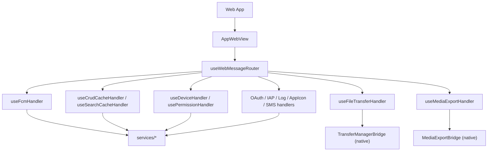
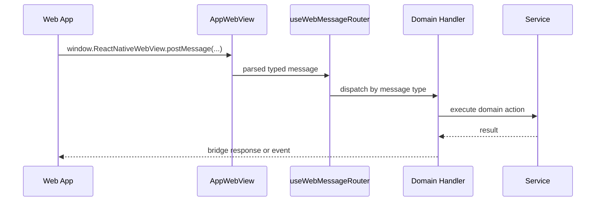

# WebView

The WebView is the message boundary between the web client and the native shell: the web posts a
typed message, and a handler hook answers it through a service.

> To inspect webview console output and errors at the code level (Safari Web Inspector /
> `chrome://inspect`), see [webview-debugging.md](./webview-debugging.md).

## Key files

| File                                                         | Role                                                                          |
| ------------------------------------------------------------ | ----------------------------------------------------------------------------- |
| `src/app/webview/AppWebView.tsx`                             | Renders the `WebView`, wires the injected runtime scripts, tracks ready state |
| `src/app/webview/hooks/useBaseBridge.ts`                     | Builds the `AppBridgeHost` (`@chatic/bridges`) and its `onMessage` handler    |
| `src/app/webview/hooks/useAppBridge.ts`                      | Thin wrapper exposing `{ bridge, onMessage }` to `MainScreen`                 |
| `src/app/webview/hooks/useWebMessageRouter.ts`               | Central message router; dispatches to 31 handler hooks                        |
| `src/app/webview/hooks/*Handler.ts`                          | 31 domain handlers, one per capability group                                  |
| `src/app/webview/hooks/useWebMessageRouter.contract.test.ts` | The bridge contract: what this shell answers, and what it leaves unsupported  |
| `src/app/webview/utils/injectionScripts.ts`                  | Builds the scripts injected before the WebView loads                          |

`webview/core/bridge.ts` (`createBridge`, `postAppMessage`, `receiveWebMessage`) has no importer
anywhere in `apps/mobile/src` — the bridge actually in use is `AppBridgeHost` from `@chatic/bridges`,
assembled in `useBaseBridge.ts`.

```bash
grep -rln "from '.*core/bridge'" apps/mobile/src
```

## Trust boundary

Only the web the WebView was pointed at may reach native features. `useBaseBridge`'s `onMessage` drops
a message — with a `BRIDGE` warning in the log and no reply — unless its page URL is on the origin of
the resolved base URL (release web, debug override, or custom-zip server) or on one of the app's own
web hosts (`DEEP_LINK_DOMAINS`). A new web host the base URL redirects to has to be added there, or the
bridge goes silent. The check lives in `webview/utils/urlTrust.ts` and parses origins by hand, because
React Native's `URL.origin` keeps userinfo, query and fragment while Jest's does not.

`OpenURL` opens only `http`, `https`, `mailto`, `tel`, `sms` and the app schemes (`chatic`,
`chatic-dev`); anything else answers `LINK_NOT_ALLOWED` without reaching the OS.

The page is always served over http(s), so file-URL pages get no extra reach
(`allowFileAccessFromFileURLs` / `allowUniversalAccessFromFileURLs` are off). `originWhitelist`,
navigation and `mixedContentMode` are still open: narrowing them needs a device pass over sign-in,
payment and the http-served images.

## Structure



## Message flow



Messages are not queued. `useBaseBridge` hands each one to `AppBridgeHost.handleMessage` without
waiting for the previous one, so handlers run concurrently and a slow one holds up nothing else.
Some rely on that: `ShareFile` on iOS answers only when the share sheet closes, minutes later if the
user lingers — see [../native/media-export.md](../native/media-export.md). Two requests of the same
kind can therefore finish out of order; a handler that needs ordering has to provide it itself.

A message is registered only where this build can answer it. The photo-library messages are added to
the routing map only when the native `PhotoLibrary` module exists, so a JS bundle run over a native
build without it leaves them unregistered and `AppBridgeHost` answers `NOT_FOUND` — the answer the
web falls back to its file input on ([../native/photo-library.md](../native/photo-library.md)). The
same holds for `PickAttachments`, `PrepareVideo` and `ReadAttachment` (the native `AttachmentPicker` module,
[../native/attachment-picker.md](../native/attachment-picker.md)), and for `OpenFile` and `SaveFile`,
each registered only when the installed `MediaExport` module has that method
([../native/media-export.md](../native/media-export.md)). A handler that exists but fails would take
that fallback away.

## The bridge contract

`useWebMessageRouter.contract.test.ts` pins this shell to the vocabulary in `@chatic/app-messages`.
It mounts the router and `useWebViewNavigation` (which registers `SetCanGoBack`) on a real
`AppBridgeHost`, with every domain hook stubbed and every native module reported present, and reads
what got registered — `WebAppReady` and `Ping` included, since the host registers those itself.
Then:

- **Every request in `WEB_MESSAGE_RESPONSE_TYPE` is decided.** Each has a handler or a line in
  `MOBILE_UNSUPPORTED`, with a one-line reason. A message added to `@chatic/app-messages` fails the
  suite until this shell makes that call.
- **Nothing stale survives.** A handler for a request no longer in the map fails it, and so does an
  unsupported line for a request that has since gained a handler or left the map. The list's
  `satisfies` type also catches a line whose request left the map, but only to `tsc`, and CI does
  not type check this project — the runtime check is the one that runs.
- **The round trip behaves as the web expects.** A real `WebBridgeClient` over `InMemoryAdapter`
  (`@chatic/bridges`) talks to that host and router in one process: a request resolves with its
  handler's reply, a fire-and-forget `SendLog` reaches its handler, a throwing handler rejects as a
  `BridgeError`, a reply of the wrong type rejects as `RESPONSE_TYPE_MISMATCH`, and every
  unsupported request gets `NOT_FOUND`.
- **The handshake says the same thing.** The `WebAppReady` reply over that loopback lists exactly the
  registered requests — the vocabulary minus `MOBILE_UNSUPPORTED` — and their paired replies, since
  the web decides photo save and share and where performance traces go from that list.

The suite mounts only the router and `useWebViewNavigation`, so it also fails if any other source
file calls `registerHandler` — a handler there would be invisible to the checks above. Register
through the router.

The handlers registered only where a native module exists (photo library, attachment picker,
`OpenFile`, `SaveFile`) count as handled here: they are, on a build that has the module, and
`useWebMessageRouter.test.ts` holds the rule for a build that does not. The desktop shell has its
own contract suite beside its handlers, `apps/desktop/src/main/bridgeHandlers.contract.test.ts`,
with the same exhaustiveness and handshake checks; it also runs each desktop handler and checks its
reply against the type the map pairs with it.

```bash
npx jest --config apps/mobile/jest.config.js useWebMessageRouter
npx jest --config apps/desktop/jest.config.js bridgeHandlers
```

## The WebAppReady handshake

`WebAppReady` is not one of the routed messages — `AppBridgeHost` (`@chatic/bridges`) answers it
internally, inside `handleMessage`, before a message ever reaches `useWebMessageRouter`. It is a
capability handshake, not a plain ready ping: the reply reports the app's local-cache schema version
and supported cache types (read from the SQLite install, warmed in parallel with the WebView's bundle
load) so a web build newer than this app can route unsupported cache domains to its own storage
instead of a silent void. `useBaseBridge.ts` passes an `onAppReady` callback into `AppBridgeHost`;
`MainScreen` uses it to mark the `bootMetricsService` `web-app-ready` timestamp and to hand the
web's declaration to `bootSplashService` — a web build that does not declare `holdsBootSplash` is
revealed on the handshake itself, since it will never send `FirstScreenReady`. `DismissResumeOverlay`, by contrast, is a normal
routed message — `useAppStateHandler` answers it like any other handler — that fires when the web's
own repaint animation after a resume has finished, and is what actually hides `ResumeOverlay`.

| Message                          | What it does                                                                                                                                                   |
| -------------------------------- | -------------------------------------------------------------------------------------------------------------------------------------------------------------- |
| `WebAppReady`                    | Handshake, answered inside `@chatic/bridges`; buffers and flushes any push events queued before it                                                             |
| `Ping`                           | Liveness probe, answered inside `@chatic/bridges` with a `Pong` carrying the payload back                                                                      |
| `DismissResumeOverlay`           | Routed handler (`useAppStateHandler`); clears the resume overlay after the web's repaint                                                                       |
| `FirstScreenReady`               | Routed handler (`useBootSplashHandler`); lifts the launch splash and the crash-reload cover — see [../boot/boot-splash.md](../boot/boot-splash.md)             |
| `SavePreference` with `theme`    | Routed handler (`usePreferenceCacheHandler`); updates the native theme store — see [../system/theme.md](../system/theme.md)                                    |
| `SavePreference` with `language` | Routed handler (`usePreferenceCacheHandler`); validates `system`/`ko`/`en` and updates the language store — see [../system/language.md](../system/language.md) |

## Events the shell pushes

The other direction has no request behind it. A hook calls `bridge.pushEvent(...)` when something
happens on the device, `AppBridgeHost` holds the event until the `WebAppReady` handshake and then
sends it, and the web reads it through `webClient.onEvent`. Nothing answers an event, so nothing on
the web side notices one that never comes or arrives in the wrong shape — which is why this
direction has its own contract tests.

| Event                                   | Pushed by                   | When                                                                                                                                   |
| --------------------------------------- | --------------------------- | -------------------------------------------------------------------------------------------------------------------------------------- |
| `OnBackPressed`                         | `useAndroidBack`            | Android back press, only while the web has reported `SetCanGoBack` true or the WebView has history; otherwise the press goes to the OS |
| `OnBackgroundStatusChanged`             | `useAppStateHandler`        | On mount and on every `AppState` change, except while the state is `unknown`. Also the reply to `FetchBackgroundStatus`                |
| `OnNavigate`                            | `useDeepLinkNavigation`     | A deep link or a notification tap, warm or cold start, that resolves to a web path; a room path carries a `perfTrace`                  |
| `OnReceiveNotification`                 | `useFcmHandler`             | A push received in the foreground — from the notification library, or relayed by Android's native service                              |
| `OnUpdateDeviceInfo`                    | `useVersionCheckHandler`    | When the store version check finds a newer version — iOS only for now, since Android's check reports none                              |
| `OnFileTransferState`                   | `fileTransferHandlers`      | Every state change the native transfer manager reports; the payload is passed through                                                  |
| `OnPurchaseSuccess` / `OnPurchaseError` | `useSubscriptionIapHandler` | The store's outcome of a `Purchase`, which was already answered when the flow started                                                  |

`OnUpdateStatus` is the one push-only message this shell never sends: the desktop updates itself,
the phone through the store. `OnOpenURL` is not an event despite the name — it is the reply to the
web's `OpenURL` request.

### Its contract tests

`appEvents.contract.test.ts` is the inventory. `MOBILE_APP_EVENTS` decides every push-only message
in `@chatic/app-messages` — every type `AppMessageDataMap` declares that no request in
`WEB_MESSAGE_RESPONSE_TYPE` is answered with — as either pushed (by which file, triggered by which
test) or never pushed, with a reason. The suite fails when:

- a push-only message is added to the vocabulary and nobody decided it here;
- a line names a message the vocabulary no longer declares;
- the `pushEvent` calls in `src/` disagree with the list — a new call site, a listed file that
  stopped pushing, a reply type pushed unprompted without a line (as `OnBackgroundStatusChanged` has),
  or a call whose `type` is not a string literal and so cannot be read;
- a listed test does not exist, or never names its event and `pushedEventErrors` — a pointer, not
  proof; that the test triggers the event is its own assertion.

Each pushing hook's own test then drives the native trigger — a mocked `BackHandler`, `AppState`,
deep-link and notification services, the store callbacks — and hands what the shell pushed to
`pushedEventErrors` (`appEventContract.ts`). That runs the TypeScript compiler over each message as a
literal assigned to `AppMessageData<its type>`, after the JSON round trip the bridge puts it through:
the envelope and the payload together, with excess-property checks, against the vocabulary itself.
A renamed type, a dropped required field and an unknown extra field each come back as a compiler
message, and the test fails on it; so does an empty list, so a trigger that stopped pushing cannot
pass on nothing. A payload declared as an empty object (`OnBackPressed`) has only its envelope to
check. The helper also refuses to run when the vocabulary itself has type errors — an unresolved
import there would turn a payload type into `any` and let everything through.

A compiler rather than `satisfies` because jest transpiles each file alone (`isolatedModules`), so
no type annotation in a test is ever checked, and CI does not type check this project. The first
compile in a file takes about 300 ms; later ones reuse the parsed vocabulary and take a few.

`OnUpdateDeviceInfo` is pushed without the envelope's `success` and without the payload's required
`webVersion`. Its test pins that gap rather than fixing it, and asserts everything else conforms;
when the hook is fixed the pinned test fails and is replaced by a plain check.

What these tests cannot see: the native side of `OnFileTransferState` (its payload comes from the
Kotlin and Swift transfer managers, and the hook only relays it), and what the web does with an
event — that is for the web E2E suite in a fake native shell. The desktop shell has the same inventory and helper in
`apps/desktop/src/main/` (`appEvents.contract.test.ts`, `appEventContract.ts`).

```bash
npx jest --config apps/mobile/jest.config.js appEvents.contract useAndroidBack useAppStateHandler \
  useDeepLinkNavigation useFcmHandler useVersionCheckHandler fileTransferHandlers useSubscriptionIapHandler
npx jest --config apps/desktop/jest.config.js appEvents.contract shellEvents updater
```

## Injection

Before the WebView loads, `injectionScripts.ts` assembles one script (`getSyncInjectionScript`) that
sets these globals, guarded so a runtime failure reports itself through `SendLog` (tag `INJECTION`)
instead of surfacing as an opaque "Script error.":

- safe-area insets and keyboard height, as CSS variables — and `AppWebView` injects them again
  whenever either changes, which is how a keyboard opening reaches the web. `--keyboard-height` is
  how far the keyboard reaches up from the WebView's bottom edge, which is the screen edge on both
  platforms (Android runs edge-to-edge). Android's `Keyboard` event reports the height with the navigation bar subtracted,
  so `useKeyboardHeight` adds the safe-area bottom back there — without it, anything padded by the
  variable (the chat composer) sits behind the keyboard by exactly the navigation bar.
- device info: run id, platform, stage, app/OS version, build number, language, device model
- `CHATIC_APP_CONSOLE_ENABLED` — whether relaying `debug` logs to native is worth it in this build.
  The legacy `__console__` relay script it replaced is gone; `SendLog` is now the only web→native log
  channel (ADR-0097).
- device identity: `CHATIC_APP_UNIQUE_DEVICE_ID` (raw device id) and
  `CHATIC_APP_FIREBASE_INSTALLATION_ID` (empty until the async Firebase lookup resolves), plus two
  `@deprecated` globals kept for older web bundles — `CHATIC_APP_DEVICE_ID`
  (`uniqueDeviceId:firebaseInstallId`, built by
  [`buildInjectedUniqueId.ts`](../../src/app/webview/utils/buildInjectedUniqueId.ts)) and
  `CHATIC_APP_INSTALLATION_ID` (confusingly named — it is the bare device id, not a Firebase id)
- the persisted theme (`CHATIC_APP_THEME`), read by the web's pre-paint script — see
  [../system/theme.md](../system/theme.md)
- `CHATIC_APP_CONFIG_BAG` — `@chatic/config`'s shell-lane KV bag, so `config.init()` can hydrate
  synchronously before the web's first paint

All string values are `JSON.stringify`-interpolated rather than quoted directly: an unescaped quote
or backslash from native data (a localized app name, an odd Android device-model string) would
otherwise break out of the literal and throw inside a script with no `<script src>` to attribute the
error to.

**The web's E2E suite runs this file too.** [`apps/web-e2e`](../../../web-e2e/README.md) loads
`injectionScripts.ts` by path at run time and injects `getSyncInjectionScript`'s output into the page,
so the page under test boots with the globals the app sets. Three things are therefore a contract with
it: the file's path, the export's name, and the file having **type-only imports** — a value import
would pull the app's runtime into a Node test process. There is deliberately no dependency edge from
that project to this app, whose typecheck is excluded; instead the `e2e` job in `verify.yml` names
this file by path and runs when it changes. Moving or renaming it breaks both the suite and that
trigger, so a move updates the two paths (`apps/web-e2e/src/support/fake-shell/appInjection.ts` and
the workflow) in the same change.

## Device contacts

`GetContacts` is answered by `useDeviceHandler` through `DeviceService.getContacts`, which returns
the list together with `permission` (`granted` or `denied`) so the web can tell a refusal from an
empty address book. The list is read **without photos**: with them iOS writes a PNG into Caches for
every contact that has one, and the web shows none of them.

The two platforms settle the permission at different moments:

- **Android** checks, then requests, `READ_CONTACTS` before reading; a refusal returns an empty
  `denied` result without touching the provider.
- **iOS** reads first and lets the read raise the system prompt. It never calls
  `Contacts.checkPermission()`: in react-native-contacts 8.0.10 the new-architecture implementation
  never settles on iOS 18+ while the status is not yet determined or limited — its iOS 18 branch
  tests `Restricted` where it means `Limited`. Called before the read it hung the request before any
  prompt appeared; called after a read that followed partial access it never returned. A refusal is
  read from the read's own rejection instead — the library rejects with the message `denied`
  exactly when the status is denied or restricted — and any other rejection is a real failure.

The cost is that partial access is reported as `granted`: the list is real, only shorter.
Reporting it separately needs a status call that settles — a patched or upgraded library — and a
new `permission` value the web can adopt without breaking older builds, since the field is optional
on the wire.

## Change checklist

- Is a new WebView message type reflected in `@chatic/app-messages`, and does this shell either
  answer it (a handler wired into the router) or list it in `MOBILE_UNSUPPORTED` with its reason?
  The contract suite fails until it does — and the desktop one does the same for that shell.
- Does a handler only call a service, without carrying its own domain logic?
- Is it safe to call before and after WebView ready?
- Do the bridge response/event names match the web contract?
- Does a new `pushEvent` call have a line in `MOBILE_APP_EVENTS` and a test that triggers it and
  checks the result with `pushedEventErrors`?
