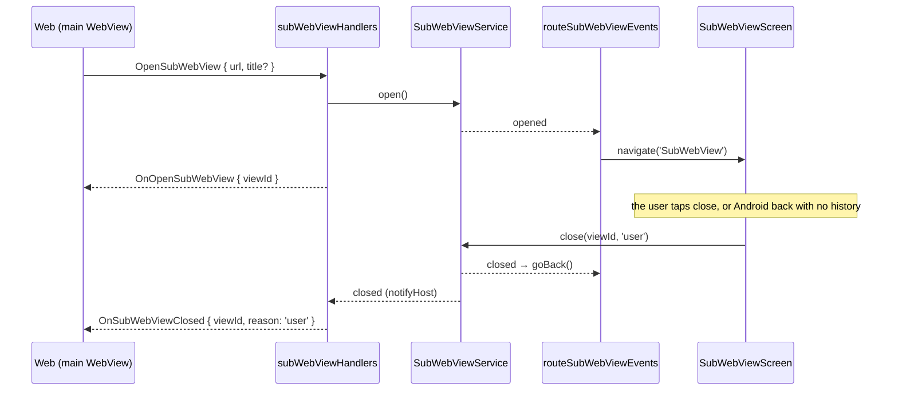

# The sub WebView

A second WebView the shell shows over the main one, for a page on another origin. The web asks for
it with `OpenSubWebView`; the shell shows the page full screen under a bar with its title and a close
control, and tells the web with `OnSubWebViewClosed` when it is gone. The messages and their codes are
in `@chatic/bridge-messages` (`model/sub-webview.ts`). What a page and the shell say to each other —
the envelope, versions, errors, timing, every request and push — is specified in
[sub-webview-protocol.md](./sub-webview-protocol.md); this document is how the shell behaves.

It exists so the app can host pages it does not own the code of — a service of its own, a notice —
without
sending the user out to the OS browser and without letting that page near the app. It is not a
general in-app browser: an arbitrary site such as a search portal is never shown here (see
[Where it may go](#where-it-may-go)).

## What the page gets, and what it does not

**Nothing of the main WebView.** The sub WebView is its own component (`subWebView/SubWebView.tsx`),
not `AppWebView` with another URL:

- none of the main WebView's `window.CHATIC_APP_*` globals (device id, install id, Firebase install
  id, run id) and no `ChaticMessageHandler`. react-native-webview's own history shim on iOS still
  runs; it only reports navigation state to the shell;
- the platform's own user agent, without the `DOU_IOS` / `DOU_ANDROID` prefix the main WebView adds,
  so a server cannot mistake it for the app;
- none of the main WebView's handlers: its messages go to a host of its own (below).

**A context, defined before the page's scripts run.** `window.ChaticSubWebView` is a frozen
`SubWebViewContext`: `protocolVersion` (1), `viewId`, `platform`, `appVersion`, `locale` (the
language the user chose in the app), `theme` (the app's resolved theme, which can differ from the
OS's), `params` — what the web passed in `OpenSubWebView`, never put in the URL — and `appLink`,
the link that opens the page again (below). Nothing that
identifies the device, the install or the user. The script defines it only when the page's origin is
the one the view was opened on, so a page the view navigates to — another allowlisted one too —
finds
nothing (`subWebViewContextScript.ts`). A later theme or language change arrives as the push
`OnSubWebViewContextChanged`.

**A bridge of its own, with a subset of the vocabulary.** The page speaks the same message
vocabulary as the main web, through `window.ReactNativeWebView`, to a second `AppBridgeHost`
(`createSubBridgeHost.ts`) that registers only `SubWebViewRequestType` — and of that, the base set
and what the page's manifest permits (below):

| Request                   | What the sub WebView's host does                                                                          |
| ------------------------- | --------------------------------------------------------------------------------------------------------- |
| `WebAppReady`             | The handshake; lists the base set and the permitted rows of this table. No cache schema: nothing to store |
| `Ping`                    | Answered by the host itself                                                                               |
| `FinishSubWebView`        | Closes this view as `page`, handing `result` (JSON, at most 16 KiB) to the web                            |
| `SetSubWebViewTitle`      | Puts a title (1–100 characters) in the bar, over the document's own                                       |
| `CopyToClipboard`         | Writes text to the clipboard (permission `clipboard`)                                                     |
| `TriggerHaptic`           | Plays one short haptic, a tick, a tap or an outcome                                                       |
| `OpenURL`                 | Opens only what the view would hand to the OS — never the app's own links (`openUrl`)                     |
| `OpenShareSheet`          | Opens the OS share sheet with a message and an http(s) link — never a file (`share`)                      |
| `GetSubWebViewUserKey`    | This device's key for the page's origin — never the device id (`userKey`)                                 |
| `SetCanGoBack`            | The page claims Android back: presses are pushed to it as `OnBackPressed`                                 |
| `SetSubWebViewCloseGuard` | The user's close is pushed to the page as `OnSubWebViewCloseRequested` first                              |
| `ReportSubWebViewError`   | Writes the page's error to the app's log under its origin, 20 per page load                               |
| `GetSubWebViewStorage` …  | The page's own storage: get, set, remove, clear, and what it holds (the five storage requests)            |

**The page's manifest decides the gated four.** Before it loads the page, the screen reads
`/.well-known/chatic-app.json` from the opened origin (`subWebViewManifest.ts`). Each permission it
declares — `clipboard`, `share`, `openUrl`, `userKey` — adds one request; without a manifest, or with
one the shell cannot read, the page gets the base set only, and `permittedSubBridgeHandlers` leaves
the rest unregistered, so they answer `NOT_FOUND` as an older app would. The manifest also names the
page, and sets its display (`fullscreen` drops the bar) and orientation. It is fetched with a
3-second limit, kept in memory per origin for the run of the app, and refreshed behind each later
open; failures fall back to the defaults and are logged. The strict default is deliberate: pages
are written by people outside the app's team, who submit a bundle and ask for permissions in its
manifest; an administrator approves them at review, and the manifest deployed to the allowlisted
origin is that approval. What a page may reach is then one file a reviewer signed off, not
something every page gets by default.

Everything else — cache, preferences, push tokens, purchases, files, `SendLog` — answers `NOT_FOUND`.
The handshake reply also carries the page's context as `subWebView`, and a message over 64 KiB is
answered `TOO_LARGE` before any handler sees it (`SUB_WEBVIEW_MESSAGE_LIMIT`).
The handlers are written for this host (`subBridgeHandlers.ts`), not borrowed from the main
WebView's: the boundary forbids that, and the main ones assume the main web is asking — its
`OpenURL`
opens the app's schemes. The table is typed by `SubWebViewRequestType`, so a request outside the
subset does not compile there — locally: CI does not type check `apps/mobile`. What CI does run is
`createSubBridgeHost.test.ts`, which checks the handshake lists exactly the subset.

**What a page may share.** `OpenShareSheet` goes through the same `DeviceService.openShareSheet` as the
main web's, but its own handler decides what reaches it. The link must be `http:` or `https:`
(`LINK_NOT_ALLOWED` otherwise): on iOS the share sheet treats a `file:` URL as the file itself, so a
page could otherwise hand another app a file from DoU's container. The app's own links are not
refused, unlike `OpenURL`'s: a shared link is text the user sends on, not a navigation, and the
message is free text that could carry the same link anyway. The check parses by hand (`originOf`),
not with `URL`, which React Native implements differently from the Node `URL` the tests run on.

There has to be a message that is not blank, or a link. A title is at most 100 characters, a
message 4,000 and a link 2,048; a field that is present but not a string within its limit, and an
empty link, are `INVALID`; a `null` field counts as left out. Only those three fields pass. What
reaches the OS differs by platform: Android hands the title to the receiving app as a subject (an
email's subject line, say) and appends the link to the message; iOS ignores the title. The reply carries React Native's `ShareAction`, which means
little on Android: it answers `sharedAction` as soon as the chooser opens, whatever the user then
does, and never an `activityType`; only iOS reports `dismissedAction` and the activity chosen. A
page that would rather copy than fail checks the handshake for `OpenShareSheet` first: apps built
before it answer `NOT_FOUND`.

**A key for the page's own server, not an identity.** `GetSubWebViewUserKey` answers `{ key }`, 64
lower-case hex characters, so a page's server can keep a user's data — a save game, progress — under
something stable, without an account and without the app telling it who the user is. The key is
HMAC-SHA-256 keyed by the device id over a fixed label and the page's origin
(`subWebViewUserKey.ts`):

- **Same device and origin, same key**, on every launch and in every view. **Another origin, another
  key** — `foo.apps.chatic.io` and `foo.apps-dev.chatic.io` too. Two pages' servers comparing keys cannot tell they
  share a user, and neither can work back from its key to the device id.
- **The origin is the shell's record** — the origin of the URL the view was opened on — never
  anything in the request, so a page can only ever get its own origin's key.
- **The device id is the one the main WebView is given** as `CHATIC_APP_UNIQUE_DEVICE_ID`
  (`DeviceInfo.getUniqueIdSync()`); no new id is made. With none — `null`, empty, or the library's
  `unknown` — the reply is `UNAVAILABLE` rather than a key every such device would share.
- **The label is the salt, and it is not a secret.** It is a constant in this public repository, so
  it only keeps this use of the device id apart from any other. What makes the key unlinkable is the
  device id, which a page never sees; whoever does hold it — DoU's own logs and crash reports carry it
  — can recompute any page's key. A secret salt built into the app would not change that much (it can
  be read out of the app binary) and would re-key every page if it were ever lost or changed.
- **The label never changes.** Changing it, or anything else in the derivation, changes every key and
  orphans every page's data kept under the old ones; `subWebViewUserKey.test.ts` pins two keys so
  that cannot happen unnoticed. A different key would be a new request.

How long a key lasts is how long the device id lasts:

| Event                         | iOS                                                                                                                                                                             | Android                                                                                                              |
| ----------------------------- | ------------------------------------------------------------------------------------------------------------------------------------------------------------------------------- | -------------------------------------------------------------------------------------------------------------------- |
| What the id is                | react-native-device-info's own: the vendor id (IDFV, or a random UUID without one) when first read, then kept in the keychain (this device only) and in the app's user defaults | `Settings.Secure.ANDROID_ID`: one per app signing key, user and device on Android 8+; on 7.x one per user and device |
| Reinstall                     | The same key: the keychain entry outlives the app                                                                                                                               | The same key, for a build signed with the same key                                                                   |
| Erase or factory reset        | A new key, unless restored from a backup (below)                                                                                                                                | A new key                                                                                                            |
| A new phone                   | A new key, unless restored from a backup of the old one (below)                                                                                                                 | A new key                                                                                                            |
| Another user on the phone     | —                                                                                                                                                                               | A new key                                                                                                            |
| A build signed with a new key | —                                                                                                                                                                               | A new key on Android 8+: a locally signed build and the store's build see different ids                              |

The iOS rows are read from the library's code (`DeviceUID.m`), not checked on a device: an id is
looked up in the keychain first, then in the user defaults, and written back to both. A backup carries
the user defaults but not a this-device-only keychain entry, so a phone erased or replaced and then
restored from a backup keeps its key.

**What the key is not:**

- **Not the DoU account.** Two accounts on one phone get the same key; one account on two phones gets
  two. Signing out changes nothing.
- **Not proof of anything.** The page's server receives the key from the page's own script, and
  anyone can send it any 64 hex characters. A key is as good as a long random bearer value: it cannot
  be guessed, but whoever learns one (from that server's logs, say) can use it. A server that must know
  a request came from the app on that device needs a token the app signs, which does not exist yet.
- **Not secret from the page.** The page may keep it and send it where it likes; it means something
  only to that origin.

A page asks once its handshake lists `GetSubWebViewUserKey`; an app built before it answers
`NOT_FOUND`, and the page falls back to a sign-in of its own (an anonymous one keeps working until the
WebView's storage is cleared or the app reinstalled).

**Storage on the device, one file per origin.** The five storage requests keep a page's JSON values in
an MMKV file of its own (`subWebViewStorage.ts`, opened by `subWebViewStorageFile.ts`). The file is
opened on the page's first storage request, not when the view opens, so a page that never stores
leaves no file; once open it is kept for the run of the app, one per origin, because every MMKV
instance registers a memory-warning listener that an engine without `FinalizationRegistry` never
removes. The file's id
is `subwebview.` plus the first 32 hex characters of the origin's SHA-256, so it is the same on every
open, holds only characters a file name can, and is apart from the app's own files. Like the user key,
it is chosen from the shell's record of the opened origin, never from the request, so a page can reach
no other page's file. Pages are isolated by origin alone: an origin is never handed to a second page,
so nothing finer is needed.

- **It is the device's, not the account's.** The app's sign-out clears only its default MMKV file, so a
  page's data survives a sign-out and another account on the phone sees the same data — the same terms
  as the user key. It goes with an uninstall. Data that must follow the user belongs on the page's own
  server, under the key.
- **1,048,576 characters per origin**, counted as every key's length plus its value's JSON: what the
  page put there, not the file's size, which includes MMKV's reserve and the space removed keys left.
  The count is worked out on the first request and kept up to date after. A write past it is
  `QUOTA_EXCEEDED`; a write is all or none.
- **Keys are 1–200 characters**, and `__proto__` is refused: as a property of a reply it would set the
  object's prototype. One request is also held to the host's 64 KiB message limit, so a page writes
  more than that over several requests, and one value stays under it.
- **Only a clear trims the file.** MMKV does not shrink by itself, but its `trim` also drops the
  memory cache, so the next read loads the whole file again; removing keys leaves the space for the
  next write.
- **All or none, as far as the device lets it.** A write past the limit or with one bad entry changes
  nothing. A write the device itself refuses part way (a full disk) keeps what it wrote, is answered
  `INTERNAL_ERROR`, and the count is taken afresh on the next request.
- **In the base set.** Keeping its own data reaches nothing outside the view, so a page needs no
  manifest permission for it. The alternative a page already has, `localStorage`, is the WebView's
  and goes whenever the WebView's data is cleared.
- A file that cannot be opened is logged, and every storage request is answered `UNAVAILABLE`.
- No screen lets the user see or clear a page's data yet; that, and letting the user reset a page's
  user key, would come together.

**Only the origin the view was opened on is answered.** Every message is checked against that origin
before the host sees it; a page the view navigated to, or a frame elsewhere, gets no answer at all.
One caveat: on an Android System WebView too old for web message listeners, react-native-webview
reports a frame's message under the top-level URL, so a cross-origin frame inside the opened page
would pass. Current WebViews report the frame's own origin.

**Each page load gets a fresh host.** A host stays ready after its page's first message, so a
reloaded
page would be sent pushes before it listens; a new host holds them until the new page's handshake.
A title the last page asked for is dropped at the same moment, and so are its claim on back and its
close guard. A reply the old host sends after that still reaches the WebView, but cannot set either:
the load counter is bumped in `onLoadStart` itself, before the state that rebuilds the host.
`SubWebView.test.tsx` pins the context, the origin check and the user agent.

**Device features are left open.** Camera, microphone, file pickers and downloads behave as the
WebView and the OS make them behave; nothing is switched off for this view. What keeps that safe is
not a setting but what may be deployed to the allowlisted domains: only pages that passed the app's
own content review. What each feature does today, given the permissions the app declares:

| Feature     | iOS                                                                   | Android                                                                                            |
| ----------- | --------------------------------------------------------------------- | -------------------------------------------------------------------------------------------------- |
| Camera      | The OS asks, under DoU's name and DoU's camera purpose string         | Granted without a prompt once the app holds `CAMERA`                                               |
| Microphone  | The OS asks, under DoU's name and DoU's microphone purpose string     | Granted without a prompt once the app holds `RECORD_AUDIO`; asked for at run time when it does not |
| Location    | The app declares no location purpose; not usable                      | `geolocationEnabled` is off by default and no permission is declared                               |
| File picker | The OS picker                                                         | The OS picker                                                                                      |
| Downloads   | Not handled: the view sets no `onFileDownload` (unverified on device) | react-native-webview's default saves to the device's Downloads                                     |

Every prompt says "DoU", not the page: to the user, a page's use of a feature is the app's. The
microphone was added for voice messages, and a page gets it on the same terms as the camera: nothing
here refuses an audio capture, and react-native-webview offers no way to refuse audio alone — its iOS
grant setting answers the camera and the microphone with one value, and its Android client turns an
audio request into the app's `RECORD_AUDIO`. Whether a page uses the microphone is part of what its
review checks before it goes on an allowlisted domain. Adding location still needs a purpose string or
permission in the app, so an app release, and is done when a reviewed page needs it.

### For a page's author

Pages talk to the shell through [`chatic-apps-sdk`](../../../../libs/chatic-apps-sdk/README.md)
(`libs/chatic-apps-sdk`, published as `@lemoncloud/chatic-apps-sdk`), or by hand following
[sub-webview-protocol.md](./sub-webview-protocol.md), which is the contract either way: the envelope,
the handshake, every request and push, errors, timeouts and limits. Three things from it that a page
most often gets wrong:

- Take the context from the handshake reply's `subWebView`, not from `window.ChaticSubWebView` while
  the first script runs: on Android the global can be defined after it.
- Hold request timeouts while the page is hidden: on Android nothing reaches the page while the app
  is in the background.
- Do not turn on the bridge logger forwarding (`setupBridgeLogger`): `SendLog` is not in the subset
  and every line would come back `NOT_FOUND`.

### A link back to a page

A page's context carries `appLink`, `https://app.chatic.io/apps/<appId>` for the app id the web
opened it as (`OpenSubWebView`'s `appId`), on the link host of this build — never from the page, so a
page cannot point it elsewhere. Opened without an id, by an older web, the page's label stands in. A
page shares `appLink` plus a query of its own; a tap opens the page in the app, at its root with that
query, through the main web, which resolves the id — see
[../system/deeplink.md](../system/deeplink.md#sub-webview-page-links). The shell only checks the link's
shape: which page an id is, it leaves to the web, so a page can move without its links changing.
Where the app is not installed, the landing site offers the app and the store, never the page in a
browser. A link opens any page the web resolves and the allowlist takes, whatever debug mode or the
Lab says: the allowlist and the review are the gate, not where the link came from.

## Where it may go

**The allowlist** is `SUB_WEBVIEW_DOMAINS` in `services/subWebView/subWebViewAllowlist.ts`: the
subdomains of `apps.chatic.io` and `apps-dev.chatic.io`, one label deep
(`https://foo.apps.chatic.io`).
The app's review pipeline is the only thing that deploys there, so the pattern means "a reviewed
page",
and a new page needs a deploy rather than an app release. The domain itself
(`https://apps.chatic.io`) is not a page and is refused.

It is a subtree on purpose, not `*.chatic.io`. That would take in the web app itself
(`dou.chatic.io` boots a second copy of the app in the view, and the storage the two WebViews share
is
kept apart by origin alone), the deep-link domain the main WebView's bridge trusts
(`app.chatic.io`),
every internal tool, and every subdomain created later — including one whose DNS record outlived its
service and that someone else now serves.

**A URL that parsers could read two ways is refused**: userinfo, a port, a backslash (Android reads
it
as `/`, so `https://evil.example\@foo.apps.chatic.io` would load `evil.example`), whitespace and
control characters. `SubWebViewService.test.ts` holds these cases.

**Inside the page**, every navigation is decided by `decideSubWebViewNavigation`. The view's
`originWhitelist` is `['*']` so that every one of them reaches it: react-native-webview checks that
list first and hands whatever fails it straight to the OS, the app's own schemes included.

| Navigation                                                                           | Top level      | Inside a frame |
| ------------------------------------------------------------------------------------ | -------------- | -------------- |
| An allowlisted page, `about:blank`                                                   | Loads          | Loads          |
| Any other `https`                                                                    | The OS browser | Loads          |
| `http`                                                                               | The OS browser | Dropped        |
| `mailto:`, `tel:`, `sms:`, `itms-apps:`, `market:`                                   | The OS         | Dropped        |
| The app's links: `chatic://`, `chatic-dev://`, `app(-dev).chatic.io/i`, `/s`, `/s/*` | Dropped        | Dropped        |
| `intent:`, `javascript:`, `file:`                                                    | Dropped        | Dropped        |
| `data:`, `blob:`                                                                     | Dropped        | Loads          |

A request with no `isTopFrame` — Android reports none — is decided as a top-level one. The app's own
links are dropped because the web that opened the view owns the app's routing; a page under it must
not drive it. Loaded in the view, the universal-link paths would show the invite bounce page, and
handed to the OS they would re-enter the app on Android. `target=_blank` and `window.open` load in
the same view — `setSupportMultipleWindows={false}` on Android, and on iOS react-native-webview
loads a
request with no target frame in the view it came from — so they go through the same check. A login
that runs in a popup and answers through `window.opener` therefore does not work in a sub page.

## Lifecycle

One view at a time; a second `OpenSubWebView` is refused with `ALREADY_OPEN`.



| Reason   | Who closed it                                                               |
| -------- | --------------------------------------------------------------------------- |
| `user`   | The bar's close control, or Android back with no page to go back to         |
| `host`   | The web, with `CloseSubWebView`                                             |
| `system` | The shell, before a deep link or a tapped push navigates the web            |
| `page`   | The page, with `FinishSubWebView` — the only reason that carries a `result` |

**A deep link or a tapped push closes the view first.** `useDeepLinkNavigation` closes a showing
view
as `system` before it sends `OnNavigate` (or resets the navigator for a native route), so the web
hears why the view went before it hears where to go, and what it opens is not hidden underneath.

**The web reloading under the view closes it without a word.** `MainScreen` calls
`resetForNewHost()` on every `WebAppReady`: a handshake after the first is a page that reloaded, and
the page that opened the view is gone. The view is dismissed and no `OnSubWebViewClosed` is sent.

**The user's close can be asked of the page first.** A page with something to lose turns on its close
guard (`SetSubWebViewCloseGuard`); the bar's control and an Android back press that would close then
push `OnSubWebViewCloseRequested` instead, and the page closes with `FinishSubWebView` or stays. A
second close within three seconds of the first closes anyway (`subWebViewCloseGuard.ts`), so a page
that hangs cannot keep the user in. Only `user` closes are guarded; `host`, `system` and `page` are not.

**A `fullscreen` page has no bar but keeps a close control**, floating over its top-right corner,
so a page cannot leave the user without a way out. Until the manifest is in the screen shows that
control alone and no page, so even a manifest that never answers leaves the user a way out. The
manifest's orientation is applied with react-native-screens' `orientation` screen option once the
manifest is in (not yet checked on a device for a full-screen modal).

**The screen pads every edge by the safe area.** The page lies wholly inside it and needs no insets
(that `env(safe-area-inset-*)` then reads 0 is not yet checked on a device):
top and bottom under the bar and above the home indicator, and the sides too, for the notch in
landscape. The padding takes the theme background.

**The screen cannot be swiped away.** It is a `fullScreenModal` with gestures off, so every close
goes through the bar's control or Android back, and the web always hears of it. If the screen leaves
some other way anyway, its unmount closes the view as `user`; once the service has closed it, that
call answers `NOT_OPEN` and does nothing. The other way round, a close control pressed on a screen
the
service no longer knows leaves by itself, since nothing else would take it down.

**Android back** goes to the page first when it claimed back with `SetCanGoBack` (pushed as
`OnBackPressed`, and nothing else happens), then to the page's own history, then closes the view
through the close guard (`decideSubWebViewBack`). The main WebView's back
listener (`useAndroidBack`) passes the press on while a view shows: listeners run newest first, and
that one is re-added whenever the web's `canGoBack` changes, so it can end up above the sub
WebView's.

## The boundary

The main WebView (`webview/`) and the sub WebView (`subWebView/`, `features/subWebView/`) never
import
each other. They meet only in `services/subWebView`, which holds the allowlist and the view that is
showing and tells two listeners about each change: `routeSubWebViewEvents`, which shows and
dismisses
the screen, and the main WebView's handler, which tells the web. `apps/mobile/eslint.config.mjs`
enforces it with `no-restricted-imports`, both ways; the one path let through is
`webview/hooks/appEventContract`, test support with no runtime that every event's colocated test
uses. `useAndroidBack` and `useDeepLinkNavigation`
reach the view only through that service too.

The reason is what a shortcut would carry across: an import from `webview/` into the sub side is how
the main WebView's injection or handlers would end up in front of a page that must not have them,
and
an import the other way ties the main WebView to a screen it should only know through the service.

## Files

| File                                                   | Role                                                                    |
| ------------------------------------------------------ | ----------------------------------------------------------------------- |
| `src/app/services/subWebView/SubWebViewService.ts`     | Validates, records the view, reports opened/closed                      |
| `src/app/services/subWebView/subWebViewAllowlist.ts`   | `SUB_WEBVIEW_DOMAINS`, `isAllowedSubWebViewUrl`                         |
| `src/app/webview/hooks/subWebViewHandlers.ts`          | `OpenSubWebView` / `CloseSubWebView`, and the `OnSubWebViewClosed` push |
| `src/app/subWebView/SubWebView.tsx`                    | The second WebView: its context, its host, the origin check             |
| `src/app/subWebView/createSubBridgeHost.ts`            | The sub WebView's own `AppBridgeHost`, with the subset only             |
| `src/app/subWebView/subBridgeHandlers.ts`              | The page-facing handlers, typed by `SubWebViewRequestType`              |
| `src/app/subWebView/subWebViewUserKey.ts`              | The page's key, from the device id and its origin                       |
| `src/app/services/subWebView/subWebViewStorage.ts`     | A page's storage: the limits, the count, all-or-none writes             |
| `src/app/services/subWebView/subWebViewStorageFile.ts` | Opens an origin's MMKV file                                             |
| `src/app/subWebView/subWebViewCloseGuard.ts`           | Whether the user's close asks the page first, and the forced second one |
| `src/app/subWebView/useSubWebViewBack.ts`              | Android back: the page's claim, then history, then close                |
| `src/app/subWebView/chaticAppsSdk.contract.test.ts`    | `chatic-apps-sdk` run against this host and its handlers                |
| `src/app/subWebView/subWebViewContextScript.ts`        | `window.ChaticSubWebView`, for the opened origin only                   |
| `src/app/services/subWebView/subWebViewData.ts`        | The 16 KiB data, 64 KiB message and 100-character title limits          |
| `src/app/services/subWebView/subWebViewManifest.ts`    | Reads, checks and caches a page's manifest                              |
| `src/app/services/deeplinks/deeplinkUtils.ts`          | Checks a page's app link and hands it to the web as `/apps/<appId>?…`   |
| `libs/shared/src/utils/subWebViewLink.ts`              | Reads a page link and builds `appLink` — shared with web and landing    |
| `src/app/subWebView/subWebViewNavigation.ts`           | Load, hand to the OS, or drop                                           |
| `src/app/features/subWebView/SubWebViewScreen.tsx`     | The manifest, then the bar or the floating close control, orientation   |
| `src/app/features/subWebView/routeSubWebViewEvents.ts` | Navigates to the screen and back as the service reports                 |

## Checking it by hand

Any page deployed on a subdomain of `apps-dev.chatic.io` (or `apps.chatic.io`) will do — nothing else
opens. The game `https://dou-raise.apps.chatic.io/` is the page kept for trying it: the web's Lab
page (Settings → Lab) lists it under Experiments for everyone, and a tap opens it. The debug screen's
URL field starts at its development host, `https://dou-raise.apps-dev.chatic.io/`, and takes any other
page. The allowlist takes `apps-dev.chatic.io` in every build, so an unlocked store build opens a
development page too. A page reaches
`CopyToClipboard`, `OpenShareSheet`, `OpenURL` and `GetSubWebViewUserKey` only when its deployed
manifest grants them; without one, those four answer `NOT_FOUND`.

A page link can be tried without a page sharing one, by handing the OS the link (a dev build claims
the `app-dev` host):

```bash
adb shell am start -a android.intent.action.VIEW -d https://app-dev.chatic.io/apps/dou-raise
```

```bash
xcrun simctl openurl booted https://app-dev.chatic.io/apps/dou-raise
```

The page opens over whatever the app shows. On the simulator a universal link needs the association
file deployed and fetched; until then Safari opens the landing page, which offers the app or the store.

Open it from the web's debug panel → **Sub WebView (app)**: a URL, an optional title and `params`, and
a log of how the view closed, with the `result` the page handed back. A URL off the allowlist answers
`NOT_ALLOWED`. The screen hears the close only while it is the one showing in the panel: switch to
another screen while the view is open and that close is not logged. The Bridge screen's
`OpenSubWebView` preset sends the same request but shows no close event.

In a development build the sub WebView is inspectable like the main one (`webviewDebuggingEnabled`):
Safari's Develop menu on iOS, `chrome://inspect` on Android.
