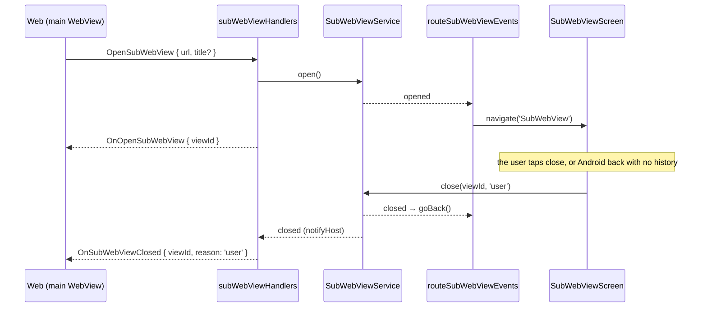

# The sub WebView

A second WebView the shell shows over the main one, for a page on another origin. The web asks for
it with `OpenSubWebView`; the shell shows the page full screen under a bar with its title and a close
control, and tells the web with `OnSubWebViewClosed` when it is gone. The messages and their codes are
in `@chatic/app-messages` (`model/sub-webview.ts`).

It exists so the app can host pages it does not own the code of — a service of its own, a notice — without
sending the user out to the OS browser and without letting that page near the app. It is not a
general in-app browser: an arbitrary site such as a search portal is never shown here (see
[Where it may go](#where-it-may-go)).

## What the page gets, and what it does not

**No channel to the app.** The sub WebView is its own component (`subWebView/SubWebView.tsx`), not
`AppWebView` with another URL:

- no `onMessage`, so react-native-webview never injects `window.ReactNativeWebView`;
- none of our injected scripts, so none of the main WebView's `window.CHATIC_APP_*` globals (device
  id, install id, Firebase install id, run id) and no `ChaticMessageHandler`. react-native-webview's
  own history shim on iOS still runs; it only reports navigation state to the shell;
- the platform's own user agent, without the `DOU_IOS` / `DOU_ANDROID` prefix the main WebView adds,
  so a server cannot mistake it for the app.

`SubWebView.test.tsx` pins all three.

**Device features are left open.** Camera, microphone, file pickers and downloads behave as the
WebView and the OS make them behave; nothing is switched off for this view. What keeps that safe is
not a setting but what may be deployed to the allowlisted domains: only pages that passed the app's
own content review. What each feature does today, given the permissions the app declares:

| Feature     | iOS                                                                       | Android                                                              |
| ----------- | ------------------------------------------------------------------------- | -------------------------------------------------------------------- |
| Camera      | The OS asks, under DoU's name and DoU's camera purpose string             | Granted without a prompt once the app holds `CAMERA`                 |
| Microphone  | The app declares no microphone purpose; not usable (unverified on device) | The app declares no `RECORD_AUDIO`; refused                          |
| Location    | The app declares no location purpose; not usable                          | `geolocationEnabled` is off by default and no permission is declared |
| File picker | The OS picker                                                             | The OS picker                                                        |
| Downloads   | Not handled: the view sets no `onFileDownload` (unverified on device)     | react-native-webview's default saves to the device's Downloads       |

Every prompt says "DoU", not the page: to the user, a page's use of a feature is the app's. Adding
the microphone or location needs a purpose string or permission in the app, so an app release, and
is done when a reviewed page needs it.

A page that needs the app itself — a context, a way to close itself and hand back a result, later a
token for the signed-in user — gets it through a second `AppBridgeHost` that registers only the
messages a sub page may use, never the main WebView's router. That is the next step and not built
yet.

## Where it may go

**The allowlist** is `SUB_WEBVIEW_DOMAINS` in `services/subWebView/subWebViewAllowlist.ts`: the
subdomains of `apps.chatic.io` and `apps-dev.chatic.io`, one label deep (`https://foo.apps.chatic.io`).
The app's review pipeline is the only thing that deploys there, so the pattern means "a reviewed page",
and a new page needs a deploy rather than an app release. The domain itself
(`https://apps.chatic.io`) is not a page and is refused.

It is a subtree on purpose, not `*.chatic.io`. That would take in the web app itself
(`dou.chatic.io` boots a second copy of the app in the view, and the storage the two WebViews share is
kept apart by origin alone), the deep-link domain the main WebView's bridge trusts (`app.chatic.io`),
every internal tool, and every subdomain created later — including one whose DNS record outlived its
service and that someone else now serves.

**A URL that parsers could read two ways is refused**: userinfo, a port, a backslash (Android reads it
as `/`, so `https://evil.example\@foo.apps.chatic.io` would load `evil.example`), whitespace and
control characters. `SubWebViewService.test.ts` holds these cases.

**Inside the page**, every navigation is decided by `decideSubWebViewNavigation`. The view's
`originWhitelist` is `['*']` so that every one of them reaches it: react-native-webview checks that
list first and hands whatever fails it straight to the OS, the app's own schemes included.

| Navigation                                                                           | Top level      | Inside a frame |
| ------------------------------------------------------------------------------------ | -------------- | -------------- |
| An allowlisted page, `about:blank`                                                   | Loads          | Loads          |
| Any other `https`                                                                    | The OS browser | Loads          |
| `http`                                                                               | The OS browser | Dropped        |
| `mailto:`, `tel:`, `sms:`, `itms-apps:`, `market:`                                   | The OS         | Dropped        |
| The app's links: `chatic://`, `chatic-dev://`, `app(-dev).chatic.io/i`, `/s`, `/s/*` | Dropped        | Dropped        |
| `intent:`, `javascript:`, `file:`                                                    | Dropped        | Dropped        |
| `data:`, `blob:`                                                                     | Dropped        | Loads          |

A request with no `isTopFrame` — Android reports none — is decided as a top-level one. The app's own
links are dropped because the web that opened the view owns the app's routing; a page under it must
not drive it. Loaded in the view, the universal-link paths would show the invite bounce page, and
handed to the OS they would re-enter the app on Android. `target=_blank` and `window.open` load in
the same view — `setSupportMultipleWindows={false}` on Android, and on iOS react-native-webview loads a
request with no target frame in the view it came from — so they go through the same check. A login
that runs in a popup and answers through `window.opener` therefore does not work in a sub page.

## Lifecycle

One view at a time; a second `OpenSubWebView` is refused with `ALREADY_OPEN`.

| Reason   | Who closed it                                                             |
| -------- | ------------------------------------------------------------------------- |
| `user`   | The bar's close control, or Android back with no page to go back to       |
| `host`   | The web, with `CloseSubWebView`                                           |
| `system` | The shell, before a deep link or a tapped push navigates the web          |
| `page`   | Declared, not sent yet — the page has no way to ask until it has a bridge |

**A deep link or a tapped push closes the view first.** `useDeepLinkNavigation` closes a showing view
as `system` before it sends `OnNavigate` (or resets the navigator for a native route), so the web
hears why the view went before it hears where to go, and what it opens is not hidden underneath.

**The web reloading under the view closes it without a word.** `MainScreen` calls
`resetForNewHost()` on every `WebAppReady`: a handshake after the first is a page that reloaded, and
the page that opened the view is gone. The view is dismissed and no `OnSubWebViewClosed` is sent.

**The screen cannot be swiped away.** It is a `fullScreenModal` with gestures off, so every close
goes through the bar's control or Android back, and the web always hears of it. If the screen leaves
some other way anyway, its unmount closes the view as `user`; once the service has closed it, that
call answers `NOT_OPEN` and does nothing. The other way round, a close control pressed on a screen the
service no longer knows leaves by itself, since nothing else would take it down.

**Android back** goes to the page's own history first, then closes the view. The main WebView's back
listener (`useAndroidBack`) passes the press on while a view shows: listeners run newest first, and
that one is re-added whenever the web's `canGoBack` changes, so it can end up above the sub WebView's.

## The boundary

The main WebView (`webview/`) and the sub WebView (`subWebView/`, `features/subWebView/`) never import
each other. They meet only in `services/subWebView`, which holds the allowlist and the view that is
showing and tells two listeners about each change: `routeSubWebViewEvents`, which shows and dismisses
the screen, and the main WebView's handler, which tells the web. `apps/mobile/eslint.config.mjs`
enforces it with `no-restricted-imports`, both ways. `useAndroidBack` and `useDeepLinkNavigation`
reach the view only through that service too.

The reason is what a shortcut would carry across: an import from `webview/` into the sub side is how
the main WebView's injection or handlers would end up in front of a page that must not have them, and
an import the other way ties the main WebView to a screen it should only know through the service.

## Files

| File                                                   | Role                                                                    |
| ------------------------------------------------------ | ----------------------------------------------------------------------- |
| `src/app/services/subWebView/SubWebViewService.ts`     | Validates, records the view, reports opened/closed                      |
| `src/app/services/subWebView/subWebViewAllowlist.ts`   | `SUB_WEBVIEW_DOMAINS`, `isAllowedSubWebViewUrl`                         |
| `src/app/webview/hooks/subWebViewHandlers.ts`          | `OpenSubWebView` / `CloseSubWebView`, and the `OnSubWebViewClosed` push |
| `src/app/subWebView/SubWebView.tsx`                    | The second WebView: no bridge, none of our injection                    |
| `src/app/subWebView/subWebViewNavigation.ts`           | Load, hand to the OS, or drop                                           |
| `src/app/features/subWebView/SubWebViewScreen.tsx`     | The bar and its close control                                           |
| `src/app/features/subWebView/routeSubWebViewEvents.ts` | Navigates to the screen and back as the service reports                 |

## Checking it by hand

The debug panel's Bridge screen has an `OpenSubWebView` preset. Pick it, give it a payload such as
`{ "url": "https://<page>.apps-dev.chatic.io/" }`, and send it as a request: the page slides up over the
app, the reply carries the `viewId`, and closing it sends `OnSubWebViewClosed`. A URL off the allowlist
answers `NOT_ALLOWED`. It needs a page actually deployed under `apps-dev.chatic.io`.
