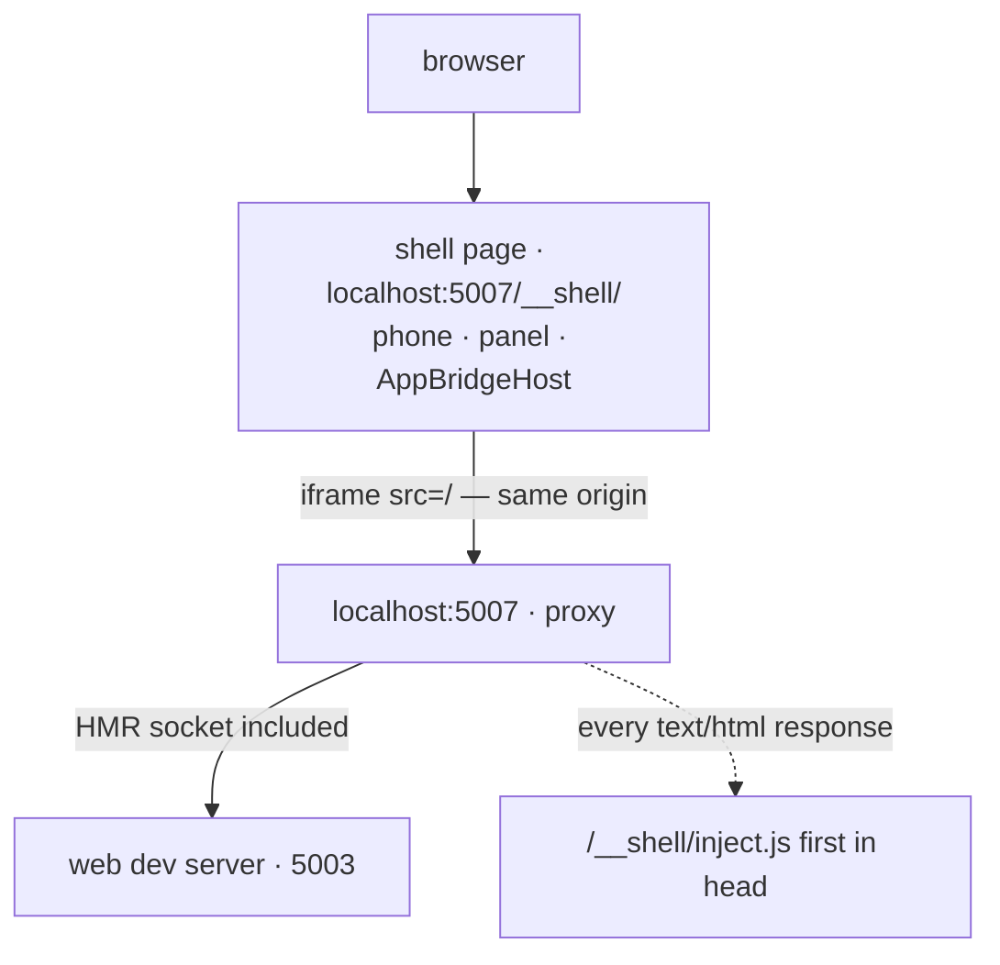

# virtual-shell — the web as if inside the mobile app, in one browser tab

`yarn local` starts the web dev server and this shell, and opens nothing else: no simulator, no Metro,
no Xcode or Android SDK. The shell page draws a phone, loads the web in it, and answers the web the
way the mobile app's native shell does — so the web boots believing it runs inside the app and takes
the same paths it takes on a phone. A panel beside the phone makes what a phone would otherwise have
to make happen: a push arriving or tapped, a link opening the app, the app going to the background,
Android's back button, a relaunch, another device. The same tools are on `window.virtualShell`, for an
agent driving the page through a browser tool.

It is a local development tool. Nothing here is built into, or reachable from, the deployed web or app.

## Run it

```bash
yarn local                    # the shell, against dev — asked in a terminal, dev without one
yarn local --env prod         # the shell against prod, under a red PROD band (on 5017)
yarn local --mode web         # the web alone, as a plain browser page
yarn local --mode native      # the simulator run (yarn mobile:ios:local), unchanged
yarn local --mode native --platform android   # the emulator run (yarn mobile:android:local)
```

It prints the shell's address as it starts; wait for both Vite servers to print theirs, then open
`http://localhost:5007/__shell/` (nothing opens a browser for you). Opening `http://localhost:5007/` (or any path but the
shell's) sends you there too, so the web never boots outside the shell while believing it is inside.

`yarn local` stops before starting anything if something is missing and says what and where to get it:
`node_modules`, `apps/web/.env`, `apps/web/.env.<env>`, and for the shell `apps/mobile/.env.<env>`
with its `VITE_GOOGLE_WEB_CLIENT_ID`; the backend's two ports (dev 5003 · 5007, prod 5013 · 5017) must be free — a port in use is reported,
with the command that shows who holds it, and the holder is never stopped. Both servers start with
`--strictPort`, so neither drifts to another port behind the shell's back. `--env prod` is refused in
the web and native modes, which have no page to show the PROD band on (the native scripts build the
dev app from the checkout's `.env` anyway); only the shell mode asks which backend at all. Ctrl-C,
SIGTERM or closing the terminal stops both servers with everything under them; a second Ctrl-C kills
them outright.

## How it works



- **One origin.** The shell's Vite server proxies every path but `/__shell/` to the web's dev server,
  WebSocket included, so the web's HMR keeps working. The shell and the frame share an origin, which
  is what lets the shell reach into the frame's `window` and the frame call the shell.
- **Injection first.** The proxy rewrites every HTML response — the web is a single-page app, so a
  full reload on a deep path gets the same page — putting `inject.js` right after `<head>`. The web
  decides once, while its entry module is evaluated, whether it runs inside the app (which storage it
  uses, whether to register for push), and its first inline script already reads the theme the app
  injects. Anything later would leave it in browser mode for good.
- **What `inject.js` sets up** (by calling the shell page): `window.ReactNativeWebView.postMessage`,
  the mobile app's own boot script (`getSyncInjectionScript` from
  `apps/mobile/src/app/webview/utils/injectionScripts.ts` — device info, safe-area variables, theme,
  the config bag), and a relay of the frame's `console` into the log. The user agent is left alone:
  the socket's auth signature is computed over `navigator.userAgent` and checked against the one the
  server actually received, so changing it in JavaScript gets every socket refused.
- **The bridge is the app's own.** Messages go to `AppBridgeHost` from `@chatic/bridges`, through
  `@chatic/fake-shell` — the same core the e2e suite's fake shell uses
  ([libs/fake-shell](../../libs/fake-shell/README.md)). Matching a reply to its request, `NOT_FOUND` for an unknown message, the WebAppReady handshake and
  holding events until it are production code; the handshake reports exactly what this shell answers.
  A reply is dispatched as a string `MessageEvent` on the frame's `window` (iOS) or `document`
  (Android), as react-native-webview does. The handler table is typed against `@chatic/app-messages`,
  so a contract change fails `typecheck` here instead of drifting.
- **One frame per launch.** A relaunch (restart, cold tap or link, device change) draws a new frame
  and a new bridge host. Each frame carries its launch number; only the current one may attach, and
  posts from an older frame still on its way out are dropped. A reply from the host of an earlier
  launch — a sign-in that waited on a person — is dropped too, as a killed app's is, and a sign-in
  sheet still open is cancelled.
- **The mobile app's own routing.** A push tap and a link go through `resolvePushTapPath` and
  `resolveDeepLink` from `apps/mobile/src/app/services/deeplinks/deeplinkUtils.ts`, so the shell sends
  the path the app would. Both mobile files are reached through Vite aliases
  (`virtual-shell/mobile-deeplink`, `virtual-shell/mobile-injection`), never imported: an import would
  make `@chatic/mobile` a dependency of this project and its typecheck would build the mobile app. The
  types are declared by hand in `src/shell/mobile.d.ts`; what holds them to the app is
  `src/shell/mobile.spec.ts`, which calls the real functions through the same aliases on every test
  run. `deeplinkUtils.ts` reads one value from `react-native-config` (`VITE_ENV`, for the scheme a bare
  path resolves under), which is swapped for `src/stubs/reactNativeConfig.ts`; and its invite decoder
  is taken from `libs/shared/src/utils/inviteLink.ts` rather than the whole `@chatic/shared` barrel.
- **The backend.** `yarn local` hands `apps/web/.env.<env>` to the web dev server as its process
  environment, which wins over `apps/web/.env` and Vite's own env files. The shell injects the stage
  the app would for that backend (`toEnvStage`: dev → `stage`, prod → `prod`), which the web reads
  ahead of its build stage — so the debug overlay is open on dev, as on a dev build, and closed on prod.
  The Google client ID goes to the shell server only, never into the web's environment.

## What it imitates and what it does not

This table is the reference. Adding an imitation changes it in the same commit.

| Area                                                                                                                            | The virtual shell                                                                                                                                                                                                                                                                                                                                                      |
| ------------------------------------------------------------------------------------------------------------------------------- | ---------------------------------------------------------------------------------------------------------------------------------------------------------------------------------------------------------------------------------------------------------------------------------------------------------------------------------------------------------------------- |
| Handshake, device info, safe area, theme                                                                                        | Imitated, per device preset (below)                                                                                                                                                                                                                                                                                                                                    |
| Local cache (`FetchCacheData` and the rest)                                                                                     | Answered from memory (`MemoryCache`). Kept across a relaunch, as the app's SQLite is; emptied by reloading the shell page or `app.restart({ clearCache: true })`                                                                                                                                                                                                       |
| Settings: `SaveConfigValue`, `ClearConfigValue`, and the older `Save/Delete/FetchPreference`                                    | Kept in memory and injected again at every launch as `CHATIC_APP_CONFIG_BAG` (and the saved theme as `CHATIC_APP_THEME`), as the app does. Preference keys follow the app's allowlist                                                                                                                                                                                  |
| App state: `FetchBackgroundStatus`                                                                                              | Answered with the shell's current state                                                                                                                                                                                                                                                                                                                                |
| Per-channel chat preview (`FetchLastChatsData`), log upload queue (`FetchLogUploadQueue`), badge base count (`FetchBadgeCount`) | **Not answered** (`NOT_FOUND`), as the e2e shell leaves them. The web reads a window per channel, keeps its own upload queue, and counts the badge itself — these three show as unsupported at every boot                                                                                                                                                              |
| Push received / tapped, links, background and resume, Android back                                                              | Made with the tools                                                                                                                                                                                                                                                                                                                                                    |
| Google sign-in                                                                                                                  | Real — a Google popup (below)                                                                                                                                                                                                                                                                                                                                          |
| Apple sign-in                                                                                                                   | **Not imitated.** Answered as the app answers a failed sign-in, so the web shows its failure toast                                                                                                                                                                                                                                                                     |
| Push token (`FetchFcmToken`)                                                                                                    | **Not answered** (`NOT_FOUND`). The web then registers no device: a fake token would put a fake device on the server — junk on dev, a real account's device on prod                                                                                                                                                                                                    |
| Keyboard height                                                                                                                 | Raised and lowered with a tool: the app's own safe-area script runs again with the keyboard's height, changing `--keyboard-height` as on a device. The web's layout can be judged; typing and focus scrolling cannot (input row below)                                                                                                                                 |
| App badge (`SetBadgeCount`)                                                                                                     | **Recorded and shown**: the number the web sets is drawn on the app icon beside the phone and read from `status().badge`. There is no OS badge                                                                                                                                                                                                                         |
| Photos, camera, file save, contacts, SMS, app icon, app update, haptics, file transfer (`ListFileTransfers` on entering a room) | **Not imitated** (`NOT_FOUND`). The web falls back where it has one. In the attach menu: opening it asks for the photo grid (`ListPhotos`, unsupported); **Photos** goes straight to the browser's file input without asking the shell; **Files → Choose from files** asks `PickAttachments` (unsupported) and then falls back to the file input. Uploads go over HTTP |
| In-app purchase                                                                                                                 | **Not imitated** — on prod a receipt check would reach the real server                                                                                                                                                                                                                                                                                                 |
| Input: user agent, pointer, touch                                                                                               | **Not imitated.** The frame keeps the desktop browser's: Enter sends instead of adding a line; the file input's `accept` list is the one the web uses outside iOS WebKit (it names image and video types), even on an iOS preset, because the web tells iOS by the user agent; focus does not scroll into view. Check those in the native mode                         |

Every request answered `NOT_FOUND` — and the refused Apple sign-in — is logged as `unsupported` every
time and shown once per type, for three seconds, as a notice in the corner beside the phone (not over
the screen, where it would hide the app): "Not supported in the
virtual shell: `<type>`". A guest boot alone shows `FetchFcmToken`, `FetchBadgeCount`,
`FetchLastChatsData` and `FetchLogUploadQueue`; those are expected. What the shell cannot show is not
a pass; check it on a simulator ([dou-device-verify](../../docs/config/skills/dou-device-verify/SKILL.md)).

Also not imitated: the OS handing a link to the app (universal-link association files, scheme
registration), real backgrounding (the frame's `visibilityState` does not change, sockets and timers
keep running — the web merges the shell's event with `visibilitychange`, so the event alone switches
it), OS notification banners, sounds and badges, and the room-open trace a native tap hands over
(`perfTrace`, absent here as from an older app). Three smaller differences: Android back on the first
screen closes the app at once (the app first shows a "press again to exit" toast and closes on a second
press within a second); a received push's `data` is what you give it (the app's carries FCM's string
values — `payload` as a JSON string — and a `messageId`; the web reads both); and an invalid link only
answers `UNRESOLVED`, where the app shows its error screen.

The web dev server answers `/version.json` with the app's HTML page, so the web's version check logs
a JSON parse warning — the same on `http://localhost:5003`, not something the shell adds. If the web
dev server stops, the phone shows a page saying so instead of going blank.

## Sign-in

The app signs in with the native Google SDK and hands the ID token to the web. The shell gets the same
kind of token from Google Identity Services, for the same client (`VITE_GOOGLE_WEB_CLIENT_ID` from
`apps/mobile/.env.<env>`, the one the native SDK is configured with), so the server verifies it the
same way. When the web asks to sign in with Google, a sheet rises over the phone with Google's own
button: the popup can only open from a click on that button. Cancel answers the web as a cancelled
sign-in (`result: null`). Closing Google's popup is not reported by Google, so the sheet stays until
you sign in or cancel. Sign-out turns automatic account selection off.

Outside this repository each client must list `http://localhost` and its shell's origin as authorised
JavaScript origins: `http://localhost:5007` on the dev client, `http://localhost:5017` on the prod one.

A person signs in, in the browser the agent drives — the session lives in that browser profile's
storage for `localhost:5007` and survives relaunches. An agent never picks an account or types a
password.

## Tools

Each tool is one method on `VirtualShell`; the panel button and `window.virtualShell` call the same
one, and the log records who called (`by: 'panel' | 'api'`). Every tool answers JSON:
`{ ok: true, sent: [...types, in the order pushed], queued?: true, ...extra }` or
`{ ok: false, error, message }`, where `error` is `INVALID_INPUT`, `UNRESOLVED` (a link that does not
resolve), `PLATFORM_MISMATCH` (back on iOS), `NATIVE_ROUTE` (a link to a native screen of the app),
`TIMEOUT`, or `PROD_BLOCKED` (`events.push` called through the API on prod). `queued: true` means the bridge is holding what was pushed until the page's first message,
as the app's does on a launch; once it has heard from the page it sends at once, even across a reload
inside the frame (as the app's host does across a WebView reload).

| `window.virtualShell.…`                                       | What it does                                                                                                                                                                                                                                                                                                                                                                                              | Extra fields                   |
| ------------------------------------------------------------- | --------------------------------------------------------------------------------------------------------------------------------------------------------------------------------------------------------------------------------------------------------------------------------------------------------------------------------------------------------------------------------------------------------- | ------------------------------ |
| `status()`                                                    | `env`, `platform`, `device`, `theme`, `handshake`, `capabilities`, `appState`, `webCanGoBack` (the page's last `SetCanGoBack`), `historyCanGoBack`, `path`, `exited`, `keyboardHeight` (0 when down), `badge` (the web's last `SetBadgeCount`, `null` before one). `path` is the frame's pathname and search as the web left them — the web rewrites some, so a tapped room shows without its `cid`/`sid` | —                              |
| `logs(filter?)`, `logs.clear()`                               | The log: `{ seq, at, source, type, refId, data }`, the newest 2,000 lines. Filter by `since` (a `seq`), `source[]`, `type`, `text`                                                                                                                                                                                                                                                                        | —                              |
| `push.receive({ title?, body?, data? })`                      | A push while the app runs: `OnReceiveNotification` when active; in the background nothing is sent and a card goes to the panel's notification centre                                                                                                                                                                                                                                                      | —                              |
| `push.tap(data, { launch?: 'warm' \| 'cold' })`               | A notification tapped. Warm: `OnNavigate` to `resolvePushTapPath(data)`, then the app comes to the front. Cold, or the app closed: a relaunch with the navigation held until the handshake. No path: only the front                                                                                                                                                                                       | `path` (`null`: nowhere to go) |
| `deeplink(url, { launch? })`                                  | A link opening the app, through `resolveDeepLink`: invites (`/s?code=…`, `/i?t=…`), the app schemes, the app's domains, a bare path                                                                                                                                                                                                                                                                       | `path`                         |
| `app.background()`, `app.foreground()`                        | `OnBackgroundStatusChanged` as React Native reports it: iOS `inactive` then `background`, Android `background`; back to `active`. Nothing when already there. Foreground on a closed app opens it again                                                                                                                                                                                                   | —                              |
| `back()`                                                      | Android's back button, judged as the app judges it: sent while the page holds an overlay or the frame has history behind; otherwise the app closes. iOS has none — its back is the WebView's swipe, which walks the frame's history: `document.querySelector('iframe').contentWindow.history.back()`                                                                                                      | `exited: true` when it closed  |
| `app.restart({ clearCache? })`                                | Quit and relaunch: a new frame on `/`, a new handshake. Settings, sign-in and (by default) the cache survive. Also what tapping the closed-app cover does                                                                                                                                                                                                                                                 | `queued: true` (always)        |
| `device.set({ preset?, platform?, theme? })`, `device.list()` | Become another phone — a relaunch onto `/`, since platform, safe area and theme are fixed at boot. `theme` is the app's theme setting, set where both sides keep it: the copy the app injects and the web's own `vite-ui-theme` (which the web reads first — changing only the injection would show nothing). Answers like a restart: `sent: ['OnBackgroundStatusChanged']`, `queued: true`               | —                              |
| `waitFor(type, { source?, since?, timeout? })`                | Resolves with the first log line of that message type after `since` — **`since` defaults to 0, so a line from an earlier launch counts; pass a cursor**. `TIMEOUT` (default 10 s) names what crossed meanwhile                                                                                                                                                                                            | `entry` (the log line)         |
| `keyboard.show(height?)`, `keyboard.hide()`                   | The keyboard up or down: the app's safe-area script runs again with the height (default iOS 336, Android 300 — approximate), and a keyboard is drawn over the screen. No message is sent; down again after a relaunch                                                                                                                                                                                     | —                              |
| `storage()`                                                   | Read-only: the cache by domain and cloud (`{ domain, cloud, count, rows }`), the settings bag, the preferences — masked as the log is. The panel's "Clear the cache only" is `app.restart({ clearCache: true })`                                                                                                                                                                                          | —                              |
| `events.push(type, data)`, `events.types()`                   | **Advanced.** Any app → web event (one of `events.types()`, every `AppMessageType`) with data as given. Nothing checks the data against the contract; the result always says so. Not callable through the API on prod (`PROD_BLOCKED`); the panel asks first there. **Never a pass on its own** — an event shaped as the app never sends it proves nothing; confirm with the tools above                  | `contract: 'unchecked'`        |

**Waiting for the handshake.** `WebAppReady` is the web's request; the shell is ready once its reply,
`OnWebAppReady`, has gone out. Take a cursor first, then wait for the reply:

```js
const mark = virtualShell.logs().at(-1)?.seq ?? 0; // before the relaunch, if there is one
await virtualShell.app.restart();
await virtualShell.waitFor('OnWebAppReady', { source: 'shell→web', since: mark });
virtualShell.status().handshake; // 'ready'
```

**The order of a warm tap.** The app's code sets none between bringing itself forward and navigating:
the tap's `OnNavigate` is pushed straight from the notification callback, while the foreground event
goes out from React Native's `AppState` after a render. The shell sends them in the order that code
produces — navigation first. Judge a scenario by where the page ends up (`status().path`), not by the
order.

**The push card** starts with the push type — a dropdown, each type explained under it (a room
message, a cloud ready, custom JSON; more will come) — then goes in three steps. **1 Room** — picked from the rooms the app has cached, most
recently active first, in a list that scrolls, with a search (or typed-in ids). A self chat or an
unnamed one-to-one room is named for what it is, with its cloud beside it. **2 Message** — built in the
server's shape: title and body, who it is from (someone else, or the signed-in user — an echo of one's
own message, for which the app shows no banner), a thumbnail, any extra field, and whether it arrives
as FCM delivers it (`payload` as a JSON string, the message id beside it). **3 Send** — the notification
as it would look, the screen it opens (computed by the same function the tap calls), and three
buttons: **Arrives while open** (the in-app banner), **Tap it** (the app goes to the background first,
as a phone is when someone taps a notification, then opens the room) and **Tap with the app closed**
(a cold launch onto the room). The data that will be sent is shown under the buttons and can be taken
on as JSON to edit. The other kinds are a cloud ready (`{ type: 'cloud' }`, which lands on `/`) and
custom JSON. Step 3 says in words what each part is: how the notification finally shows on the phone,
and when it reaches it. A room message is `{ type: 'chat', link: '/channels/<id>/room', payload: { cid, sid,
channelId, channelName, ownerId, … } }`, `cid` being `#` on the relay; each push sent gets a new
message id.

**The deep link card** opens, in one click each, the app's main screens (home, MY, settings,
notification settings), an invite link with a code no server knows (which shows the app's "invite is
not valid" screen — the path an invite takes), and any room the app has cached, from the same
scrolling list. Any other link goes in "Another link…", with what it resolves to shown as it is typed.

**Device presets** are the whole screen the WebView covers, in CSS pixels. The phone is drawn smaller
to fit the window; the frame itself keeps the preset's size. What the OS draws over an app — the
status bar inside the top safe area, the island or the punch-hole camera, the home indicator — is drawn
over the frame without taking clicks, so the web lays out exactly as it does on the device.

| id                       | Platform | Size (CSS px)          | Safe area top / bottom | Size from                                               |
| ------------------------ | -------- | ---------------------- | ---------------------- | ------------------------------------------------------- |
| `iphone-large` (default) | ios      | 393 × 852              | 59 / 34                | fixed                                                   |
| `iphone-small`           | ios      | 375 × 667              | 20 / 0                 | fixed                                                   |
| `android`                | android  | 412 × 915              | 24 / 0                 | fixed                                                   |
| `pixel-fold-unfolded`    | android  | 841 × 701              | 24 / 0                 | width measured in the app's WebView, height approximate |
| `galaxy-fold-folded`     | android  | 344 × 882              | 24 / 0                 | approximate                                             |
| `galaxy-fold-unfolded`   | android  | 673 × 841              | 24 / 0                 | approximate                                             |
| `galaxy-flip`            | android  | 412 × 1004             | 24 / 0                 | approximate                                             |
| `surface-duo`            | android  | 540 × 720 (one screen) | 24 / 0                 | approximate                                             |
| `ipad-mini`              | ios      | 744 × 1133             | 24 / 20                | approximate (the iOS app supports iPad)                 |

"Approximate" rows are not measured — correct one from a device when someone measures it. A
foldable's folded and unfolded states are two presets, and switching between them is a relaunch like
any device change: the web is told nothing when a phone folds, and the app sends no such event. A
Surface Duo is one screen; spanning both is out of scope, as the web does not support it.

## The log

In the panel each line shows its time on this machine's clock, where it came from, and under that what
it said: a console line as the page wrote it (format strings applied, `%c` styling dropped), with
warnings and errors tinted; a message as a one-line preview of its data. A line opens to the whole
value; a request and its reply share a `refId`, and opening one highlights both.

Every message both ways, the frame's `console` (`log`, `info`, `warn`, `error`), every tool call,
every `unsupported` answer and lifecycle lines (attach, handshake, relaunch, exit, a frame of an
earlier launch turned away, the frame leaving this origin). A line's `data` is cut at 16 KB.

**Credentials are masked as lines are recorded**, and no unmasked copy is kept anywhere in the page:

- a field whose name says it holds one — `idToken`, `identityToken`, `accessToken`, `refreshToken`,
  `serverAuthCode`, `Authorization`, and anything matching token, secret, password, credential,
  signature, cookie, API key — keeps its first six characters and its length (`eyJhbG…(1184)`);
- inside any text — console arguments, error messages and stacks, string values — a JWT is masked the
  same way and a `Bearer`/`Basic` value is cut.

That is pattern masking, not a guarantee: a credential in a field with another name and another shape
would get through, so treat "Copy JSON" as sensitive on prod anyway. Values are walked to a bounded
depth and size, and a DOM node is logged by its name. The log lives in the page's memory only and is
never written to a file.

## Dev and prod

**Each backend has its own pair of ports, so its own origin**: dev is web 5003 · shell 5007, prod is
web 5013 · shell 5017. A session the web keeps in `localStorage` belongs to one origin, so a dev
sign-in never reaches a prod page — switching backends means signing in again there, once.

`yarn local --env <env>` starts with that backend's pair. While it runs, the **DEV | PROD** switch in
the header runs the other pair too and moves the page there; one already running is a click away.
`yarn local` runs both pairs as its own children and stops both when it stops. Going to prod asks
first ("real accounts, real data"); coming back to dev does not. Before it starts the other pair it
checks that backend's own files and ports, and if something is missing the page says what and does
not switch.

The switch asks the shell server at `POST /__shell/api/env`, which hands it to `yarn local`. Starting
the prod pair is the one thing a page can ask this server for, so only the shell page may ask: the
server listens on `127.0.0.1` only, and the request must carry the shell's `X-Virtual-Shell: 1` header
(a page on another origin cannot add it without a preflight the server never grants) and come with
this shell's own `Origin`. **Only a person switches**: `window.virtualShell` has no function for it,
and reads the current backend from `status().env`. An agent that needs prod starts with
`yarn local --env prod`, and only when it was asked for prod.

On prod the terminal prints a warning and the shell page carries a red PROD band for as long as it is
open. The band is on the shell page, not in the frame: a screenshot of the frame alone does not show
it, so a report says `status().env` too. On prod everything is real — accounts, data, other people's
rooms. Do not send, delete or invite from a prod shell. Sign-in on prod needs `http://localhost:5017`
among the prod Google client's authorised origins.

## The page

- **Tabs:** Push, Deep link, App & device, Log, Notifications. A first visit gets three lines of
  orientation at the top, closed for good with "Got it".
- **Tooltips:** everything that does something explains itself when the pointer rests on it.
- **Language:** Korean and English, switched in the header (below).

## Layout

```text
apps/virtual-shell/
├── vite.config.mts          the server: base /__shell/, the web proxy and HTML rewrite, the mobile aliases
├── public/inject.js         first in every web page; calls the shell page
└── src/
    ├── server/proxyRules.ts which paths are the web's, and where the script goes
    ├── shell/               VirtualShell (bridge, frame, tools), handlers, log, devices, sign-in, window.virtualShell
    ├── stubs/               react-native-config for the mobile modules
    ├── i18n/                the page's words — en.ts and ko.ts, the same keys
    └── ui/                  the phone, the tool cards, the log, the notification centre
```

**The page speaks Korean and English.** It opens in the language a link asks for (`?lang=`, which the
dev/prod switch adds — the other backend's origin has not heard the pick), else the one picked last
time on that browser, else in the browser's own (Korean for a Korean browser); the switch is in the header. Only the page's
own words are translated — tool results, log lines, `unsupported` messages and everything on
`window.virtualShell` stay English, since agents and reports read them. A new string goes into both
`src/i18n/en.ts` and `src/i18n/ko.ts`; the type refuses a key that one of them lacks.

Tests: `npx nx run virtual-shell:test`. The entry is `scripts/local/`, tested by
`npx jest --config scripts/jest.config.js scripts/__tests__/local.test.js` — which no CI workflow runs.
