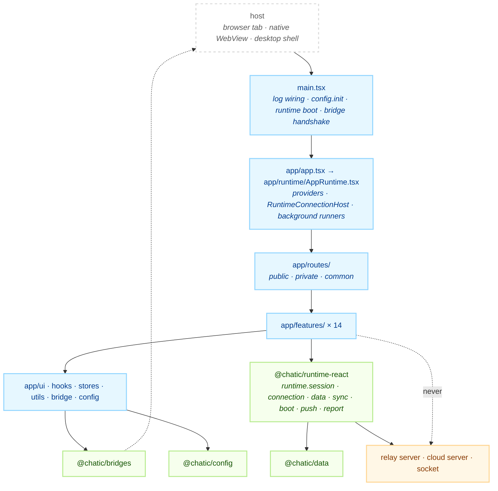
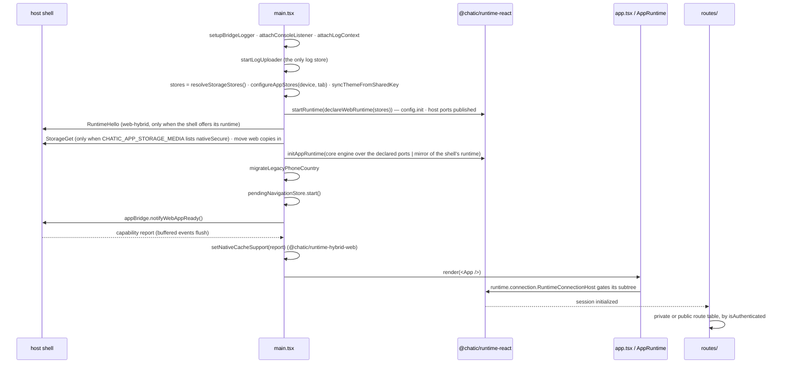

# @chatic/web

**The Chatic web client — the screens, the router, and nothing underneath them.** React + Vite, one
bundle that runs both as a plain browser app and as the WebView inside the native shell. It
assembles routes, pages, hooks and layout chrome on top of libraries that own everything stateful:
session, sockets, repositories, caches, settings, logging and the native bridge.

This document covers the **overview and structure** only. The per-layer detail is canonical under
[`docs/`](#documents).

## Purpose

The app owns screens. Everything a screen needs that outlives a render — a session, a socket, a
cache, a token, a setting, a log sink — belongs to a library, and the app reaches it through a hook
or a facade rather than constructing it.

The invariant is visible in the import list. Every `@chatic/*` the app names is a library whose
README is the contract for what it hands back:

```bash
grep -rhoE "@chatic/[a-z-]+" apps/web/src --include='*.ts' --include='*.tsx' | sort | uniq -c | sort -rn
```

There is no `api/` directory, no socket constructor, no token store and no cache adapter inside
`apps/web/src`. A new one appearing is the violation this section exists to name.

What the app does **not** own:

| Concern                                               | Owner                                                             |
| ----------------------------------------------------- | ----------------------------------------------------------------- |
| Session, auth, connection lifecycle, sync, push, boot | [`@chatic/runtime-react`](../../libs/runtime/README.md)           |
| Repositories, local cache, observe streams            | [`@chatic/data`](../../libs/data/README.md)                       |
| The native ↔ web message seam, and the logger facade | [`@chatic/bridges`](../../libs/bridges/README.md)                 |
| Settings, environment, feature flags                  | [`@chatic/config`](../../libs/config/README.md)                   |
| The logging hub, its listeners, its levels            | [`@chatic/logger`](../../libs/logger/README.md)                   |
| Web design-system components                          | [`@chatic/web-ui-kit`](../../libs/web-ui-kit/README.md)           |
| Cross-platform primitives, fallbacks                  | [`@chatic/shared`](../../libs/shared/README.md)                   |
| Stores                                                | [`@chatic/storage`](../../libs/storage/README.md)                 |
| Bridge message payload types                          | [`@chatic/bridge-messages`](../../libs/bridge-messages/README.md) |
| HTTP request building and signing                     | [`@chatic/http`](../../libs/http/README.md)                       |
| What the host injected at boot (the host profile)     | [`@chatic/bridges`](../../libs/bridges/README.md)                 |
| Policy copy (terms, privacy, licenses)                | [`@chatic/policy-content`](../../libs/policy-content/README.md)   |

`@chatic/http` and `@chatic/logger` reach the app indirectly: HTTP through `@chatic/runtime-react`,
the logger through the `logger` re-export in `@chatic/bridges`. The app imports neither package
directly, and it should stay that way — the command above says whether it has.

## Design principles

1. **The app holds no primitive.** Sessions, sockets, repositories, caches and tokens are obtained
   from `runtime.*` and used; they are never constructed, wrapped in a module-level singleton, or
   stored in app state. A `new WebSocket` or a hand-rolled token refresh in `apps/web` is a
   contract violation, not a shortcut.
2. **Selection state changes through a switch hook.** `cid` (cloud), `sid` (place) and `uid` are
   session state, and setting one is a multi-step operation — re-auth, socket rebind, cache
   repartition. Call `app/runtime/useSiteSwitch.ts` or the cloud switch under `features/home`, never
   a raw setter.
3. **`shared` imports no feature.** `ui/`, `hooks/`, `stores/`, `utils/`, `navigation/`, `bridge/`
   and `config/` contain zero imports from `features/`. That is what makes them safe to import from
   anywhere; the rule and the command that checks it are in [docs/README.md](./docs/README.md).
4. **Features do not import each other.** Two features that need the same thing promote it to
   `app/hooks/`, `app/ui/components/` or `app/utils/`. A `features/a → features/b` import is a
   refactor that was skipped.
5. **Routes are built, not typed.** Every absolute path comes from the `ROUTES` builder in
   `app/routes/paths.ts`. A literal `'/channels/' + id` in a `navigate()` call is a bug waiting for
   a route rename.
6. **The bridge has one door.** Native messages enter and leave through `app/bridge/` only. A
   feature never posts to the shell itself.
7. **`main.tsx` is ordered by contract.** Log listeners attach before anything can log, the stores
   are resolved before config reads them, and `startRuntime(declaration)` — config, then the host's
   ports, then the runtime boot — precedes every setting and session read. Each boundary in that file
   carries a comment naming what breaks if a line crosses it.
8. **Source comments and documents are English.**

## Scope

**In** — routes and route guards; pages and their components; feature-local hooks and state; layout
chrome (safe areas, keyboard insets, navigation bars); theme application to the document; i18n
resources; the app side of the native bridge; the debug overlay; boot wiring in `main.tsx`.

**Out** —

- Session, auth, connection lifecycle, background sync, push registration, boot —
  [`@chatic/runtime-react`](../../libs/runtime/README.md).
- Repositories, local caches, observe streams — [`@chatic/data`](../../libs/data/README.md).
- The native message transport and the logger facade —
  [`@chatic/bridges`](../../libs/bridges/README.md).
- Settings resolution and storage — [`@chatic/config`](../../libs/config/README.md).
- Reusable components and tokens — [`@chatic/web-ui-kit`](../../libs/web-ui-kit/README.md).
- The native shell itself — `apps/mobile`. The desktop shell — `apps/desktop-web`.

## Structure



The arrow the diagram draws only to forbid it is the dotted one: **no feature talks to a server.** A
screen that needs server data asks a repository, and the repository is reached through
`runtime.data`.

```bash
grep -rn "fetch(" apps/web/src/app/features --include='*.ts' --include='*.tsx' | grep -v '\.test\.'
```

The hits are react-query's own `refetch`, plus exactly one real `fetch`: `LicensesPage.tsx` reads
`/licenses.json`, a static file served from this bundle's own origin. A hit against a Chatic
endpoint is the violation.

Import direction _inside_ `app/` — which of those boxes may name which — is decided in
[docs/README.md](./docs/README.md) and not restated here.

### Boot



`runtime.connection.RuntimeConnectionHost` is the single session-init driver and it holds the
subtree until the session is ready. `Router` renders nothing while `isInitialized` is false — that
gate is why no screen ever sees a half-built session.

### Directories

```text
apps/web/src/
├── main.tsx            boot, ordered by contract (see principle 7)
├── config/             the runtime declarations main.tsx starts from, and their app adapters
├── styles.css          Tailwind entry
├── i18n/               locale loading and boot language resolution
├── assets/             app-local static files
├── types/              ambient declarations
└── app/
    ├── app.tsx         provider assembly only — no session logic
    ├── routes/         12 files: three route tables, the ROUTES builder, entry gates
    ├── runtime/        66 files: RuntimeConnectionHost wiring, background runners, log and perf-trace wiring, PUT senders
    ├── features/       617 files across 14 feature groups
    ├── hooks/          71 files: hooks shared by more than one feature
    ├── ui/             39 files: components/, layouts/, hooks/
    ├── utils/          30 files: pure helpers
    ├── navigation/     14 files: the history stack — entry rules, depth, and the back judgement
    ├── bridge/         23 files: the single native ↔ web seam
    ├── stores/         8 files: global client state and preference keys
    └── config/         the theme key's boot re-sync (themeSharedKeySync.ts)
```

Files you cannot guess from the name:

- `app/routes/paths.ts` — the `ROUTES` builder and `ROUTE_PARAMS`. Every absolute path in the app is
  here, grouped by page type rather than by feature.
- `app/routes/index.tsx` — the `Router` itself: it picks `privateRoutes` or `publicRoutes` from
  `runtime.session.useSessionAuth()` and blocks render until the session is initialized.
- `app/runtime/AppRuntime.tsx` — mounts `runtime.connection.RuntimeConnectionHost` and eight
  background runners inside it.
- `app/runtime/useSiteSwitch.ts` — the place (site) switch. The cloud switch lives under
  `features/home`.
- `config/` — the declaration part: the only code besides `main.tsx` that imports
  `@chatic/runtime-hybrid-web` or `@chatic/config` (everything under `app/` reads the runtime through
  `@chatic/runtime-react`). See [The runtime declarations](#the-runtime-declarations).
- `app/storage/` — the two stores this app's features keep their own state in: `deviceStore` (outlives
  the tab — drafts, recent emoji, the sent-invite log, the browser's log queue) and `tabStore` (dies
  with it — the pending invite channel, the crash sentinel, the debug unlock). `main.tsx` points them
  at what `resolveStorageStores()` (`@chatic/runtime-hybrid-web`) built; a zustand `persist` store names one through
  `persistStorageOver`. No feature names `localStorage`/`sessionStorage` itself — the root ESLint
  config refuses it, and refuses a `persist` without a `storage`.
- `app/bridge/appBridge.ts` — the outbound half of the seam; `GlobalBridgeListener.tsx` the inbound.
- `app/navigation/index.ts` — the whole of what the rest of the app may use from the history-stack
  module. Its header says what the module answers and what deliberately stays outside it; import
  from there rather than from a file inside. The files are split because only two of them may touch
  the router and a grep is what holds that line. Note `app/navigation/` is the app's own history
  stack; the push-tap seam is `app/bridge/navigation/`, a different thing with a similar name.

`docs/feature/` carries one folder per feature in `app/features/`, and the names match exactly — the
`diff` in [docs/README.md](./docs/README.md) is what enforces that. Code that has no feature folder
is documented by category instead: push-tap routing and device token registration are
[docs/bridge/](./docs/bridge/README.md), because their entry point is `app/bridge/navigation`.

### Vocabulary

| Term        | Meaning                                                                                                          |
| ----------- | ---------------------------------------------------------------------------------------------------------------- |
| **Cloud**   | One workspace. A user can belong to several. Carried as `cid`.                                                   |
| **Place**   | A subgroup inside a Cloud. The backend model is named `site`, so `place === site` and the session axis is `sid`. |
| **Channel** | A room inside a Place — 1:1, group, or self chat.                                                                |
| **Join**    | The relation between a user and a channel; carries `readNo`, the last-read `chatNo`.                             |

The app runs in one of two connection modes, read from
`runtime.session.useGlobalSession().activeServer.kind`:

- **`relay`** — no Cloud selected (or `cloudId === 'default'`). The client talks to the relay server
  with a relay session token. This is the fallback mode.
- **`cloud`** — a specific Cloud is active. The client talks to that Cloud's own backend with a
  cloud identity token, and re-authenticates when the Place changes.

Both switches, and every re-auth they imply, are performed by `@chatic/runtime-react`. The app calls
the switch hook and touches no token.

## Usage

Run it against the dev backend:

```bash
yarn web:start          # nx serve web --port 5003
```

Reading and writing data — repositories, obtained from the runtime:

```ts
import { runtime } from '@chatic/runtime-react';

const { join: joinRepository } = runtime.data.useRuntimeRepositories();
const uid = runtime.session.useGlobalSession().identity.userId;
```

`runtime.data.useRuntimeRepositories()` is the one door to `@chatic/data`. The invariant, not a
count, is what to keep true: **no repository is ever imported directly.** The second command below
must return nothing.

```bash
grep -rn "useRuntimeRepositories()" apps/web/src --include='*.tsx' --include='*.ts'
grep -rn "from '@chatic/\(data\|runtime\)'" apps/web/src --include='*.tsx' --include='*.ts' \
  | grep -v 'import type' | sed 's/type [A-Za-z]*Repository//g' | grep -i repository
```

The app takes `@chatic/data`'s domain names from `@chatic/runtime-react`, which re-exports them; that is not
itself a violation — most of it is `import type`, and a handful of pure helpers such as
`isInJoinWindow` come across as values. A **Repository** crossing that line is the violation, because
it would bypass the context the runtime binds to each call.

Navigating — always through the builder, imported by relative path (this app has no `@/` alias):

```tsx
import { useNavigate } from 'react-router-dom';

import { ROUTES } from '../routes/paths';

navigate(ROUTES.channels.room(channelId));
```

### Wiring

```text
main.tsx
├── setupBridgeLogger / attachConsoleListener / attachLogContext   (before anything logs)
├── startLogUploader                                               (owns the only log store)
├── resolveStorageStores() → configureAppStores                     (every store, chosen once)
├── syncThemeFromSharedKey(stores.webLocal)                          (before config reads the key)
├── startRuntime(declareWebRuntime(stores))                          (config/ — web-browser | web-hybrid)
│   ├── config.init(declaration.config)                              (before any lazy setting read)
│   ├── host ports published                                         (docs/bridge/host-ports.md)
│   ├── engine: web-browser → core; web-hybrid → engine.mirror settles who holds the session
│   │   ├── web    → storage.resolved loads the vault (only when the stores hold one) → core engine
│   │   ├── native → no port built, no vault: the mirror of the shell's runtime
│   │   └── null   → no engine
│   └── initAppRuntime(engine)                                       (before any session read)
├── migrateLegacyPhoneCountry(stores.webLocal)
├── owner null → sessionOwnerUnsettled screen, nothing below runs
├── a late vault reloads (tokens this run wrote to localStorage go first); native → sign-out drops the web token copy
├── bootSplash.armCap(10_000)                                      (docs/shell/boot-cover.md)
├── pendingNavigationStore.start()                                 (before the handshake)
├── appBridge.notifyWebAppReady() → setNativeCacheSupport (@chatic/runtime-hybrid-web)
└── render(<App />)
    └── app/app.tsx            HelmetProvider · I18nextProvider · QueryClientProvider · ThemeApplier
        ├── GlobalBridgeListener
        ├── AppUpdatePromptHost
        ├── app/runtime/AppRuntime.tsx
        │   └── runtime.connection.RuntimeConnectionHost   (gates until the session is ready)
        │       ├── background runners × 8
        │       └── app/routes                             (Router → public | private + common)
        └── DebugOverlayHost
```

### The runtime declarations

`main.tsx` boots from a declaration (`defineRuntime` / `startRuntime` from `@chatic/runtime-hybrid-web`, which sits on runtime-web — see
[runtime-web § The adapters](../../libs/runtime-web/README.md#the-adapters) and
[runtime-hybrid-web](../../libs/runtime-hybrid-web/README.md)) instead of wiring the
runtime by hand. There are two, in `src/config/`, and the entry picks one once:

**The rule** (`chooseWebRuntime`, `config/webRuntime.ts`): `web-hybrid` when the host profile found a
shell's bridge at boot — the phone app's WebView, or the virtual shell that plays it — and
`web-browser` when it found none. It is the same fact the page already told the two apart by: the
stores chose `localStorage` or the tab by it, and config wired the shell's lane by it.

| Slot                          | `web-browser` (a plain tab)                                     | `web-hybrid` (inside a shell)                                                                |
| ----------------------------- | --------------------------------------------------------------- | -------------------------------------------------------------------------------------------- |
| storage                       | `storage.resolved`                                              | `storage.resolved`                                                                           |
| transport · auth · foreground | `transport.browser` · `auth.location` · `foreground.visibility` | the same                                                                                     |
| db                            | `db.web-local`                                                  | `db.web-local`                                                                               |
| engine                        | `engine.core`                                                   | `engine.mirror` (`VITE_SESSION_MIRROR_DISABLED` stops it asking, unless the session is held) |
| checkout                      | `checkout.host`                                                 | `checkout.host`; may switch to `.store`, `.web`, `.none`                                     |
| the other seven host ports    | `<port>.host`                                                   | `<port>.host`; may switch to `<port>.shell`, `<port>.browser`                                |
| config                        | no shell lane                                                   | the shell's lane (`shellKvAdapter.ts`)                                                       |

Every runtime port has one adapter and no alternatives, so a `port.*` toggle cannot move it: each is
fixed to what the entry built before declarations. Only the host ports of `web-hybrid` may be switched,
and a `.shell` adapter only where the shell declared that it does the work.

Two adapters are this app's own (`config/adapters/`), because the library's do not reproduce the boot:

- **`storage.resolved`** hands out the stores `resolveStorageStores()` chose in `main.tsx` — the very
  objects the features and config were handed. Where site data is blocked those stores are page
  memory, and a second set would hide the session from config's session lane and the cache's tab rows.
  It loads the device vault (`prepareSecretStorage`) on a launch the page owns, never on one the shell
  owns, and watches a vault that could not be read at launch so the page starts over once it can be. The
  library's `storage.vault` reads neither the late-vault mark nor what loading the vault answered.
- **`db.web-local`** is `webLocalCachePorts` over that same raw tab store, as the page built it before
  declarations.

`engine.mirror` takes the app's own settle (`config/adapters/engine.ts`), which records who holds the
session for the log context the moment it is settled, so the boot's own lines carry it. Checkout's store
purchase is `@chatic/host-web-mobile-shell`'s `mobileShellStoreCheckout`, handed `webClient`; the website
hand-off stays in `config/adapters/checkout/`. The other host ports are declared the same way, from
`@chatic/host-web-mobile-shell` and `@chatic/host-web-browser` ([host ports](./docs/bridge/host-ports.md)).

What stays in `main.tsx`, as app policy around the start: the unsettled screen and the session-owner
default sent to the shell, the page's own signed-out keys on a launch the shell owns, the late-vault
reload after the handshake, and everything from the logout callbacks to the render.

`config/viteEnv.ts` is the only file under `config/` that reads `import.meta.env`; the declarations'
specs replace it and load everything else as it is. `config/diagnosticsKind.ts` is here too: the log
pipeline reads it before `startRuntime` has published the ports, and whether they are published yet is
the declaration's to know.

## Scenarios

### 1. Add a screen to an existing feature

Add the page under `app/features/<group>/pages/`, add its path to `ROUTES` in
`app/routes/paths.ts`, then register it. Seven feature groups export their own
`features/<group>/routes/index.tsx` for the three tables in `app/routes/` to compose; the rest are
listed directly in `PrivateRoutes.tsx`, `PublicRoutes.tsx` or `CommonRoutes.tsx`. Follow whichever
the neighbouring pages in that group already use. Nothing in `app/ui/` or `app/hooks/` may import
the new page. Then update the feature's `docs/feature/<group>/README.md`.

### 2. Read server data on a screen

Call the repository hook from `runtime.data` and render what it observes. Do not fetch, do not
cache in component state, and do not reach for `@chatic/data` internals — the facade on
`runtime.data` is the supported surface. Refresh, sync and delta reconciliation are
[docs/state/data-flow.md](./docs/state/data-flow.md).

### 3. Switch cloud or place

Call the switch hook — `app/runtime/useSiteSwitch.ts` for a Place, the cloud switch under
`features/home` for a Cloud — and render the result. Re-auth, socket rebind and cache repartition
all happen inside `@chatic/runtime-react`. Writing `sid` or `cid` directly leaves the socket bound to
the old partition.

### 4. React to something the native shell does

Inbound messages land in `app/bridge/GlobalBridgeListener.tsx` and the handlers under
`app/bridge/`; outbound calls go through `app/bridge/appBridge.ts`. A push tap that arrives during
cold start is buffered by `pendingNavigationStore`, which `main.tsx` starts _before_ the
`WebAppReady` handshake so the shell's flush is never dropped.

### 5. Read or change a setting

Settings live in `@chatic/config`, initialised once by `startRuntime` from the declaration's
`config` (`createWebConfigPorts(stores)`, `config/configPorts.ts`). Read through `runtime.settings`;
never through `import.meta.env` inside a feature.
The theme is a setting (`ui.theme`) that `app/runtime/ThemeApplier.tsx` mirrors onto `<html>`.

### 6. Diagnose an error a user hit

`app.tsx` installs the global handlers — `window.onerror`, `unhandledrejection`, capture-phase
resource-load failures, CSP violations — and every one of them writes through `logger` from
`@chatic/bridges`. The entries reach the upload queue started in `main.tsx`. The in-app view is the
debug overlay (`DebugOverlayHost`), documented under [docs/observability/](./docs/observability/README.md).

## Documents

The detail lives under [`docs/`](./docs/README.md). `docs/README.md` is the layering contract — where
a new file goes, and which direction an import may point — and the index of everything below it.

| Folder                                                | What it covers                                                                                                                                |
| ----------------------------------------------------- | --------------------------------------------------------------------------------------------------------------------------------------------- |
| [docs/feature/](./docs/feature/)                      | One folder per feature in `app/features/`, names matching exactly — a README each, plus a topic file per screen or flow that reads on its own |
| [docs/shell/](./docs/shell/README.md)                 | The frame every screen is drawn into — layout chrome, the route tables, and theme                                                             |
| [docs/state/](./docs/state/README.md)                 | How data reaches a screen — the zustand stores, preference plumbing, observe/refresh/sync                                                     |
| [docs/bridge/](./docs/bridge/README.md)               | The single seam to the native shell — `appBridge`, push-tap routing, device token registration                                                |
| [docs/observability/](./docs/observability/README.md) | The logger hub and the upload queue, and the debug panel's side of the bridge                                                                 |

## How to verify

```bash
npx tsc -b apps/web/tsconfig.json                                    # app AND specs
yarn web:test                                                        # jest, --runInBand
npx nx run web:lint
yarn web:e2e                                                         # in a browser, inside a fake native shell
```

`yarn web:e2e` runs `apps/web-e2e` — this app in its native mode against a scripted shell and relay;
see [its README](../web-e2e/README.md) for what it can and cannot catch. CI runs it whenever this app
changes.

Build and deploy:

```bash
yarn web:build:dev      # nx build --configuration=dev web   (apps/web/.env.dev, .env, then the root .env.dev)
yarn web:build:prod     # nx build --configuration=prod web  (apps/web/.env.prod, .env, then the root .env.prod)
yarn web:deploy:dev
yarn web:deploy:prod
```

Then the traps:

- Type checking must be `tsc -b`. `tsc --noEmit` inside an Nx project checks zero files and
  succeeds, so passing it proves nothing. `apps/web/tsconfig.json` references `tsconfig.app.json`
  and `tsconfig.spec.json`, which is why the one command covers source and specs.
- Jest does not type check — the base sets `isolatedModules`, so ts-jest transpiles. A broken
  fixture surfaces as `… is not a function` at runtime unless the spec project is checked.
- A spec that imports a barrel pulls the whole barrel. Import the concrete module when the barrel
  drags in more than the spec needs. Jest compiles `import.meta` (ADR-0371), so that alone no longer
  breaks a spec.
- A spec fails when the code under test navigates the page or plays media: jsdom cannot, and the shared
  environment turns its "not implemented" into a failure. Pass a stub through a parameter or prop.
- A stale `dist`/`out-tsc` produces phantom errors after a directory moves. `rm -rf` and look again.
- `.github/workflows/verify.yml` runs `typecheck` for `web` but **excludes `web` from the test
  step**, with the count of failures recorded in its own trailing comment. Web tests are the ones to
  run by hand before merging.
- Changing a shared library is a wider change than it looks: `web` is the heaviest consumer of
  `@chatic/runtime-react` and `@chatic/data`. Type check this app after touching either.
