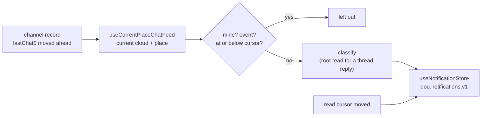

# notifications — the inbox this device derives from the rooms it watches

`apps/web/src/app/features/notifications` owns the notification inbox's data: what gets into it, how
it is stored, when an item reads as read, and the reads a screen composes it from. It owns no screen
yet — the inbox screen, the bottom-navigation dot and the home row marks are built on what is
described here. Why it is derived on the device, and apart from desktop's inbox, is ADR-0312.

The store and the pure reads over it live app-wide — `app/stores/useNotificationStore` and
`app/utils/notifications` (the item model, the mark/remove/undo operations, thread participation and
the selectors) — because home and the room read them as well, and a feature may not import another.
What fills the inbox and keeps it read stays here: the room feed, the capture, the classification and
the read sync.

There is no notification list on the server. The inbox is **derived on the device**, from the same
channel records that drive the unread badges, and kept in device storage. What follows from that —
it starts empty on a new device, and it holds only what this device saw — is in § Limits.

## Responsibilities

| Question                                                     | Answered by                                                                    |
| ------------------------------------------------------------ | ------------------------------------------------------------------------------ |
| Which rooms are watched, and how a new message is noticed    | `hooks/useCurrentPlaceChatFeed`                                                |
| Whether a message becomes an item, and of which kind         | `hooks/useNotificationCapture`, `utils/classify`                               |
| What is stored, the cap, and the mark/remove/undo operations | `app/stores/useNotificationStore`, `app/utils/notifications/notificationItems` |
| When a room's items turn read on their own                   | `hooks/useNotificationReadSync`                                                |
| Which items a tab, a filter, a day or a room row shows       | `app/utils/notifications/selectors`                                            |

`NotificationsRunner` mounts the two background hooks once, under `AppRuntime` and inside the shared
active-cloud observation, so the inbox fills and clears on every route.

## The model

One item is one message — or, for a reaction, one person's emoji on one message. Each item is a
snapshot taken when it was captured (`NotificationItem`): the source row pages out of the chat cache
long before the inbox forgets the item, so the item keeps its room's name, its author's name, a
one-line preview and, where it has one, a one-line quote of the message it answers.

An item names its cloud. Every cloud numbers its places and channels from the same start, so a place
or channel id alone names one in every other cloud too; every read and every mark checks the cloud
first.

### Kinds, strongest first

A message is filed under the strongest reason it has, and only that one:

| Kind                 | When                                                                    |
| -------------------- | ----------------------------------------------------------------------- |
| `mention`            | a top-level message calls me out — by id, or "everyone"                 |
| `threadMention`      | a thread reply calls me out                                             |
| `replyToMine`        | someone replied in a thread whose root is my message                    |
| `participatedThread` | someone replied in a thread I replied in before, whose root is not mine |
| `dmMessage`          | a new message in a 1:1 that none of the above covers                    |
| `reaction`           | someone reacted to my message — filed on its own, it is not a message   |

The order matters in two places. A 1:1 message that calls me out is a `mention`, not a `dmMessage`:
the plain 1:1 kind is what is left over. And a reply in a thread is split by who wrote the root —
`replyToMine` and `participatedThread` say different things to the reader, so they are two kinds,
not one "reply".

Whether a message calls me out is read from its mention record (`isMentioningViewer` in
`@chatic/data`), the same rule the home row's `@me` mark and the room's highlight use — never from
the text.

## Capture

**What is watched.** The rooms of the current cloud's current place, from the app's one shared
channel observation. Message content streams only for the room on screen, so any other room is seen
through its channel record: the record's `lastChat$` moving ahead means a message arrived, and that
newest message is what capture looks at. Each room in scope has its channel sync registered while it
is in scope — the same registration home's rows make, merged by the sync engine — so the record stays
live on every route. The first record seen for a room is a baseline, not news.

**What is left out.** My own messages (by any id I am known by in that room — account, cloud user,
member), join and leave events and edit notices, anything at or below the room's read cursor, and in
a room whose notifications are off or down to mentions, everything but mentions. The level is read
through the rooms' own `notifyLevelOf`, so the inbox and the room settings agree about it.

**Thread replies.** A reply that does not call me out needs to know whose thread it is. A device-local
record of the threads I take part in (`useThreadParticipationStore`, `dou.notifications.threads.v1`)
answers for threads already known; it learns a thread from a reply of mine, and from reading a root.
Otherwise the root is read — this device's cache first, the server after — once per thread: a thread
found to be someone else's is remembered for the session, until a reply of mine lands in it.

**Reactions.** The reaction event carries only its target's id, so the target is read from this
device's cache — never from the server. A target the cache does not hold is left out rather than
costing a request per reaction. A reaction taken back adds nothing.

## Storage

One zustand store persisted to device storage under `dou.notifications.v1` — one key for every
cloud, since each item names its own.

- **Cap 500, no retention period.** Over the cap, read items go first, oldest first; only when every
  item left is unread does the oldest unread one go.
- **Operations:** `add` (an id already held is ignored, so a resync never brings an item back as
  new), `markRead` and `remove` (each returns what it changed, for an undo), `markUnread` and
  `restore` (the undos), `markChannelReadUpTo`, `markThreadRead`.
- **Writes only on a change.** `persist` rewrites device storage on every `set`, so every action
  checks its result before setting.
- **Cleared at sign-out**, with the thread record, through the session's logout callbacks
  (`clearNotifications`, registered in `main.tsx`). The next account on the device never opens onto
  the last one's inbox.

## Read

- **The room's read cursor.** When a room's cursor moves ahead — read here, or on another device
  through the synced cursor — its top-level items up to the cursor turn read
  (`useNotificationReadSync` → `markChannelReadUpTo`). The cursor is the one the unread badges count
  from. Only a move ahead is applied, once, so an item an undo turned back to unread stays unread
  until the reader reads further.
- **A thread's items** are not touched by the room's cursor: a thread is read on its own screen, and
  `markThreadRead` is the operation for that. The thread screen does not call it yet, so until it
  does, a thread item turns read only when it is opened or marked from the inbox.
- **Opening an item** from the inbox marks it read (`markRead`) — the screen's job.

A message in the room on screen is usually captured before the reader's cursor passes it, and then
turns read as the cursor moves. When the cursor lands first, the message is left out as already read.

## Selectors

Pure functions over a list of items (`app/utils/notifications/selectors`); a screen scopes first and composes the rest.

- `inScope(items, cloudId, placeId)` — the cloud, then the place; an item with no place (a relay 1:1)
  shows in every place of its cloud.
- `byTab(items, tab)` — `all | group | dm | thread | mention`. `group`/`dm` split by the room,
  `thread`/`mention` by the kind, so a 1:1 mention is in both `dm` and `mention`.
- `unreadCounts(items)`, `unreadOnly(items, on)`, `hasUnreadInScope(items)`.
- `groupByDay(items, now)` — local calendar days, newest first, `today` / `yesterday` / `date`; the
  screen formats a `date` from `dayStart`.
- `findMe(items)` — unread `mention`, `threadMention` and `replyToMine`, newest first.
- `channelBadges(items, channelId)` — one room's unread mention and thread counts.

## Limits

- **A background room is seen by its newest message only.** A burst that lands between two record
  updates collapses to its last message; the ones before it are not captured.
- **Nothing is captured while the app is closed.** The first record seen after a launch is the
  baseline, so what arrived meanwhile is in the rooms' unread counts, not in the inbox.
- **Per device.** Another device of the same account has its own inbox, built from what it saw.
- **The current place only.** Rooms of other places and other clouds are not watched; switching
  place starts watching that place's rooms.
- **Thread membership is what this device saw.** A thread counts as one I joined once this device
  has seen a reply of mine in it as a room's newest message — sent from any device. A reply of mine
  that was never a room's newest message while the app was open leaves its thread unknown, and the
  replies in it are not captured unless they call me out or the root is mine.
