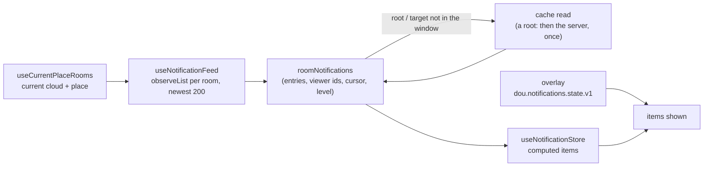

# notifications — the inbox this device works out from its cached rooms

`apps/web/src/app/features/notifications` owns the notification inbox: what is in it, what the reader
did to it, when an item reads as read, and the two screens that show it — the notifications tab
(`/notifications`) and the find-me sheet over home. The bottom-navigation dot and home's room marks
read the same store. Why it is worked out on the device, and apart from desktop's inbox, is ADR-0312;
why it is read from the chat cache rather than captured as snapshots is ADR-0321.

The store and the pure reads over it live app-wide — `app/stores/useNotificationStore` and
`app/utils/notifications` (the item model, the overlay and its mark/remove/undo operations, the
selectors) — because home and the room read them as well, and a feature may not import another. What
works the items out stays here: the rooms in scope, the room feed and the per-room computation.

There is no notification list on the server. The inbox is **worked out on the device**, from the rows
this device has cached for the current place's rooms. Nothing about an item is stored except what the
reader did to it. What follows from that — it holds only what this device has cached, within a window —
is in § Limits.

## Responsibilities

| Question                                               | Answered by                                                                      |
| ------------------------------------------------------ | -------------------------------------------------------------------------------- |
| Which rooms are read                                   | `hooks/useCurrentPlaceRooms`                                                     |
| Which rows of a room are read, and when again          | `hooks/useNotificationFeed`                                                      |
| Which rows become items, of which kind, read or not    | `utils/roomNotifications`, `utils/classify`, `chatNotificationEntries` (data)    |
| What the reader did to items, and the mark/remove/undo | `app/stores/useNotificationStore`, `app/utils/notifications/notificationOverlay` |
| Which items a tab, a filter, a day or a room row shows | `app/utils/notifications/selectors`                                              |

`NotificationsRunner` mounts the feed once, under `AppRuntime` and inside the shared active-cloud
observation, so the inbox follows the cache on every route.

## The model

One item is one message — or, for a reaction, one person's emoji on one message (`NotificationItem`).
An item is worked out from a cached row each time its room is read and is never stored, so an edit
changes it, a delete removes it, and a mention edited away takes its item with it. It carries its
room's name, its author's name, a one-line preview and, where it has one, a one-line quote of the
message it answers — all as the cache has them now.

An item names its cloud. Every cloud numbers its places and channels from the same start, so a place
or channel id alone names one in every other cloud too; every read and every mark checks the cloud
first.

### Kinds, strongest first

A message is filed under the strongest reason it has, and only that one:

| Kind                 | When                                                                    |
| -------------------- | ----------------------------------------------------------------------- |
| `mention`            | a top-level message calls me out — by id, or "everyone"                 |
| `threadMention`      | a thread reply calls me out                                             |
| `replyToMine`        | someone replied in a thread whose root is my message                    |
| `participatedThread` | someone replied in a thread I replied in before, whose root is not mine |
| `dmMessage`          | a new message in a 1:1 that none of the above covers                    |
| `reaction`           | someone reacted to my message — filed on its own, it is not a message   |

The order matters in two places. A 1:1 message that calls me out is a `mention`, not a `dmMessage`:
the plain 1:1 kind is what is left over. And a reply in a thread is split by who wrote the root —
`replyToMine` and `participatedThread` say different things to the reader, so they are two kinds,
not one "reply".

Whether a message calls me out is read from its mention record (`isMentioningViewer` in
`@chatic/data`), the same rule the home row's `@me` mark uses — never from the text. (The room's
highlight falls back to the text for a row with no record; the inbox does not.)

## Working the items out

**What is read.** The rooms of the current cloud's current place, from the app's one shared channel
observation; the reader's notes room is left out. Each room's channel sync is registered while it is
in scope, so its record — cursor, level, head — stays live on every route. The rows themselves reach
the cache through the app-wide chat sync and its catch-up (`ChatSyncRunner`, see
[home/last-chat.md](../home/last-chat.md)); this feature only reads them.

**When.** Each room's newest **200** rows are observed through the room's own list key
(`chat.observeList`), so a write to one room re-reads that room only. The query asks for unsent rows
too (`includeUnsent`), which the judge drops, only so its key never equals the open room's window:
observers on one key share a group, and the room's window joining this one as it grew to the same
limit stopped its paging. A room is worked out again when
its rows change and when what they are judged against changes — the reader's ids, the room's read
cursor, its notification level, its name. A run whose inputs are the same as the last one's is
skipped. Rows sent more than **14 days** ago (`NOTIFICATION_RETENTION_MS`) are past the window and
file nothing; the store also leaves out items that crossed the line since their room was last worked
out, so a quiet room does not keep showing items the overlay can no longer hold marks for.

**The rows' facts.** `chatNotificationEntries` in `@chatic/data` reads what a row can tell an inbox
with no reader in mind — whom it names, whether it calls everyone, which thread it replies in, which
message a reaction event targets — and `isNotifiableMessage` decides whether a row is a settled
message at all. The reader is applied afterwards, so the same entries can later be stored beside the
rows and read back through an index (ADR-0321).

**What is left out.** My own rows (by any id I am known by in that room — account, cloud user,
member), anything that is not a settled message or reaction event (unsent, failed, deleted, edit
notices, other system rows), and in a room whose notifications are off or down to mentions,
everything but mentions. The level is read through the rooms' own `notifyLevelOf`, so the inbox and
the room settings agree about it.

**Thread replies.** A reply that does not call me out needs to know whose thread it is. A reply of
mine in the window makes its thread one I take part in; the root is taken from the window, or read —
this device's cache first, the server after — once per thread per session, at most three at a time
(the first run after a launch reads every room of the place at once). While the root is being read,
the reply is filed as far as the window tells, and filed again when the root arrives. A root that
cannot be read is not asked for again.

**Reactions.** Reaction events are folded per target, emoji and person; the newest event decides, so
a reaction taken back leaves nothing and one given again comes back — as new, even when the earlier
one was deleted or marked read, because an overlay entry remembers the event it was made for. Only a
reaction to my own message is kept. A target outside the window is read from this device's cache — never from the
server — and a target the cache does not hold is left out.

## The overlay

Only what the reader did is kept, per device, in one zustand store persisted under
`dou.notifications.state.v1` (one key for every cloud; each entry's id names its cloud):

| What                    | Kept as                              | Effect                                             |
| ----------------------- | ------------------------------------ | -------------------------------------------------- |
| marked read by hand     | `entries[id] = { state: 'read' }`    | the item reads as read                             |
| deleted                 | `entries[id] = { state: 'deleted' }` | the item is not shown, however often it comes back |
| a thread read on screen | `threads[threadKey] = { no }`        | the thread's items up to `no` read as read         |
| when the overlay began  | `baselineAt`                         | thread items sent before it read as read           |

- **Operations:** `markRead` and `remove` (each returns what it changed, for an undo), `markUnread`
  and `restore` (the undos — a deleted item that had been marked read comes back read), and
  `markThreadRead`. The feed calls `setRoomItems` and `retainRooms`.
- **Pruned by sent time only.** An entry goes once its item's sent time is past the 14-day window —
  never because its row left the cache, so a row cleared and fetched again stays deleted.
- **Writes only on a change.** `persist` rewrites device storage on every `set`, so every action
  checks its result before setting; a room that comes back the same writes nothing.
- **The baseline.** A room's cursor never reads a thread item, so without a starting point every thread
  reply already in the cache would light up as new the first time the inbox reads it. The overlay is
  started with `baselineAt` = now the first time this inbox runs on the device (no stored overlay) and
  again at every sign-out; thread items sent before it read as read. What this device could not have
  seen is not news — the same rule the old capture had by never looking back past its first record.
- **An entry belongs to an event.** Marks and deletions carry the item's chat number. A reaction keeps
  its id however often it is taken back and given again, so an entry made for an earlier event of it
  does not apply to the reaction given again.
- **Cleared at sign-out** through the session's logout callbacks (`clearNotifications`, registered in
  `main.tsx`). The next account on the device never opens onto the last one's overlay, and starts
  its own baseline.
- **Retired keys.** `dou.notifications.v1` (the snapshot inbox) and `dou.notifications.threads.v1`
  (its thread record) are removed once by `NotificationsRunner`; nothing in them is carried over. A
  top-level item's read state comes from the room cursor and a thread item's from the baseline, and
  the old inbox kept no record of deletions.
- **Not yet.** ADR-0321 also names an `archived` state with an archive view, and an explicit `unread`
  mark. Nothing sets them yet, so the overlay does not hold them.

## Read

- **The room's read cursor.** A top-level item at or below its room's cursor reads as read — read
  here, or on another device through the synced cursor. The cursor is the one the unread badges count
  from (my join row or the channel's embedded copy, whichever is further along).
- **A thread's items** are not touched by the room's cursor: a thread is read on its own screen. The
  thread screen (`ThreadPage`) calls `markThreadRead` for its thread while it is open — on opening,
  and again whenever a new unread item for that thread arrives. A reply that comes later carries a
  higher number and reads as unread. A thread item the reader has since replied after, in the same
  thread, reads as read too — they were there — and so does one sent before the overlay's baseline.
- **The room's mention pills** (`useRoomJumpPills` in features/channels) take the room's unread
  mentions when it is entered. On a cold launch straight into a room the inbox has not worked the room
  out yet (`computedRooms`), and entering moves the cursor, so the pills wait for the room's first run
  and count the top-level mentions above the cursor the room was entered at.
- **Opening an item** from the inbox marks it read (`markRead`) — the screen's job.

## Selectors

Pure functions over a list of items (`app/utils/notifications/selectors`); a screen scopes first and composes the rest.

- `inScope(items, cloudId, placeId)` — the cloud, then the place; an item with no place (a relay 1:1)
  shows in every place of its cloud.
- `byTab(items, tab)` — `all | group | dm | thread | mention`. `group`/`dm` split by the room,
  `thread`/`mention` by the kind, so a 1:1 mention is in both `dm` and `mention`.
- `unreadCounts(items)`, `unreadOnly(items, on)`, `hasUnreadInScope(items)`.
- `groupByDay(items, now)` — local calendar days, newest first, `today` / `yesterday` / `date`; the
  screen formats a `date` from `dayStart`.
- `findMe(items)` — unread `mention`, `threadMention`, `replyToMine` and `reaction`, newest first.
- `channelBadges(items, channelId)` — one room's unread mention and thread counts.

## Screens

**The notifications tab** (`pages/NotificationsPage`, route `ROUTES.notifications`, the bottom nav's
middle tab). Everything in scope (`useScopedNotifications` — the session's cloud and place), read or
not:

- five tabs (`SegmentedTabs`, inline) with their unread counts, a zero hidden;
- "Unread only" (`FilterChip`) and "Mark all read", which covers the current tab only;
- the items by day, newest first, each one the kit's `NotificationRow` through `NotificationListItem`.
  The row's chip, location, context, quote and body come from `utils/rowParts` (pure, tested). A
  reaction's row is drawn as the design has it: the emoji in the context ("내 메시지에 반응 ❤️"), my
  message reacted to as the body, and no quote line — the emoji if that message is not cached;
- a tap reads the item and goes to its message (`?chatNo=` on the room or the thread; a reaction goes
  to the message reacted to);
- **selection mode** — from "Select" or a long press, which starts with that row picked; "Cancel"
  leaves it, and the action bar is drawn over the nav. The rules are the sheet's too (§ Selection
  mode);
- three empty states — nothing at all (no filter row, no "Select"), an empty tab (named), and nothing
  unread under "Unread only" (with "Show all notifications");
- **the title steps down once the list scrolls** — "Notifications" goes from 28px to 20px (eased,
  none under reduced motion) and back at the top, so the header reads as a bar rather than a heading
  over the rows. Only the type changes: the header keeps its height. A header that shrank would hand
  its height to the list, and a list only just long enough to scroll would then fit, snap back to the
  top and grow the header again, round and round. The tabs and the header stay fixed above the list,
  and the tabs' underline is the divider, so nothing else changes with the scroll;
- **coming back lands where the reader left.** Opening an item navigates away and unmounts the page,
  so the tab and "Unread only" live outside it, in memory (`stores/useNotificationsViewStore`), and the
  list's offset is kept by the app's `useScrollRestoration`. The two go together: an offset restored
  onto a different list would land somewhere meaningless. Hence three rules:
    - **Only a return restores.** The page reads how it was reached (`useNavigationType`): a back
      press is `POP` and lands on the tab, filter and offset that were left. Any other way in — the
      bottom nav's bell replaces rather than pops — starts on "All", filter off, at the top: the
      bell's dot says something new arrived, and new items sort to the top. Home restores on every
      entry; the inbox deliberately does not.
    - **The offset is kept per place** (`notifications:<cloud>:<place>`), since each place lists other
      items. The tab and filter are one setting for the whole inbox.
    - **Changing the filter drops an offset still waiting for rows** — a return onto "nothing unread"
      followed by "Show all" opens the full list at the top, not at a point the reader never saw.

    Memory only — a relaunch starts fresh. Selection mode is not kept; a return always browses.

**The find-me sheet** (`components/FindMeSheet`) — what is looking for the reader now: `findMe` of the
scope (unread mentions, thread mentions, replies to my messages and reactions to them), titled
"나를 찾는 알림", narrowed by All / Mentions / Threads chips with counts, "Select", the close (X),
and a tap that closes the sheet and opens the message. It always opens at its full height — the
design's, its top just under home's header — and the list scrolls inside, so a filter change, an
item read or selection mode never resizes it. A reaction has no chip of its own, so it
shows, and counts, under "All" only; "Threads" is replies to my messages. Reactions joined the
sheet with the 2026-11 design: being reacted to is someone answering me too, while a new 1:1
message (the room list's badge already says it) and a reply in a thread I only joined stay in the
tab.
Reading an item anywhere takes it off the sheet; it stays in the tab. Home's row raises it through
`app/stores/useFindMeSheetRequest`, and the private shell mounts `FindMeSheetHost` to answer, since
home may not import this feature. In selection mode the title becomes the count, the filter row gives
way to "Select all", the footnote to the action bar (laid out in the sheet's footer), and the close
(X) is the way out — closing the sheet ends the mode, and a sheet opened again starts browsing. The
sheet drew "Mark all read" before it had a selection mode; "Select" took its place, as the design has
it, and "Select all" then "Mark as read" does the same job.

### Selection mode

The tab and the sheet share one set of rules (`useNotificationSelection`, `SelectionActionBar`):

- **One quick pick, "Select all".** It picks every visible item — the tab and filter in force — and,
  pressed again while that is exactly the selection, clears it. Rows toggle one by one. There is no
  "unread" or "read" pick: what is picked is told apart by the bar instead.
- **"Mark as read n" counts the unread among the picks**, and applies to those only. With only read
  items picked it is off and drops its number; with nothing picked both buttons are off and
  numberless. "Delete n" counts every pick.
- **Marking read keeps the mode and the picks**, so the same items can be deleted next; "mark as
  read" turns off, "delete" stays. A list that drops read items — the sheet, or the tab under
  "Unread only" — would take them away at that moment, so they are held (`withHeld`) and stay listed
  until the mode closes. A held item that is deleted, or leaves the scope, is gone all the same.
- **Deleting closes the mode**, after a confirm. Deleting takes items off the inbox only; the messages
  stay.
- Both show a 3-second toast whose "Undo" puts back exactly what changed (`useNotificationActions`).
  "Undo" on a mark-read while still selecting turns the held items unread again, still picked.

**Haptics and motion.** A selection tick for every toggle and switch (tabs, filter chips and
"Select all", a row picked or unpicked, entering or leaving selection mode from the header); a firmer impact
as a long press commits to selection mode; a warning as the delete confirm opens; success once a mark
read or a delete has gone through, and a tick for "Undo". Opening an item plays nothing — the page
change is the feedback. Motion comes from the kit parts (the underline growing under a tab, the check
column sliding in, the action bar rising where the nav was, a row's ground easing between unread,
read and picked) plus fades as the header and the chip rows swap with selection mode; every one of
them is off under `prefers-reduced-motion`.

**Avatars.** An item keeps its author's id and name, not a photo — the cached row has none. The
photo is the author's place profile, read for the whole list by `hooks/useNotificationAvatars`
through the app-wide `useSenderProfiles` that search uses for its authors: the profile cache first,
one fetch per author it does not hold, one subscription per place, and no poll, since the inbox
covers rooms the reader has not opened and a profile sync per author would keep running for them.
The find-me sheet reads only while it is open. An item with no place (a relay 1:1), an author with
no profile in that place, or a profile with no photo draws the default person glyph.

## Limits

- **What this device has cached, within the window.** The inbox holds what the cache holds for the
  current place's rooms: a room's newest 200 rows, sent in the last 14 days. A room that gained more
  while the reader was away than the chat catch-up pulled (see home/last-chat.md) keeps a hole, and
  nothing in it is filed until the room is opened and scrolled.
- **Per device.** Another device of the same account has its own overlay. Read state follows the
  synced room cursor for top-level items, so it agrees across devices; a thread read on its screen, a
  mark by hand and a deletion are per device.
- **The current place only.** Rooms of other places and other clouds are not read; switching place
  reads that place's rooms.
- **Thread membership is what the window shows.** A thread counts as one I joined when a reply of
  mine in it is among the room's cached rows in the window. Replies in an older thread I joined are
  filed only when they call me out or the root is mine.
- **No index yet.** Every room is judged in memory from its rows (ADR-0321 decision 8). The index
  that stores the entries beside the rows (decisions 4 and 7) is a later change.
