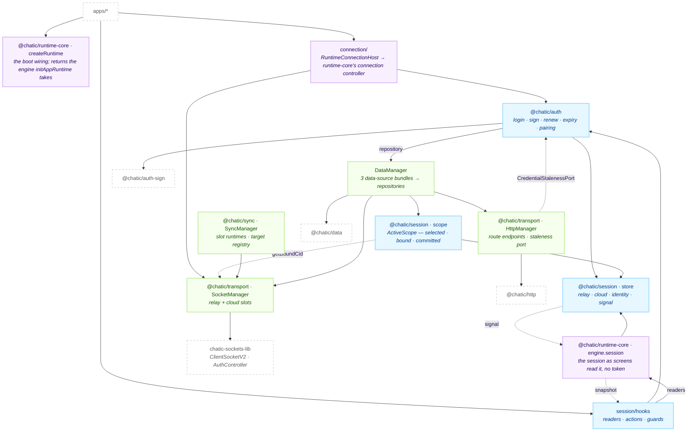
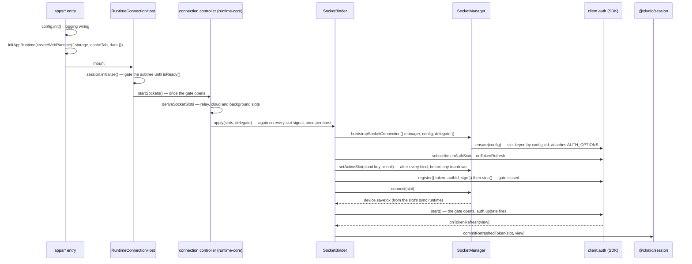

# @chatic/app-runtime

**The runtime an app mounts.** It owns the session — tokens, the selected cloud and site, identity —
and derives everything downstream from it: two WebSocket slots and their authentication, the HTTP
client and the credential that signs it, the repository graph and its cache scope, the sync runtimes
that keep those caches current, device-token registration, and the user issue report. It exports one
name, `runtime`, holding seven groups.

This document covers the **overview and structure** only. The per-layer detail is canonical under
[`docs/`](#documents).

## Purpose

Apps see the `@chatic/app-runtime` barrel and nothing else, and inside that barrel there is one
identifier. Imports that reach past it into internal paths number **zero**, which is what lets the
inside be rearranged with no blast radius.

```bash
grep -rn "@chatic/app-runtime/" --include='*.ts' --include='*.tsx' apps libs | grep -v node_modules
```

Four apps consume it and nothing else does — `apps/web`, `apps/desktop-web`, `apps/admin`,
and `apps/landing`'s account surface (sign-in and the subscription repository only). The surface itself is locked symbol by symbol by
[`src/public-surface.test.ts`](./src/public-surface.test.ts): 81 value exports across the seven
groups, and a test that fails if an eighth group appears or a symbol moves between them.

This lib is the **composition root, not an engine**. It builds and wires; the engines it assembles
live elsewhere and do not leak to apps: the socket and HTTP managers
([`libs/transport`](../transport/README.md)), the socket transport and its auth controller
(`@lemoncloud/chatic-sockets-lib`), the data layer ([`libs/data`](../data/README.md)), the HTTP
executor ([`libs/http`](../http/README.md)), the storage adapters ([`libs/db`](../db/README.md)),
the HMAC signer (`libs/auth-sign`) and the logging core ([`libs/logger`](../logger/README.md)).
[`libs/config`](../config/README.md) is the one exception an app touches directly — it calls
`config.init()` from its own entry point, before this lib boots.

## Design principles

1. **Session state has one home and one writer, and that writer is passive.** The store lives in [`@chatic/session`](../session/README.md), the package below this one; it stores and announces and knows nothing about sockets, data, HTTP or the use cases here. The package graph refuses the reverse edge, and that package's eslint config bans the rest inside `store/**`, with exactly one exempt file.
2. **Every engine has one creation point.** `getSocketManager()` · `getSyncManager()` · `getHttpManager()` · `getDataRuntime()`. A second `new` for any of them is a bug. The socket and HTTP ones live in [`@chatic/transport`](../transport/README.md) and the sync one in [`@chatic/sync`](../sync/README.md), the packages below this one.
3. **Nothing here calls a refresh endpoint, and nothing here builds an `auth.update` packet.** The SDK's auth controller owns both. Two tests walk this package's source and every package cut from it, and fail on the string: [`refreshAbsence.test.ts`](./src/refreshAbsence.test.ts) and [`authUpdateAbsence.test.ts`](./src/authUpdateAbsence.test.ts). Path-based lint was tried first and died silently when the symbols moved.
4. **Every server call is a repository call.** Gateway instances are known only inside `data/` and `@chatic/transport`'s `http/`; even the login and token-exchange use cases in `@chatic/auth` go through `AuthRepository` (ADR-0036). There is no direct-gateway escape hatch.
5. **The three scope views are never collapsed.** `selected` flips optimistically, `bound` is observed from the live socket, `committed` follows the token. Their disagreement _is_ optimistic cloud switching; merging them brings back cross-cloud cache poisoning.
6. **One truth table answers "is this slot authenticated".** `deriveAuthStatus` is a pure function of six signals, and any file that recombines the sources itself is a regression (ADR-0076).
7. **A store write emits a typed signal, and one use case is one fan-out.** Every writer emits its `SessionSignalKind`; a use case wraps itself in `sessionSignal.batch()` so subscribers never observe a half-applied switch.
8. **relay refreshes, a cloud re-issues — and that asymmetry is two classes, not a comment.** A relay token has no parent, so its only renewal is the socket's own refresh; a cloud token is minted from the relay identity, so it is re-issued. `ICredentialRenewer` has one implementation for relay and one instance per cloud, addressed by slot (`credentialRenewers.forSlot`).
9. **Boot is an explicit call.** The entry point builds the runtime (`createWebRuntime(...)` in a page, which runs runtime-core's `createRuntime`) and hands the engine to `initAppRuntime(engine)` — the wiring that used to happen as an import side effect, where it was invisible in the entry point and a tree-shake could move or drop it.
10. **Only interfaces and domain types cross a boundary.** Contracts are `I*` interfaces, implementations are classes taking their dependencies as constructor arguments, and an implementation class never leaves its assembly point.
11. **File kind decides file placement, and two tests check it.** Hooks live in their module's `hooks/` ([`hookPlacement.test.ts`](./src/hookPlacement.test.ts), which checks exported `use*` declarations, not just filenames); types live in `types.ts` with **zero value exports** — the three here, and those of the packages below, whose barrels re-export theirs wholesale, so a value put there would leak onto them. Value constants go in `constants.ts`, pure helpers in `utils/`.
12. **There are no value import cycles.** [`importCycleAbsence.test.ts`](./src/importCycleAbsence.test.ts) re-measures the tree on every run rather than trusting a lint path.

## Scope

**In** — the React session surface, the host that starts runtime-core's connection controller and the hooks that read connection state,
the hooks a screen registers sync targets with, the repository graph and cache-storage routing, the offline chat outbox, device-token
registration, the user issue report and the log-batch upload, and the boot call that wires them.

**Out** — the session's state: the three stores, their signal, the derived contexts and the scope
([`libs/session`](../session/README.md)); the socket manager and its slots, and the HTTP manager
and its routes ([`libs/transport`](../transport/README.md)); the sync manager, the app's sync plans and
the receive loops that keep the clouds off screen current ([`libs/sync`](../sync/README.md)); which socket slots exist
(relay, the committed cloud, and a background slot per other joined cloud) and the binders that keep them
([runtime-core docs/connection](../runtime-core/docs/connection/README.md)); the
login/logout/switch use cases, device pairing, socket authentication wiring and credential renewal
([`libs/auth`](../auth/README.md)); the socket transport and its `AuthController`
(`@lemoncloud/chatic-sockets-lib`); repositories, data sources and mappers
([`libs/data`](../data/README.md)); the HTTP executor, retry and error classification
([`libs/http`](../http/README.md)); IndexedDB, native SQLite and Web Storage adapters
([`libs/db`](../db/README.md)); the HMAC signature itself (`libs/auth-sign`); the log entry
contract and its uploader ([`libs/logger`](../logger/README.md)); the settings registry
([`libs/config`](../config/README.md)); and everything a screen does with any of it.

## Structure



Three rules the arrows cannot draw. **The store is a leaf** — every arrow touching it points in.
**The status path only reads** — `deriveAuthStatus` and `ActiveScope` observe the store and the
socket and write to neither. And **the HTTP half reaches no further than the store**:
[`http/factory.ts`](../transport/src/http/factory.ts) (the staleness port) and `http/transport.ts`
(the relay token the signer reads per request) are the only files under `@chatic/transport`'s
`http/` that import the session, and they import `@chatic/session` alone, which is what lets `@chatic/auth` and `data/` both depend on
HTTP without closing a cycle.

### Layers

This package is the top of a stack of packages, cut out of it one layer at a time (ADR-0253). Each
imports only the ones below it, and the package graph refuses the reverse:

| Package                                             | Holds                                                                              | Imports            |
| --------------------------------------------------- | ---------------------------------------------------------------------------------- | ------------------ |
| [`@chatic/session`](../session/README.md)           | the session's state: three stores, their signal, the contexts, the scope           | —                  |
| [`@chatic/transport`](../transport/README.md)       | the socket manager and its slots, the HTTP manager                                 | session            |
| [`@chatic/sync`](../sync/README.md)                 | the sync manager, its plans, the background receive                                | session, transport |
| [`@chatic/auth`](../auth/README.md)                 | the session use cases, pairing, socket authentication and renewal                  | session, transport |
| [`@chatic/runtime-core`](../runtime-core/README.md) | the assembly (`createRuntime`) and the repository graph, over the platform's ports | all of the above   |
| `@chatic/app-runtime`                               | every hook and component, push, report, boot's facade, the `runtime` facade        | all of the above   |

Sync and auth sit side by side: each one's eslint config refuses the other. What stays here is the
app layer — every `hooks/` folder, because hooks are React and React stays here, and `utils/`, which is
one app-layer helper.

The direction is also a tag: the four packages and `@chatic/data` are `layer:core-lib`, this one is
`layer:react-surface`, and `@nx/enforce-module-boundaries` refuses a core package that reaches up — or
imports React — and this package importing a platform adapter such as `@chatic/runtime-web`. The tags
are in [`@chatic/runtime-core`](../runtime-core/README.md#layers).

The repository graph is assembled in `data/`, above the two packages that read it. So it is **handed
down at boot** instead of imported: `createRuntime()` gives `@chatic/auth`'s `authRepositorySource` an
accessor for the `AuthRepository`, and `@chatic/sync`'s `syncDataGraph` one for the scoped graphs. Both
are read on every call — the graph is still built lazily — and both throw a message naming
`createRuntime()` when nothing was handed in.

### Booting one slot



The gate is the part that is easy to get wrong: the backend cannot process `auth.update` until a
device is registered on that connection, and the SDK sends both on the same `connected` event with
`auth.update` first. Details in [auth docs/socket/](../auth/docs/socket/README.md).

### Directories

```text
libs/app-runtime/src/
├── index.ts          public barrel — one export, `runtime`
├── facade.ts         the seven groups, assembled from group barrels
├── init.ts           initAppRuntime(engine) — holds the engine the hooks and hosts start their work from
├── boot.ts           the `boot` group's barrel; it has no module of its own
├── connection/       10 files — the host and 8 hooks; the controller it starts is @chatic/runtime-core's
├── session/          34 files — the React surface (32 under hooks/), the readers through the engine (`sessionReads.ts`) and the `session` group; the use cases are @chatic/auth
├── socket/           2 files — the `sync` group and its hooks; the manager is @chatic/transport, sync and socket auth are their own packages
├── data/             the `data` group and its hooks; the graph itself is @chatic/runtime-core's
├── push/             2 files — the hook that starts runtime-core's `PushRegistration`, and the `push` group
├── report/           5 files — user issue report + log-batch upload
└── utils/            1 file — isNativeApp
```

68 source files, 37 test files, about 3,300 lines of non-test code — the assembly, the graph and the lifecycle work moved to `@chatic/runtime-core`.

Names that are not where a filename suggests. `ISocketManager`, `SlotKey`, `SocketKind`, `SocketState` and
`ScopedSocketClient` all live in `@chatic/transport`'s
[`socket/types.ts`](../transport/src/socket/types.ts) — there is no `ISocketManager.ts`. `SocketSessionDelegate` and `ReauthDelegate` live in `@chatic/auth`'s
[`socket/types.ts`](../auth/src/socket/types.ts); `IDataManager` and `CacheAssemblyOptions` in
[`data/types.ts`](../runtime-core/src/data/types.ts); `ISyncManager` in `@chatic/sync`'s
[`types.ts`](../sync/src/types.ts). The `boot` group is a **file**,
`boot.ts`, not a directory — booting is not one of the runtime's parts, so the logic stays in whichever module owns
each piece. `config/` and `utils/` have no `index.ts` at all: they are not facade groups
and in-package callers reach them by concrete path.

## Usage

Two calls and one component. Everything else is a hook.

```ts
// apps/*/src/main.tsx — once, before render.
import { runtime } from '@chatic/app-runtime';
import { createWebRuntime } from '@chatic/runtime-web';

runtime.boot.initAppRuntime(
    createWebRuntime({ storage, cacheTab, data: { cache: { maxChatsPerChannel: 1000 } } }) // `data` is optional
);
```

```tsx
import { runtime } from '@chatic/app-runtime';

export const App = () => (
    // The host starts the connection controller, which derives the slots and owns the auth delegate.
    // An app passes only children.
    <runtime.connection.RuntimeConnectionHost>
        <MainLayout />
    </runtime.connection.RuntimeConnectionHost>
);
```

```tsx
const ChannelList = () => {
    const { selectedCloudId } = runtime.session.useSessionSelection();
    const { channel } = runtime.data.useRuntimeRepositories();
    const { isConnected, isVerified } = runtime.connection.useRuntimeSocketState();
    runtime.sync.useChannelSync(channelId); // keeps this channel live while mounted
};
```

Four rules hold.

1. **Import one identifier.** `runtime`, then pick a group. The groups are not importable on their own, and that is deliberate: `data` is already a local in 23 consumer files, `session` in 17, `sync` in 9, so `const { data } = useQuery()` would shadow the group and stop the file compiling. There is no flat alias lane either — selling a symbol under two names guarantees one of them rots.
2. **A group is a job, not a folder.** `session.applySessionToken` lives in `@chatic/auth`, `session.authFailureReaction` in `@chatic/transport`, `push.useRegisterDeviceTokenMutation` in `data/hooks/`. Each group's own barrel names every symbol it sells, so the barrel is the catalogue.
3. **Read values with hooks; control lifecycle by mounting.** `RuntimeAuthHost` is the same host with background guest login switched off — for a console that must not silently acquire a session. It is a second named export rather than a prop so a forgotten argument cannot hand a console a guest.
4. **Store writers are not on the surface.** Reading `getGlobalSessionContext()` is fine; there is no `setSessionAuthenticated` to call. Driving the session is the runtime's own job.

### Wiring

```text
apps/*/src/main.tsx
  ├─ resolveStorageStores()               @chatic/runtime-web — every store the app keeps state in, chosen once (apps/web, apps/desktop-web; admin and landing build their own)
  ├─ config.init(...)                     @chatic/config — first, this lib reads it lazily
  ├─ await prepareSecretStorage(...)      only in a shell that keeps a vault: load it, move web copies in
  ├─ logging + bridge wiring              the log hub must have listeners before anything logs
  ├─ createWebRuntime({ storage, cacheTab, signedOutKeyPrefixes?, data? })   @chatic/runtime-web — fills the page's ports
  │    = createRuntime (@chatic/runtime-core, src/createRuntime.ts) ↓ ten steps, in this order; returns the engine
  │    ├─ sessionStores.configure()       the stores behind the session's secret and plain ports — required
  │    │  runtimeStores.configure()       … and the runtime's own device store (the cursor watermark) — required
  │    │  transportPlatform.configure()   the online signal, the device and the socket factory — required
  │    │  authPlatform.configure()        the address and the way home at logout — required
  │    │  localCachePlatform.configure()  where the cache's rows live — required
  │    │  foregroundPlatform.configure()  whether the app is in front of the user — required
  │    ├─ dropLemonLeftovers()            the lemon bundle older builds left in web storage
  │    ├─ signedOutAppKeys.register()     the key prefixes the app's domains say a sign-out takes
  │    ├─ logoutStorageSweeper.sweep()    honors ?logout=1, drops the signed-out account's keys
  │    ├─ applyPendingSyncCursorReset()   a cache clear on the last page retires every saved sync cursor
  │    ├─ configureSessionStore()         env → relay endpoint RESOLVERS (functions, not values)
  │    ├─ credentialRecovery.register()   HTTP recovery → the relay renewer
  │    ├─ configureDataRuntime(config)    app cache/repository policy, only if passed
  │    ├─ authRepositorySource.provide()  the repository graph, handed down to auth
  │    │  syncDataGraph.provide()         … and to sync (accessors — nothing is built yet)
  │    └─ attachConfigStateLog()          one boot line naming every overridden setting
  ├─ initAppRuntime(engine)               hands the React surface the engine it starts its work from
  └─ render
       └─ <RuntimeConnectionHost>
            ├─ useHostControllers()       the engine's session + connection controllers, one each per host
            ├─ session.initialize()       gate: renders null until session.isReady()
            ├─ session.startGuestKeepAlive()  guest login when no session exists (RuntimeConnectionHost only)
            ├─ connection.startBackground()  on mount: background clouds' tokens + receive loops
            └─ <ConnectionSockets>        once ready: controller.startSockets() — getSyncManager(),
                                          then derive the slots, SocketBinder + SocketReauthBinder
```

Nothing in `createRuntime` touches the network. Endpoints are injected as **functions**, so a
deeplink override captured after boot still applies, and the transport is built on first use. The
call is idempotent (a second one warns), and it must sit between two boundaries: **after** the app's
logging wiring, because it logs; **before** anything that can read the session, because
`relayStore.getBackend()` throws rather than guessing when its resolvers are missing — a loud
failure that names `createRuntime()` beats a request going out with an empty host. A hook or host that
asks for the engine before `initAppRuntime(engine)` throws the same way, and so does a test that renders
one: it hands over an engine first — `initAppRuntime(coreEngine)` from `@chatic/runtime-core/engine`, or a
fake one whose members are `jest.fn` when the point is what the surface asks the engine for. Anything
that reads the session reads `engine.session`, so a fake engine carries a session view: `fakeSessionView()`
from `@chatic/runtime-core/testing/sessionView`, as `initAppRuntime({ ...coreEngine, session })`, with
`session.set(...)` to change it.

Most of the steps delegate to the module that owns the thing being configured. Credential
recovery does not, because it owns nothing: it joins the HTTP registry to the socket renewers, and
the registry imports nothing at runtime precisely so the two sides never meet. Handing the repository
graph down is the same kind of wiring — the graph sits above the layers that read it ([Layers](#layers)).
A wiring with no owner belongs to the composition root.

**Every wiring call is in `createRuntime` (`libs/runtime-core/src/createRuntime.ts`), and lint holds
it there.** Each of the calls above that hands a
package something — `sessionStores.configure`, `runtimeStores.configure`, `signedOutAppKeys.register`,
`configureSessionStore`, `credentialRecovery.register`, `transportPlatform.configure`, `authPlatform.configure`,
`localCachePlatform.configure`, `foregroundPlatform.configure`, `configureDataRuntime`,
`authRepositorySource.provide`, `syncDataGraph.provide` — replaces what the last call set. A second call
site is therefore not a harmless repeat: whichever runs later silently undoes the boot, and nothing
in the assembly would show it. `@nx/workspace-runtime-wiring-call` reports any of them outside that file;
tests are exempt, since they wire packages on purpose. For the same reason the `boot` group has no
setter that swaps the session's stores after boot — it would be a wiring call any file could make
through `runtime.boot`. What an app sets up for itself before the runtime (`configurePerfTraces`, the
storage adapter, the log context) and the reaction it registers through
`runtime.session.authFailureReaction` are the app's own choices and not in the catalogue.

**Choosing the stores.** `resolveStorageStores()` (`@chatic/runtime-web`) is the one place an app's storage
stores are chosen and built — the storage counterpart of the web cache's `resolveCacheBackend`. It reads
three facts once (in a shell, whether the shell listed `nativeSecure`, and the tab's late-vault mark)
and returns the session's `secret`/`plain`, the vault when there is one, and the `device`/`tab` stores
everything else writes through. `plain` follows the session (localStorage in a shell, sessionStorage
in a browser); `device` is localStorage everywhere, because a draft or a recent emoji has always
outlived the tab. The entry point hands the result out and constructs nothing itself.

## Scenarios

### 1. Cold boot as a guest

`createRuntime` injects the endpoint resolvers and registers credential recovery; no network. The
host waits on its session controller's `initialize()`, which blocks the subtree until the session is
initialized — it reads the stored session's existence, it does not refresh it. With no relay token,
the controller's guest keep-alive runs one device-based guest login (a `Coalescer` keeps an edge that
arrives mid-attempt from firing a second). The token commits, `SocketBinder` boots the relay slot, and the slot reaches
`verified` once `device.save:ok` opens the gate and `auth.update` is acknowledged.

### 2. Waking up with a lapsed relay credential

The app calls `recoverSocketsOnResume()` on its own foreground signal. Only slots where
`needsSocketKick(status)` holds get kicked — a slot that looks `verified` (or `stale`) is not recycled outright,
because churning a warm connection costs more than it fixes. It is sent one ping instead, and
recycled only if that goes unanswered for 3 s: a half-open connection keeps reading verified after
a suspension ([auth § Waking a wedged socket](../auth/docs/socket/README.md#waking-a-wedged-socket)). When the relay socket re-verifies,
`RelayCredentialGuard` (which `useSessionStalenessGuard` starts) evaluates on that rising edge; a `stale` status runs
`credentialRenewers.relay.renew()`, which is the SDK's own `auth.refresh()`. The refreshed view
comes back through `onTokenRefresh`, is merged so that `identityToken`, `identityPoolId` and the
credential bundle survive, and lands in the store. **There is no HTTP fallback**: with no socket,
`renew()` returns `false` and the caller's job is to get a socket back.

### 3. Switching cloud

`cloudSession.switchTo(cloudId)` flips the selected cid and clears the selected site immediately, so
cid-scoped cache observers re-subscribe to the target at once. The token exchange
(`delegate-cloud` then `exchange-token`) runs, and the commits happen inside one
`sessionSignal.batch()` — subscribers see one notification, not eight, and a failed switch's token
commits roll back inside the batch so they are never observed at all. The selected cid's flip and
its rollback are seen, by the cache observers above: a read one of them started for the target and
abandoned on the rollback is dropped in `@chatic/data`, not delivered
([the stream model](../data/docs/local/README.md#the-stream-model)).
`committed` moves only on success; `bound` says where the socket actually is. The committed cid is the cloud slot's key, so the commit hands
`SocketBinder` a different slot, not a changed one. When the target already holds a background slot
— every cloud the account belongs to does, up to five — the switch commits the tokens that slot
registered with instead of exchanging new ones, and the reconcile pass only moves the pointer: the
log reads `active moved`, nothing reconnects, and the cloud just left stays up as a background slot.
Its receive loop takes over from the app's own sync as the pointer leaves it, and the target's loop
stops as the pointer arrives: the target's list and cursor are already in its partition, so the app's
first delta there continues from where the loop left off ([libs/sync](../sync/README.md#background-receive)).
A target without one is bound fresh, the pointer moves, and a left cloud that is not kept is torn
down — `slot bound` → `active moved` → `slot torn down`. The relay slot is untouched throughout.

### 4. A guest signs in

The relay token is replaced but `url|deviceId|wssType` is unchanged, so `SocketBinder` does not
reboot. `SocketReauthBinder` sees the slot's `identityToken` change and calls
`reauthenticateActiveSocket`. If the SDK already holds that exact token the call is a no-op — that
guard is what stops the SDK's own refresh writeback from looping back as a re-authentication.
Otherwise it fires `auth.logout()` to revoke the old backend session, forces the verified flag down,
and re-registers, which is how the SDK re-sends `auth.update` on a live connection.

### 5. A screen opens a room

`useChatSync(channelId)` registers a sync target by ref-count and primes the room in one call:
the cache's highest `chatNo` becomes the plan's baseline through `updateLocalSnapshot`, and only a
cold cache fetches a first page — through `fetchRoomFeed`, which joins the fetch the tap that opened
the room may already have started (`prefetchRoomFeed`), so an entry sends one request. The target belongs to the cloud selected when it registers and runs
on that cloud's slot; a switch re-registers it under the next cloud, and the previous one leaves
through the grace window. Live messages then arrive as `chat.sync` pushes and land in the
same cache by idempotent `chatNo` merge. Unmounting disposes the ref; the last dispose stops the
target after a 30-second grace, so a route change and back does not restart it.

### 6. The session is over

Two ways, and only one is reversible. A user logout calls `logoutSession()`, which notifies both
slots' sockets with `auth.logout()` and then tears the local session down and redirects with
`?logout=1` — the flag the next document's `createRuntime` reads to sweep the storage. The other is
terminal: the SDK exhausts `maxFailures` and reports `expired`, and
`RelayCredentialRenewer.onTerminalExpiry()` waits through two 30-second confirmation rounds — while
offline it does not judge at all — before logging out, because `expired` also means "three failures
on a dying link". A backend-revoked session skips all of that: nothing the client holds can
un-revoke it, so it is detected by its error message and ends the session immediately.

## Documents

| Folder                                                         | What it covers                                                                                                                                                                           |
| -------------------------------------------------------------- | ---------------------------------------------------------------------------------------------------------------------------------------------------------------------------------------- |
| [docs/session/](./docs/session/README.md)                      | The React surface over the session: readers, actions, the two credential guards, the pairing hooks                                                                                       |
| [docs/connection/](./docs/connection/README.md)                | The host that starts runtime-core's connection controller, and the connection-state hooks — the controller is [runtime-core docs/connection/](../runtime-core/docs/connection/README.md) |
| [docs/sync/](./docs/sync/README.md)                            | The registration hooks a screen mounts — `useChatSync` and its two siblings — and chat prime                                                                                             |
| [docs/data/](./docs/data/README.md)                            | The hooks over the repository graph — the graph itself is [runtime-core docs/data/](../runtime-core/docs/data/README.md)                                                                 |
| [runtime-web docs/cache/](../runtime-web/docs/cache/README.md) | Which storage a cache type lands in, and the contract-version negotiation that keeps a web deploy ahead of the app from voiding it                                                       |
| [docs/push/](./docs/push/README.md)                            | The hook that starts device-token registration — the policy is [runtime-core docs/push/](../runtime-core/docs/push/README.md)                                                            |

The socket manager and the HTTP manager are documented with `@chatic/transport`:
[transport docs/socket/](../transport/docs/socket/README.md) and [transport docs/http/](../transport/docs/http/README.md).
The sync manager, its plans and the background receive are documented with
[`@chatic/sync`](../sync/README.md); the use cases, pairing and staying authenticated on every socket
with [`@chatic/auth`](../auth/README.md).

## How to verify

```bash
npx tsc -b libs/app-runtime/tsconfig.json         # every project tsconfig.json references
npx jest --config libs/app-runtime/jest.config.js # 63 test files
cd libs/app-runtime && npx eslint src             # flat config — run it from this directory
```

- Type checking must be `tsc -b`. Inside `libs/app-runtime`, `tsconfig.json` is a solution file (`files: []`, `include: []`), so `tsc --noEmit` checks zero files and exits 0. `tsc -b tsconfig.json` builds what that file references — the lib project, and the spec project when it is on the reference list. `tsc -b tsconfig.lib.json` checks only the lib.
- Jest does not type check: the base sets `isolatedModules`, so ts-jest transpiles. A fixture that has drifted from the type it imitates surfaces as `… is not a function` at runtime unless the spec project is checked too.
- Five tests are gates rather than unit tests, and they fail for reasons a reviewer will not expect: `public-surface.test.ts` (the 81 symbols and their groups), `refreshAbsence.test.ts` and `authUpdateAbsence.test.ts` (they walk this package's source and the packages cut from it for a string), `importCycleAbsence.test.ts` (it rebuilds the import graph of each), and `hookPlacement.test.ts` (every exported `use*` sits in a `hooks/` folder).
- Do not run `yarn install` in a worktree. Node resolution walks up to the parent repo's `node_modules`, so the binaries are already reachable; installing here rewrites `apps/mobile/ios/Podfile.lock` and a leftover symlink poisons the parent on the next install.
- `.github/workflows/verify.yml` runs `lint`, `typecheck` and `test` for this project on every pull request, so a red gate here is a red CI.
- Downstream: a changed barrel symbol reaches `apps/web`, `apps/desktop-web`, `apps/admin` and `libs/data`. That workflow type checks all of them.
- A stale `dist`/`out-tsc` produces phantom errors after a directory moves — downstream projects read a lib's emitted `.d.ts`, not its source, and `tsc -b` does not delete orphans. `rm -rf libs/app-runtime/dist libs/app-runtime/out-tsc` and look again. For the same reason, an app "type error" right after a barrel change is usually an unbuilt lib: build the lib first, then re-run the app alone.
