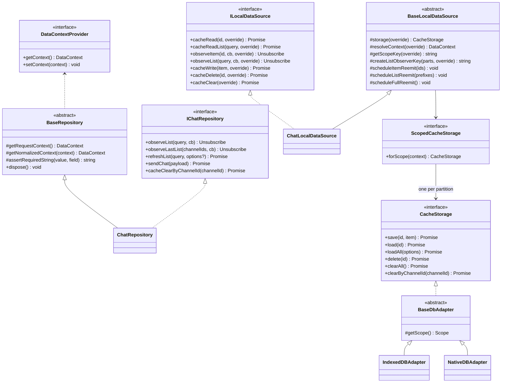

# repositories — the data facade

> Status: Live · Last updated: 2026-09-23 · Overview in the [lib README](../../README.md) · Canonical code: [repositories/index.ts](../../src/repositories/index.ts) · [repositories/types.ts](../../src/repositories/types.ts)

A repository bundles a remote data source and a local data source and exposes them to the app as a
**data facade**. It is also the layer that interprets server-side changes into a local read-model.

There is one core goal.

- Reads always come from local
- Remote is a side-effect command
- Hooks see only streams

`BaseRepository` and `DataContext` both live in `types.ts`; there is no `BaseRepository.ts`.

## Three contracts

The UI layer sees only two of them.

1. **Read streams** — subscribing via `observeList` / `observeItem`
2. **Write commands** — `sendChat`, `createPlace`, `updateProfile` and the like, reflecting user intent

The third, `refresh*` / `cache*`, is not a UI contract; it is the sync path.

| API group                                    | Called by                      | Examples                                         |
| -------------------------------------------- | ------------------------------ | ------------------------------------------------ |
| `observe*`                                   | UI hook                        | `observeList(query, cb)`                         |
| write command                                | UI action                      | `sendChat()`, `createPlace()`, `updateProfile()` |
| `refresh*` / `syncChannels` / `syncProfiles` | the external sync orchestrator | `refreshList()`, `syncChannels(since)`           |
| `cache*`                                     | sync orchestrator / tests      | `cacheWrite(item)`, `cacheClear()`               |

A UI calling `refresh*` directly can collide with sync timing. Where it is necessary, keep it to a
user-event path.

## What `BaseRepository` provides

`BaseRepository` uses no event bus and no cachePolicy. It provides only what is commonly needed.

- `getRequestContext()` — captures a snapshot of the context at call time. **Because the request-time and response-time contexts can differ, the context has to be captured before a remote response is written.**
- `getNormalizedContext()` — normalizes a missing `cid` to `'default'`.
- `assertRequiredString` — validates a required identifier.
- `acceptsAnswer(requestContext, source)` — whether an answer may be cached, judged on the **captured** context (below). A skip is recorded under `source` in `foreignDropAggregator`.
- `dispose()` — the factory routes every repository's cleanup here. There is nothing to release at the base level today; it is the seat for a subclass that holds a resource.

## Context and scope

`DataContext` is `cid` (the connected cloud) and `uid` (the current user) — the cache scope. A
repository does not hold the context; it reads the current value through a `DataContextProvider` on
every call (`DataContextHolder`). So a cloud switch requires no rebuild, and `withContext(snapshot)`
can produce a copy pinned to a specific context.

**The context a repository captures is the partition its answer is written to.** It hands the
snapshot to local as `contextOverride`, and local resolves its storage from that scope — see
[which partition an operation touches](../local/README.md#which-partition-an-operation-touches). A
response that lands after a cloud or account switch therefore goes to the account and cloud that
asked, and a stale prune runs against that partition only.

**Which cloud answered is a separate question, and it too is judged on the captured context.** While
a switch is under way `cid` has flipped but the old socket still answers, so its answer belongs to
the outgoing cloud; `isForeignContext` recognises that from `socketCid`. `acceptsAnswer` asks it of
the snapshot, never of the live context after the await — once answers go to the captured partition,
the live question is backwards both ways (ADR-0112). A site asks it before the request when nothing
is owed to the caller (`refreshList`, `syncChannels`, the place snapshot: skip the round trip), and
after it when the caller is owed the value (`startDm`, `getSelfChannel`, `refreshOne`: return it, caching only what the captured context accepts).
Chat, profile, join and user reads and every optimistic mutation are not guarded yet.

`sid` is **not** ambient (ADR-0085). The field exists on `DataContext`, but nothing seeds it: a
repository that needs a place takes it as an argument (`setMyProfile(body, siteId)`,
`syncProfiles(since, siteId)`, `syncProfilesOf(userIds, siteId)`, `listPlaceMembers({ placeId })`, `createChannel(payload, siteId)`, `getSelfChannel(payload, siteId)`,
`refreshOne(channelId, siteId)`, `refreshOneInCloud(channelId, fallbackSiteId)`,
`refreshList({ sid })`) and puts it on the context it hands down. It has to travel that way because
`profile.sync`, `channel.mine`, `channel.get-self` and `channel.get` return rows carrying no place of their own —
the caller's value is the only thing that can tag them. For `profile.set` the argument tags the
optimistic row and checks the answer, but it does not choose the site: the server writes to its
session's site regardless (see [domains](./domains.md#profile)).

## The core contract

`CacheStorage` and `ScopedCacheStorage` belong to this lib — interfaces `ports/` declares, plus the
slot that builds one adapter per partition (`createScopedCacheStorage`). The three adapters below it
are owned by `@chatic/db`, and which domain gets which adapter is decided by `libs/app-runtime`.

## Repository wiring

`createRepositories` in `repositories/index.ts` is the single assembly point. Some repositories
have no local source and some have no socket source.

| Repository     | socket | local                     | http           |
| -------------- | ------ | ------------------------- | -------------- |
| `auth`         | ✓      | —                         | `auth`         |
| `channel`      | ✓      | `channel` + `chat`        | —              |
| `chat`         | ✓      | `chat`                    | —              |
| `cloud`        | ✓      | `cloud`                   | `cloud`        |
| `device`       | ✓      | —                         | —              |
| `invite`       | ✓      | `invite`                  | —              |
| `join`         | ✓      | `join`                    | —              |
| `pairing`      | —      | —                         | `pairing`      |
| `place`        | ✓      | `place`                   | —              |
| `profile`      | ✓      | `profile`                 | —              |
| `report`       | —      | —                         | `report`       |
| `subscription` | —      | —                         | `subscription` |
| `user`         | ✓      | `user` + `join` + `place` | `user`         |
| `syncMeta`     | —      | `syncMeta`                | —              |

- `auth` and `device` are remote-only surfaces with nothing to cache (session identity commands, lookup signals).
- `pairing`, `report` and `subscription` are remote-only **and** HTTP-only — they do not even have a socket data source.
- `channel` also takes the `chat` local source because leaving has to empty that room's messages, not just the channel row (ADR-0067).
- `user` takes the `join` and `place` local sources because assembling invite candidates reads all three caches together.
- `user` also takes the **`profile` repository** — one of the two repository-to-repository dependencies here. `listPlaceMembers` stores each page's place profiles, and a `profile.sync` answer has exactly one save path (`ProfileRepository`'s upsert and `null` delete); taking the profile data sources instead would have made a second copy of it. The dependency runs one way, and both are built in the same `buildRepositories` call from the same context provider, so a scoped graph (`withContext`) keeps them on the same scope. `index.ts` builds `profile` first for that reason.
- `place` takes the **`channel` repository** (as `PlaceChannelCleanup`: `evictLeftChannels` and `dropMemberFromChannels`) — the other one. Leaving a place clears the rooms the server took me out of, and the leave guard that keeps a late snapshot from restoring a left room lives in the channel repository's instance and nowhere else. `index.ts` builds `channel` before the literal for the same reason as `profile`.
- `join` also takes the state outbox (`options.outbox`), because my join's writes go local first and through it ([outbox](../outbox/README.md)). The app runtime injects one outbox shared by every graph; omitted, `createRepositories` builds one per graph whose transport sends at once and treats every failure as final — for tests and hosts with no socket runtime.

## HTTP injection is optional

`httpDataSources` is an optional argument to `createRepositories` (`httpDataSources?`). Calling one of
those methods without it throws an explicit error. The ADR-0036 track document announced "promote to
required after stage 4", but that promotion never happened. As it stands it is optional.

## The 13 domains

The per-domain method catalogue is split out into [domains.md](./domains.md) — 13 domains over 132 lines
made both harder to read when wedged between the shared rules.

## Chat cursors

Chat is cursor-based, so two responsibilities are kept apart.

- **Detecting the newest message** goes by `channel`'s `chatNo` — comparing the `chatNo` that channel sync provided against the local max `chatNo`.
- **Paginating to earlier pages** goes by `chat.feed`'s `cursorNo`.

They are not the same value. `cursorNo` is a query discriminator for fetching an older page, not a
baseline for the latest sync.

### What a feed page proves

`chat.feed` answers a page by counting `limit` chat numbers down from the request cursor — or from
the channel's head, whichever is lower — looking each one up, and leaving out the soft-deleted ones.
The cursor it returns is the lowest number it counted, or 0 when the count ran down to the start of
what this member may see. (That is the server's own feed implementation, read from its source; the
published type says only "below `cursorNo`" and "0 = end".) So a page proves a whole range, not just
the rows it carries, and a number in that range that did not come back is a deleted message
(ADR-0206):

- With a returned cursor, the range is exactly `[cursor, cursor + limit − 1]`. The top comes from the
  answer, never from the request: a cursor above the head (a block re-check near the newest messages)
  is counted from the head, and claiming up to the request cursor would mark a message that arrived
  meanwhile as deleted and hide a later gap above the head.
- With 0, the range runs from the start of history to the newest row the page carried — or to the
  request cursor when the caller says it is a numbered row (`cursorIsRow`), which puts the head at or
  above it. An empty page that ran to the start proves nothing otherwise.

`ChatRepository.refreshList` records each proven range in `FeedCoverage`, in memory for the page's
life, keyed by scope and channel; `uncoveredFeed(channelId, low, high)` reads it back. A screen needs
this to tell the two kinds of hole in the cache apart. A deleted message leaves a missing number
exactly like history nobody has fetched, and every room with deletions has such holes, because a page
writes only what it carries. It is not persisted — a second store would have to survive every cloud
switch and app update alongside the cache, and forgetting it on relaunch costs one request per page of
old history someone looks at again — but it is cleared with the rows it describes:
`cacheClear()` forgets the scope, `cacheClearByChannelId` and `ChannelRepository`'s leave purge forget
the channel. Left behind, it would read the holes a clear opened as deletions for the rest of the run.

With `markMissingHidden`, a page also marks a cached row inside its range that it did not carry as
deleted — the delete that happened while the device was not listening, which live sync never replays.
This is inference, so it is kept narrow and reversible:

- Only callers re-reading history they already hold set it: a gap fill, a re-check of old rows, a
  thread root's page. The entry refresh does not.
- At the start of history it stops at the oldest row the page carried, because below that sit rows
  from before my join, which the server also leaves out and which are not deleted.
- The row stays in the cache, marked `hidden` and `hiddenByFeed`. The cache undoes such a mark when a
  server copy of the row arrives without saying it is hidden (the server leaves `hidden` out of a live
  row, and a write merges over the stored one), and turns it into an ordinary delete when one says it
  is. A delete the server announced carries no `hiddenByFeed`, so no later page can undo it. This is
  why it does not break the rule below that chat **deletion** waits for explicit signals: nothing is
  removed, and only the inferred mark is ever reversed.

## Cache clear rules

- `cacheClear()` clears within the current repository scope (it is not a global clear).
- `ChatRepository` additionally provides `cacheClearByChannelId(channelId)`.
- Logout, cloud switch and test setup each have to decide their clear scope explicitly.
- **Clearing a domain's rows means clearing the partition's sync cursors after them** (`syncMeta.cacheClear()`). A cursor that outlives its data still claims "synced up to T", so the next sync asks only for the delta after T and the gap never fills. A whole-partition clear of `chat` counts as refillable despite the bullet below, because `join` goes with it and the rows the server will not return were hidden by the join window anyway — what is lost is unsent messages.
- Two domains hold data the server cannot give back, and a clear meant to be refilled from the server must skip them: `cloud` (the `invitecloud` slot — there is no list API for invited clouds) and `invite` (its `dismissedAt` is written only on this device). The whole-device sweep that follows these rules is `clearLocalCaches` in `libs/app-runtime`.
- **Deleting chat cannot be undone.** Other domains can be refilled by the server if wrongly cleared, but the message feed is windowed by `join.joinedNo`, and the server will not hand back anything before it. So chat deletion is attached to explicit signals only, never to inference → below. A `hidden` mark inferred from a re-read feed page is not a deletion: the row stays and the mark is reversible ([What a feed page proves](#what-a-feed-page-proves)).

How storage carries that request out is in
[the three paths for a channel-scoped delete](../local/README.md#three-paths-for-a-channel-scoped-delete).

## Leaving and rejoining

Rejoining should look like joining for the first time. The server resets the join cursor on rejoin and
windows the feed by `chatNo > joinedNo`, but **the client renders the local chat cache, not the server
response.** Leaving does not remove that room's message rows (the chat sync plan has no `onRemove` — the
history is kept for lazy-load and offline), so two mechanisms are needed together. The reasoning is in
ADR-0067.

**① The display gate — `isInJoinWindow(chat, joinedNo)`** (`src/domain/joinWindow.ts`)

It applies the server's own rule (`chatNo > joinedNo`) at the place the cache is read. Two exceptions
carry meaning:

- When `joinedNo` is absent, nothing is hidden. Rows were written before the server shipped this field, and guessing at a missing value would erase perfectly good history.
- When `chatNo` is falsy, the row passes. An optimistic send has `chatNo: 0` until the server numbers it, and without this exception **the message you just sent would disappear.**

Three consumers use it in apps/web: the room feed, the home preview, and global search. This gate is not
a duplicate of ② — it is the retroactive line of defence covering what ② cannot reach (installs that
already built up a cache, being kicked, leaving from another device).

In the room feed it is applied **where `useChats` receives the cache, not just before render.** Gating
only the display list would give the same hook's `rawChats` (reaction folding, thread assembly, "has row
1 loaded?") a different boundary, and then a row 1 left in the cache from before leaving makes the
**"start of conversation" block appear only to someone who rejoined midway** — and not to the person
invited from the beginning. The paging cursor must not grab a `chatNo` from before the join for the same
reason.

**② Purge — on explicit signals only**

| Signal                     | Where                                                                 |
| -------------------------- | --------------------------------------------------------------------- |
| A successful self-leave    | `ChannelRepository.leaveChannel`                                      |
| A successful place leave   | `ChannelRepository.evictLeftChannels`, for each room the server names |
| Removal of my own join row | the join sync plan's `onRemove` (app-runtime)                         |

It is **not** attached to `ChannelSyncPlan.onRemove` or to `syncChannels`' stale prune. One misjudgement
by inference-based cleanup becomes unrecoverable history loss.

Purging is not optimistic — it happens after the server confirms, and a failure still lets the leave
succeed. Reporting a departure that already happened as a failure is the bigger lie, and ① hides
whatever rows remain.

## Notes for implementers and tests

- Capture the request-time context before the await (`getRequestContext`) and pass that snapshot to every local call the answer makes — the write, the prune read, the prune delete. It decides the partition; a call given no context falls back to the live one.
- Never fall back to the context for a `sid` a caller did not give. That fallback is what tagged writes for the wrong place during a site switch (ADR-0085); ask the caller instead.
- For `chat.feed`, merging matters more than overwriting.
- If a path remains where a hook renders a remote return list directly, it breaks this lib's goal.
- HTTP injection (`httpDataSources`) is optional. Calling an HTTP method without it throws an explicit error.

## Further reading

- [libs/sync](../../../sync/README.md) — the path by which a join row's removal becomes a purge signal (owned by `@chatic/sync`).
