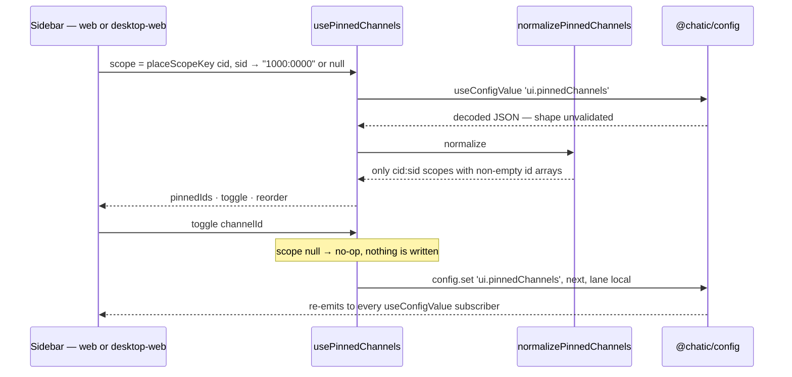

# @chatic/preferences

**The sidebar preferences a user sets per place**: which channels are pinned and in what order, the order
of the other channels, and the order of the cloud and place rails. `apps/web` and `apps/desktop-web` read
and write the same `ui.*` config keys through the same normalizers here, so the two front ends cannot
disagree about the shape.

Tags: `layer:feature` · `platform:any` · `formfactor:any`. It depends on
[`@chatic/config`](../../config/README.md) (`config`, `useConfigValue`) and React, and on nothing that
needs a DOM. Folders and tags follow
[ADR-0377](../../../docs/adr/0377-every-project-carries-a-layer-a-platform-and-a-form-factor-tag-and-folders-group-families.md).

| File                | Config key          | Holds                                                                       |
| ------------------- | ------------------- | --------------------------------------------------------------------------- |
| `placeScope.ts`     | —                   | `placeScopeKey(cid, sid)` → `"<cid>:<sid>"` or `null`, `isPlaceScopeKey`    |
| `pinnedChannels.ts` | `ui.pinnedChannels` | `usePinnedChannels`, `setChannelPinned`, `setPinnedChannelOrder`, normalize |
| `channelOrder.ts`   | `ui.channelOrder`   | `useChannelOrder`, `setChannelOrder`, `applyChannelOrder`, `moveChannel`    |
| `railOrder.ts`      | `ui.railOrder`      | `useCloudOrder`, `usePlaceOrder`, `normalizeRailOrder`                      |

`@chatic/shared` re-exports all of it under the same names, so its consumers did not change. New code
imports this package.

## Rules

1. **This package validates the product shape; `@chatic/config` validates only JSON.** The registry in
   `libs/config/src/registry/ui.ts` declares the three keys as `type: 'json'`, and that check ends at "this
   parses". That a value must be a map of `cid:sid` keys to non-empty id arrays (or, for the rail order,
   cloud ids and place ids per cloud) is knowledge this package holds, applied to the already-decoded value.
2. **A per-place key is `<cid>:<sid>`, and a half-formed one is never written.** A site id is unique only
   inside its cloud, so a bare place id would let one cloud inherit another's pins. `placeScopeKey` returns
   `null` when either half is unknown and every writer no-ops on `null`.
3. **Stored input degrades; it never throws.** `normalizePinnedChannels`, `normalizeChannelOrder` and
   `normalizeRailOrder` drop what they do not recognise, so a corrupt or hand-edited record costs the user
   their pins, not the sidebar.

## Writing a per-place preference



Reads normalize on the way out and writes normalize on the way in, so a record that a hand edit or an older
build left malformed is repaired by the next write rather than propagated.

## Pinning and reordering

- **Pinning.** `toggle(channelId)` from `usePinnedChannels(scope)` calls `setChannelPinned`, which reads
  the current map, adds or removes the id inside that one scope, drops the scope entirely if nothing is left
  pinned, and writes the whole map back through `config.set(..., { lane: 'local' })`. Other scopes are
  preserved untouched.
- **Two reorder rules, on purpose.** `setPinnedChannelOrder` rewrites only the _slots_ that listed pins
  occupy: an id not in the incoming list keeps its position, so a channel briefly missing during a rejoin or
  a sync lag cannot lose its pin to someone else's drag, and an id that is not already pinned is dropped
  rather than silently pinned. `setChannelOrder` (the non-favorite section) simply stores the new full
  order, de-duplicated. Reading is `applyChannelOrder`: stored ids that are still present first, in stored
  order, then everything new appended in the list's own order. `moveChannel` moves one id and prunes ids
  that are gone in the same write.
- **A drag in a partly shown rail keeps the tiles that are not on screen.** `ui.railOrder` can be shown with
  part of its list (a read failed, a source is late), so the stored order re-inserts every unseen id after
  the tile it followed. A removed cloud's id therefore stays in the record until logout; reading skips it.
  Duplicate ids are collapsed on read because a hand-edited record must not become duplicate React keys or
  drag ids.

## Verify

```bash
npx nx run-many -t lint,typecheck,test -p @chatic/preferences
```

`channelOrder.property.test.ts` checks the reorder invariants on generated input with fast-check.
