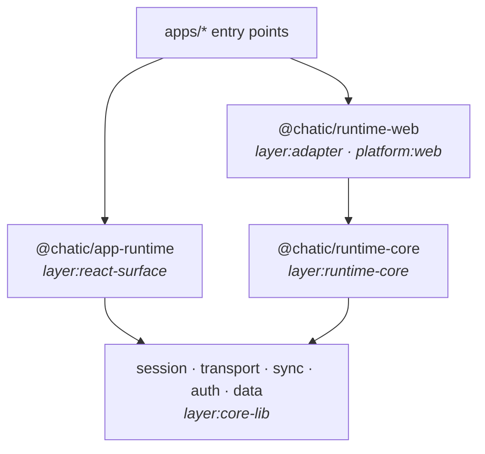

# @chatic/runtime-core

**What the runtime takes from the platform it runs on, collected in one place.** The session, the
sockets, sync and the data layer are meant to run in two places: in the web page for the browser and
the desktop shell, and in the native process for the mobile app. What differs between those places —
where the session is stored, how a socket is opened, what "online" means — comes into the runtime as
a **port**, and this package holds the type that lists them all: `RuntimePorts`.

Today it holds that type and nothing else. The assembly itself — the wiring `initAppRuntime` does in
[`@chatic/app-runtime`](../app-runtime/README.md#wiring) — moves here as a function that builds the
runtime from a `RuntimePorts`, and each port arrives as a field when the wiring behind it is turned
into one.

## Purpose

A runtime that falls back to a browser's answer when nothing is passed in works everywhere it is
tried in a browser, and in a native process it quietly reads a page's storage that is not there. The
point of collecting the ports in one required type is that leaving one out is a compile error in the
adapter that forgot it, not a fallback discovered on a device.

## Design principles

1. **Every port is required.** `RuntimePorts` has no optional field. `RuntimePortsAreRequired` in
   [`ports.ts`](./src/ports.ts) is a type that stops compiling if one is declared with `?`. A port has
   no neutral default — the only values in reach are one platform's — so there is nothing a default
   could safely be.
2. **The package that uses a port declares it.** `RuntimePorts.storage` is `@chatic/session`'s own
   `SessionStoragePorts`; this package names it, it does not redefine it.
3. **No platform here.** The package compiles without the browser's types or Node's (`lib:
["es2022"]`, `types: []` in `tsconfig.lib.json`), its tests run in jest's `node` environment, and
   it imports neither React nor React Native nor `@chatic/bridges`. One gap: React Native's global
   types (`fetch` among them) still arrive through `@chatic/bridge-messages`, which `@chatic/data`
   imports — globals both runtimes have.
4. **Only the core packages below it.** It may depend on a package tagged `layer:core-lib` and on
   nothing else — an allow-list, so taking a new dependency means tagging it on purpose.

## Layers

Each runtime package carries a layer tag in its `package.json` (`"nx": { "tags": [...] }`), and
`@nx/enforce-module-boundaries` in the root `eslint.config.mjs` refuses an import that goes the wrong
way:



| Tag                   | May not depend on                                                                                         |
| --------------------- | --------------------------------------------------------------------------------------------------------- |
| `layer:core-lib`      | runtime-core, an adapter or the React surface, directly or through another package; React or React Native |
| `layer:runtime-core`  | anything not tagged `layer:core-lib`; React or React Native                                               |
| `layer:adapter`       | the React surface; React                                                                                  |
| `layer:react-surface` | an adapter — which platform fills the ports is the entry point's choice                                   |
| `platform:web`        | React Native                                                                                              |

An adapter is not banned React Native by its layer: the native adapter will be made of React Native
modules, so that is its platform tag's decision.

Not enforced yet, because today's code still does it: the core packages import `@chatic/storage` and
`@chatic/http`, `@chatic/app-runtime` imports the core packages directly, and an app may import an
adapter from any file rather than its entry point. Each goes when the code it describes moves.

## The wiring calls

The eight calls that wire the core packages together — `sessionMedia.configure`,
`syncDataGraph.provide` and the rest — are made in one file, the assembly point, and a workspace lint
rule reports them anywhere else. The catalogue and the allowed file are in the root config; the rule
is [`tools/eslint-rules`](../../tools/eslint-rules/README.md)'s `runtime-wiring-call`. The assembly
point is `libs/app-runtime/src/init.ts` until the assembly moves into this package.

## How to verify

```bash
node node_modules/.bin/tsc -b libs/runtime-core/tsconfig.json   # includes the required-ports assertion
(cd libs/runtime-core && node ../../node_modules/.bin/jest)
(cd libs/runtime-core && node ../../node_modules/.bin/eslint .)
```

To see a constraint fire, add an import that breaks it — `import 'react'` here, or
`import '@chatic/runtime-web'` in a core package — and lint that package with `npx nx lint`. Running
ESLint by hand reads the project graph Nx last computed, so an indirect dependency added since is only
seen after an `nx` command has run.
