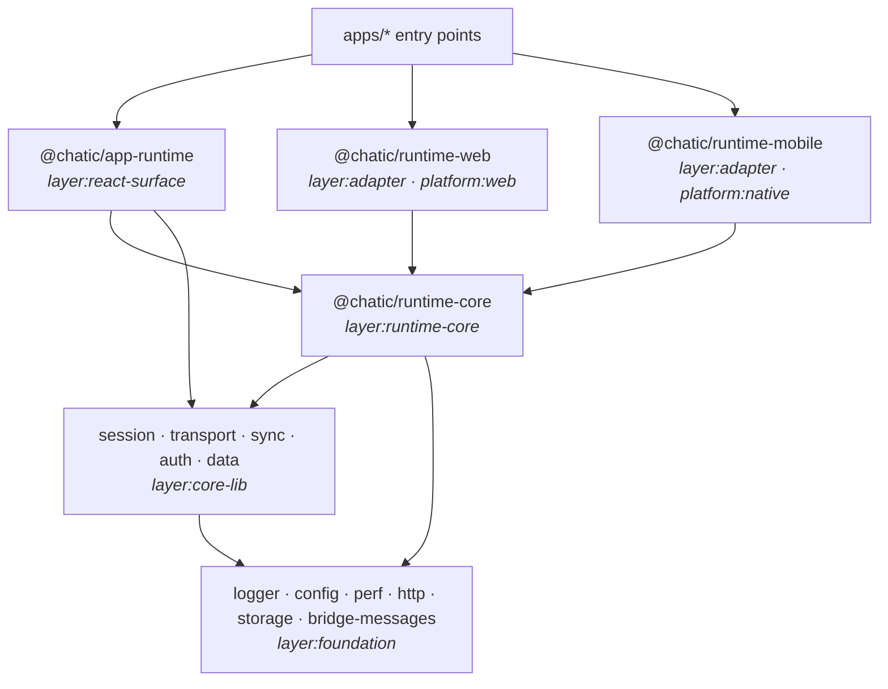

# @chatic/runtime-core

**The runtime's assembly, and what it takes from the platform it runs on.** The session, the
sockets, sync and the data layer run in two places: in the web page for the browser and the desktop
shell, and in the native process for the mobile app. What differs between those places — where the
session is stored, how a socket is opened, what "online" means, where the cache's rows live, whether
the app is in front of the user — comes
into the runtime as a **port**. This package holds the type that lists them all, `RuntimePorts`, and
`createRuntime(config)`, which wires the core packages together from them: the same assembly on every
platform.

```text
libs/runtime-core/src/
├── index.ts            the package barrel — what the React surface reads
├── ports.ts            RuntimePorts, every field required
├── createRuntime.ts    the assembly: every wiring call, in order; returns the engine
├── engine.ts           RuntimeEngine — what the React surface starts its lifecycle work from
├── config/             records the effective settings in the logs at boot
├── storage/            the runtime's own `device` store (the sync cursor watermark)
├── data/               the repository graph — see docs/data/
├── testing/            fakes for tests that go through the engine (`testing/sessionView`, `testing/sessionCommands`, `testing/connection`) — not on the barrel
├── connection/         the connection controller: session → socket slots; the sockets as screens read them — see docs/connection/
├── session/            the session controller, the two credential guards, the foreground port, the session view, the commands and the secret-storage boot step (`prepareSecretStorage`) — see docs/session/
├── push/               push device-token registration — see docs/push/
├── bridge/             the runtime across the bridge: the handshake, the contract version, errors — see docs/bridge/
└── sync/               primeChatRoom — a chat room's baseline and first page (app-runtime docs/sync/); the sync engine as screens drive it (docs/connection/)
```

Apps do not import this package — the root lint refuses it, as it refuses the core packages. A web
app builds the runtime through `createWebRuntime(...)` in `@chatic/runtime-web`, which fills the
page's ports and calls `createRuntime`, hands the engine it returns to `@chatic/app-runtime`'s
`initAppRuntime(engine)`, and reads the runtime through `runtime`. The graph's React hooks stay in
app-runtime; [docs/data](./docs/data/README.md) covers the graph itself. The native process builds it
through `createNativeRuntime(...)` in `@chatic/runtime-mobile`, which fills React Native's ports the
same way; the mobile app can boot it (its `docs/runtime/`), and nothing starts it yet.

The connections live here for the same reason: `createConnectionController` keeps the sockets in line
with the session — the slots, the binders, the background clouds' tokens and receive loops — without
React, and app-runtime's host only starts and stops it ([docs/connection](./docs/connection/README.md)).
So does the relay session's own lifecycle: `createSessionController` brings the session up at boot
and keeps a session-less visitor signed in as a guest ([docs/session](./docs/session/README.md)).

## The engine

`createRuntime(config)` wires the core packages and returns a **`RuntimeEngine`** — what the React
surface starts its lifecycle work from, instead of making it itself:

| Member                                                          | Makes                                                            |
| --------------------------------------------------------------- | ---------------------------------------------------------------- |
| `session`                                                       | the session as screens read it: a snapshot without tokens        |
| `commands`                                                      | what a screen does to the session: sign in and out, switch, pair |
| `connection`                                                    | the sockets as screens read and drive them                       |
| `sync`                                                          | the sync engine as screens drive it: targets and baselines       |
| `data`                                                          | the page's repository graphs, and the work done on them          |
| `sessionController(options)`                                    | the relay session's boot and the guest keep-alive                |
| `connectionController(options)`                                 | the sockets kept in line with the session, the background clouds |
| `relayCredentialGuard(policy)` · `cloudCredentialGuard(policy)` | the two credential guards an app starts with its own policy      |
| `pushRegistration(options)`                                     | push device-token registration                                   |
| `primeChatRoom(cid, channelId, options)`                        | a chat room's baseline and first page                            |

The engine `createRuntime` returns is the **core engine**: each member makes the core implementation, in
this process. The classes behind it are not on the barrel — only their types are — so app-runtime can
reach them only through the engine it was handed. A runtime that runs elsewhere (the native process,
with the page mirroring it) supplies the same members backed by that process, and the hooks and hosts
do not know which engine they were given.

`session`, `commands`, `connection`, `sync` and `data` are the members that are not factories: the core engine
keeps one session view over this process's stores ([docs/session](./docs/session/README.md#the-session-view)),
and every session reader app-runtime publishes reads through it; `commands` run this process's use cases
([docs/session](./docs/session/README.md#the-commands)), and every session command app-runtime
publishes runs through them; `connection` reads and drives this process's socket manager
([docs/connection](./docs/connection/README.md#the-sockets-as-screens-read-them)) and `sync` its sync
manager, and app-runtime reaches neither manager any other way; `data` hands over the page's view of
this process's repository graphs, without the token issuers ([docs/data](./docs/data/README.md#the-pages-graph)).

Everything the React surface reads or drives goes through the engine. What still runs in the page's own
process only is sending media (`runInCloud` with its work and files) — see
[app-runtime docs/data](../app-runtime/docs/data/README.md).

## The runtime across the bridge

On the phone the runtime can run in the shell's own process, with the page mirroring it. Which side
owns the session is settled once per launch: the shell offers before the page runs, the page asks in
a handshake before it boots, and the shell decides. The page runs its own runtime only on a refusal
or from a shell that cannot answer; a lost answer means asking again, never a second owner. `src/bridge/` holds what both halves are held to: the contract version they negotiate, the
handshake's three steps, and how an error crosses with the fields screens read — or says the installed
app's runtime does not have the method yet. The halves themselves
are not built yet ([docs/bridge](./docs/bridge/README.md)).

## Purpose

A runtime that falls back to a browser's answer when nothing is passed in works everywhere it is
tried in a browser, and in a native process it quietly reads a page's storage that is not there. The
point of collecting the ports in one required type is that leaving one out is a compile error in the
adapter that forgot it, not a fallback discovered on a device.

## Design principles

1. **Every port is required.** `RuntimePorts` has no optional field. `RuntimePortsAreRequired` in
   [`ports.ts`](./src/ports.ts) is a type that stops compiling if one is declared with `?`. A port has
   no neutral default — the only values in reach are one platform's — so there is nothing a default
   could safely be.
2. **The package that uses a port declares it.** `RuntimePorts.storage` is `@chatic/session`'s own
   `SessionStoragePorts` and `RuntimePorts.transport` is `@chatic/transport`'s
   `TransportPlatformPorts` (the online signal, the device, how a socket is opened) and
   `RuntimePorts.auth` is `@chatic/auth`'s `AuthPlatformPorts` (the address, the way home at logout)
   and `RuntimePorts.cache` is `@chatic/data`'s `LocalCachePorts` (where each cache domain lives);
   this package names them, it does not redefine them. `RuntimePorts.foreground` (whether the app is
   in front of the user) is this package's own `ForegroundSignal`, because only its session controller
   reads it.
3. **No platform here.** The package compiles without the browser's types or Node's (`lib:
["es2022"]`, `types: []` in `tsconfig.lib.json`), its tests run in jest's `node` environment (a test
   whose fixtures play a page says so with a `@jest-environment jsdom` docblock), and
   it imports neither React nor React Native nor `@chatic/bridges`. One gap: React Native's global
   types (`fetch` among them) still arrive through `@chatic/bridge-messages`, which `@chatic/data`
   imports — globals both runtimes have.
4. **Only the core packages and the foundation below it.** It may depend on a package tagged
   `layer:core-lib` or `layer:foundation` (logger, config, perf, http, storage, bridge-messages) and on
   nothing else — an allow-list, so taking a new dependency means tagging it on purpose.
5. **Process-wide, one per launch.** `createRuntime` wires module singletons and returns the core
   engine; a second call replaces the wiring and says so in the log.

## Layers

Each runtime package carries a layer tag in its `package.json` (`"nx": { "tags": [...] }`), and
`@nx/enforce-module-boundaries` in the root `eslint.config.mjs` refuses an import that goes the wrong
way:



| Tag                   | May not depend on                                                                                         |
| --------------------- | --------------------------------------------------------------------------------------------------------- |
| `layer:core-lib`      | runtime-core, an adapter or the React surface, directly or through another package; React or React Native |
| `layer:runtime-core`  | anything not tagged `layer:core-lib` or `layer:foundation`; React or React Native                         |
| `layer:foundation`    | anything not tagged `layer:foundation` — it knows nothing of the runtime above it                         |
| `layer:adapter`       | the React surface; React                                                                                  |
| `layer:react-surface` | an adapter — which platform fills the ports is the entry point's choice                                   |
| `platform:web`        | React Native                                                                                              |
| `platform:native`     | a `platform:web` package                                                                                  |

An adapter is not banned React Native by its layer: the native adapter, `@chatic/runtime-mobile`, is
made of React Native modules, so that is its platform tag's decision.

**No page in the core packages either.** session, transport, sync and auth compile without the DOM's
types, as this package does (Node's stay, for timers, `URL` and `TextEncoder`), and a root lint block
refuses the page's globals — `window`, `document`, `navigator`, `location`, `indexedDB`, `WebSocket`,
`XMLHttpRequest` and the rest of `PAGE_GLOBALS` in `eslint.config.mjs` — in all five, data included.
`@chatic/data` still compiles with the DOM's types: its IndexedDB port is declared in them, until the
IndexedDB assembly moves out of the core. The compiler catches the names only a page has; names React
Native also declares (`WebSocket`, `XMLHttpRequest`, `File`, `fetch`) arrive through
`@chatic/bridge-messages` and type-check, so for those the lint list is the check.

Not enforced yet, because today's code still does it: the core packages import `@chatic/storage` and
`@chatic/http`, `@chatic/app-runtime` imports the core packages directly, and an app may import an
adapter from any file rather than its entry point. Each goes when the code it describes moves.

## The wiring calls

The calls that wire the core packages together — `sessionStores.configure`,
`syncDataGraph.provide` and the rest — are made in one file, `src/createRuntime.ts`, and a workspace
lint rule reports them anywhere else. The catalogue and the allowed file are in the root config; the
rule is [`tools/eslint-rules`](../../tools/eslint-rules/README.md)'s `runtime-wiring-call`.

## How to verify

```bash
node node_modules/.bin/tsc -b libs/runtime-core/tsconfig.json   # includes the required-ports assertion
(cd libs/runtime-core && node ../../node_modules/.bin/jest)
(cd libs/runtime-core && node ../../node_modules/.bin/eslint .)
```

To see a constraint fire, add an import that breaks it — `import 'react'` here, or
`import '@chatic/runtime-web'` in a core package — and lint that package with `npx nx lint`. Running
ESLint by hand reads the project graph Nx last computed, so an indirect dependency added since is only
seen after an `nx` command has run.
