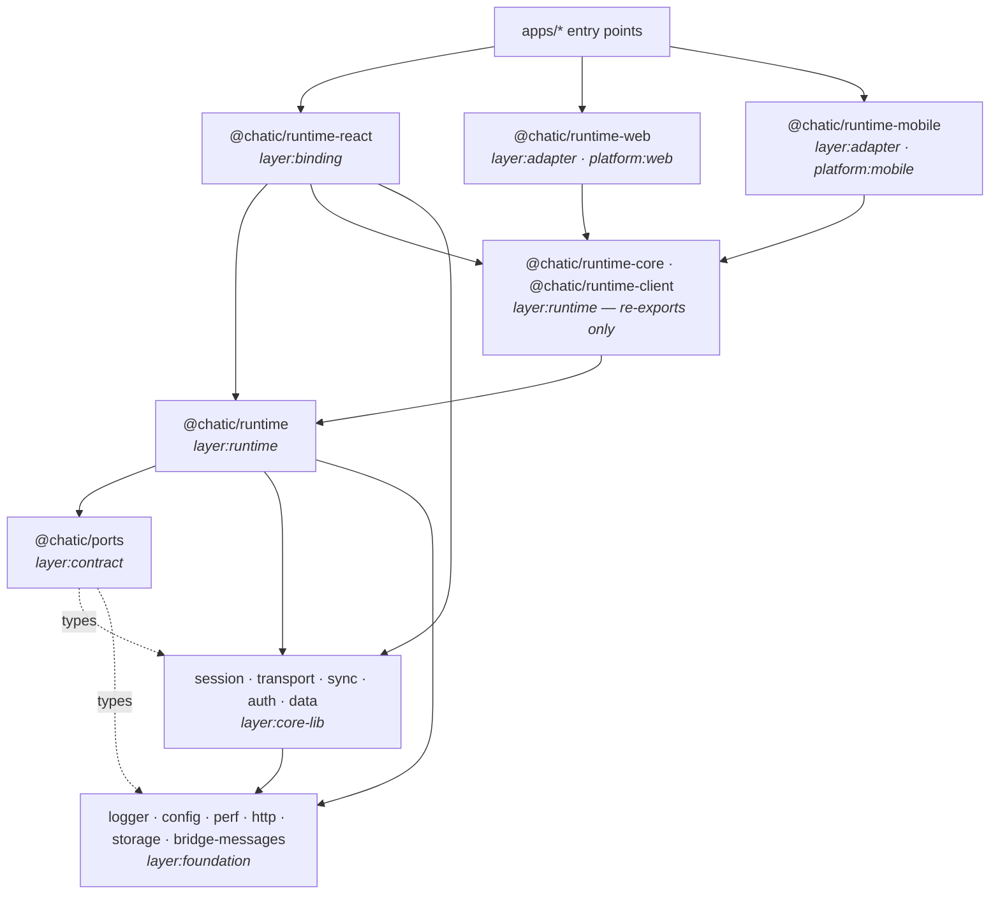
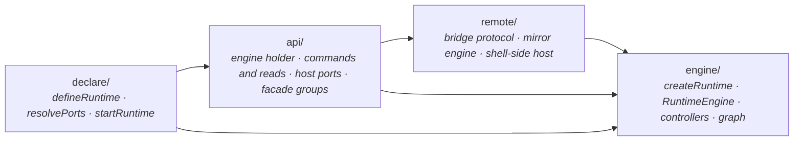

# Layers

Two directions are held by machine: between packages, by the tags every project carries; and inside
`@chatic/runtime`, by the folder its file sits in.

## Between packages

Every project under `apps/` and `libs/` carries a layer, a platform and a form factor tag (`"nx": { "tags": [...] }` in its `package.json`,
or `tags` in its `project.json`; `@nx/workspace-project-tags` fails lint without them), and
`@nx/enforce-module-boundaries` in the root `eslint.config.mjs` refuses an import that goes the wrong
way. Form factor is `any` except on apps and screen parts built for one layout.

| Tag                  | May not depend on                                                                                                                                                                                |
| -------------------- | ------------------------------------------------------------------------------------------------------------------------------------------------------------------------------------------------ |
| `layer:core-lib`     | the contracts, the runtime, an adapter, the binding, the bridge or a UI library, directly or through another package; React or React Native                                                      |
| `layer:contract`     | anything not tagged `layer:core-lib` or `layer:foundation`, and the bridge or a UI library through one that is; React or React Native; a value (only types) or `@chatic/bridge-messages` at all  |
| `layer:foundation`   | anything not tagged `layer:foundation` — it knows nothing of the runtime above it                                                                                                                |
| `layer:runtime`      | anything not tagged `layer:core-lib`, `layer:contract`, `layer:foundation` or `layer:runtime`, and the bridge or a UI library through one that is; React, React Native, `@tanstack/*` or zustand |
| `layer:adapter`      | the binding or a UI library; React                                                                                                                                                               |
| `layer:binding`      | an adapter — which platform fills the ports is the entry point's choice                                                                                                                          |
| `platform:any`       | anything not tagged `platform:any`                                                                                                                                                               |
| `platform:web`       | anything not tagged `platform:any` or `platform:web`; React Native                                                                                                                               |
| `platform:mobile`    | anything not tagged `platform:any` or `platform:mobile`, and a `platform:web` package through one that is                                                                                        |
| `platform:desktop`   | anything not tagged `platform:any` or `platform:desktop`                                                                                                                                         |
| `platform:node`      | anything not tagged `platform:any` or `platform:node`                                                                                                                                            |
| `formfactor:any`     | a `formfactor:mobile` or `formfactor:desktop` package, directly or through another package                                                                                                       |
| `formfactor:mobile`  | a `formfactor:desktop` package, directly or through another package                                                                                                                              |
| `formfactor:desktop` | a `formfactor:mobile` package, directly or through another package                                                                                                                               |
| `layer:bridge`       | — (`@chatic/bridges`, the WebView transport, with `@chatic/fake-shell` and `@chatic/chatic-apps-sdk`; tagged so the layers above can refuse it)                                                  |
| `layer:ui`           | — (`@chatic/ui-kit`, `@chatic/web-ui-kit`, `@chatic/block-kit`, `@chatic/theme`, `@chatic/shared`, `@chatic/assets`; tagged so the runtime side can refuse them)                                 |

Two packages carry `platform:any` while part of them is web, until each is split: `@chatic/db` (its
IndexedDB and Web Storage engines sit beside the bridge one) and `@chatic/chatic-apps-sdk` (its
`mock` entry reads `window`, `document` and `navigator`). And `@chatic/shared` is `platform:web`, but
the mobile and desktop shells read its sub-webview trust rules and link helpers; those imports carry an
`eslint-disable-next-line @nx/enforce-module-boundaries` with the reason, until the helpers move to
platform-free packages.

`layer:runtime` is [`@chatic/runtime`](../../README.md): the engine, the remote connection, the app API
and the runtime declaration an app starts from (`defineRuntime`, `startRuntime`). An adapter reaches it
to hand that declaration API on beside its own adapters; it never reaches an adapter.
`@chatic/runtime-core` and `@chatic/runtime-client` carry the same tag: each is a re-export of part of
`@chatic/runtime` under the name its consumers still import, so the allow-list names `layer:runtime`
itself for their one edge into it. They hold no code and go when their last consumer moves.

An adapter is not banned React Native by its layer: the native adapter, `@chatic/runtime-mobile`, is
made of React Native modules, so that is its platform tag's decision. `@chatic/db`, the cache engines
the adapters build on, is tagged `layer:adapter` too: nothing in the runtime may reach it, and the
React surface's one integration test that builds an IndexedDB engine says so where it imports it.

`@chatic/bridges` is refused by tag, not by a lint pattern in each package: the core libs and the
runtime hold nothing specific to a WebView, and what a page's bridge answers reaches them through a
port an adapter fills. The message vocabulary (`@chatic/bridge-messages`) carries no transport and
stays `layer:foundation`.

**No page in the core packages either.** session, transport, sync and auth compile without the DOM's
types, as the runtime's platform-neutral folders do (Node's stay, for timers, `URL` and `TextEncoder`),
and a root lint block refuses the page's globals — `window`, `document`, `navigator`, `location`,
`indexedDB`, `WebSocket`, `XMLHttpRequest` and the rest of `PAGE_GLOBALS` in `eslint.config.mjs` — in all
five, data included. `@chatic/data` still compiles with the DOM's types: its IndexedDB port is declared
in them, until the IndexedDB assembly moves out of the core. The compiler catches the names only a page
has; names React Native also declares (`WebSocket`, `XMLHttpRequest`, `File`, `fetch`) arrive through
`@chatic/bridge-messages` and type-check, so for those the lint list is the check.

Not enforced yet, because today's code still does it: the core packages import `@chatic/storage` and
`@chatic/http`, and `apps/mobile` may import an adapter from any file rather than its declaration and
entry point (the four web apps may not — a root lint block keeps the adapters, config, data and db to
their `src/config/` and `main.tsx`). Each goes when the code it describes moves.

## Inside @chatic/runtime

`libs/runtime/src/` holds four folders, and each imports only the ones below it:

| Folder     | Holds                                                                                                                                                             | Imports             |
| ---------- | ----------------------------------------------------------------------------------------------------------------------------------------------------------------- | ------------------- |
| `engine/`  | the assembly and the engine ([docs/engine](../engine/README.md)) — what `@chatic/runtime-core` was, but `bridge/`                                                 | no other folder     |
| `remote/`  | the runtime across a bridge: the contract, the handshake, errors, the shell's host and the page's mirror engine ([docs/remote](../remote/README.md))              | engine              |
| `api/`     | what an app calls: the engine holder, the commands and reads, the host ports, settings, and the facade groups `runtime` is made of ([docs/api](../api/README.md)) | engine, remote      |
| `declare/` | the runtime declaration an app starts from, and the secret-storage boot step ([docs/declare](../declare/README.md))                                               | engine, remote, api |

The package entry (`src/index.ts`) and the test fakes (`src/testing/`, and each folder's `testing/`) sit
above all four and may import any of them; no folder imports them back.

[`src/layering.test.ts`](../../src/layering.test.ts) maps every non-test file to its folder and fails on any
relative import — a type-only one, a re-export and a dynamic `import()` included — that reaches a folder
it may not. Tests are left out: a scenario test that drives two folders together lives with the one that
owns it. A folder reaches another through that folder's barrel (`../engine`), and reaches a file of its
own directly. `libs/runtime/eslint.config.mjs` refuses `@chatic/runtime`, `@chatic/runtime-core` and
`@chatic/runtime-client` inside the package, so no import goes around the check through a package name.

The platform is a second line inside the package. [`tsconfig.neutral.json`](../../tsconfig.neutral.json)
builds all four folders with no DOM and no Node types (`lib: ["es2022"]`, `types: []`) — what
runtime-core and runtime-client each held for themselves before they were folded in. Three files are
left out because they belong to the page-facing facade: `api/facade.ts`, `api/boot.ts` and
`api/utils/isNativeApp.ts`, which reads `window` behind a `typeof` guard. Nothing in the four folders
may import them for the same reason: a file that did would pull them into the neutral build and fail it.
