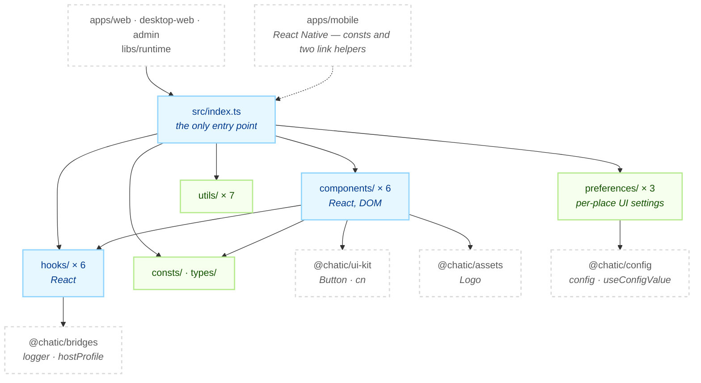
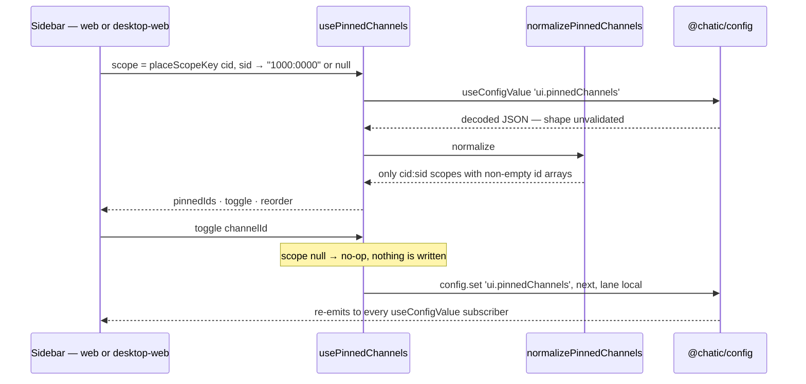

# @chatic/shared

**One barrel of React-side parts that more than one front end reaches for.** It holds six
presentational components, six hook modules, the per-place sidebar preferences, five small helpers
and two constant tables, and exports all of it from a single entry point that five projects import.

It is a catch-all rather than a layer, and that has a measurable cost. [Scope](#scope) states what the
membership rule is and where the contents fail it, so the question "does this belong in shared?" has
an answer other than "it is shared by two apps".

## Purpose

Consumers see the `@chatic/shared` barrel and nothing else. Imports that reach past it into an
internal path number **zero**, so the directory layout below is free to move.

```bash
grep -rn "@chatic/shared/" --include='*.ts' --include='*.tsx' apps libs | grep -v node_modules
```

The consumer list is worth knowing because it is not all browsers — `apps/web`, `apps/desktop-web`,
`apps/admin`, `libs/runtime` and `apps/mobile`, which is React Native.

```bash
grep -rln "@chatic/shared" --include='*.ts' --include='*.tsx' apps libs | grep -v node_modules
```

This lib **owns no domain data and makes no network call.** It reads no server model except four
fields of `MembershipView`, and it stores nothing of its own: the two preference keys it shapes are
persisted by `@chatic/config`, and every other cached value belongs to `@chatic/data`. It is also not
the design system — `Button`, `Dialog` and the `cn` helper all come from `@chatic/ui-kit`, and the
components here compose `Button` and `cn` rather than declaring a primitive of their own.

## Design principles

1. **One barrel, no deep paths.** Everything is re-exported through `src/index.ts`. A consumer that
   needs `@chatic/shared/utils/...` is telling you the export belongs somewhere else.
2. **No network, no cache, no domain model.** Nothing here fetches, maps or stores a server entity.
   The moment a helper needs a repository it belongs to the feature that owns the repository.
3. **`preferences/` validates the product shape; `@chatic/config` validates only JSON.** The registry
   in `libs/config/src/registry/ui.ts` declares `ui.pinnedChannels`, `ui.channelOrder` and
   `ui.railOrder` as `type: 'json'`, and that check ends at "this parses". That a value must be a map
   of `cid:sid` keys to non-empty id arrays (or, for the rail order, cloud ids and place ids per
   cloud) is knowledge this lib holds, applied to the already-decoded value.
4. **A per-place key is `<cid>:<sid>`, and a half-formed one is never written.** A site id is unique
   only inside its cloud, so a bare place id would let one cloud inherit another's pins.
   `placeScopeKey` returns `null` when either half is unknown and every writer no-ops on `null`.
5. **Stored input degrades; it never throws.** `normalizePinnedChannels`, `normalizeChannelOrder` and
   `normalizeRailOrder` drop what they do not recognise, so a corrupt or hand-edited record costs the user their pins, not
   the sidebar.
6. **Never touch `import.meta`.** It is a _parse_ error under the CommonJS transform ts-jest uses, and
   one occurrence anywhere in the tree makes the whole barrel unimportable from every jest suite that
   reaches it — including suites in other projects. Build-time values come through `@chatic/config`
   (ADR-0079), and even that is no escape hatch for a module-load constant, because `config.init()`
   runs in each app's entry point, after this module has already evaluated. `useVersionCheck`'s
   polling interval is the worked example: its env branch was deleted rather than moved.
7. **A component added here brings no translations with it.** `VersionUpdateBanner` calls
   `useTranslation()` against `version.*` keys that live in the consuming app's locale files, and the
   three error screens read `error.screen.*` the same way (`components/useErrorScreenText.ts`). The
   error screens differ in one respect: every lookup carries its English default from
   `ERROR_MESSAGES`, because they are what renders when something already failed — possibly the
   `/locales` request itself — and a raw key there would be worse than English. `LoadingFallback`
   names its `status` region from `common.loading` with the same kind of English default, because it
   is the `<Suspense>` fallback that renders while those locales are still on their way. It draws no
   logo: in the app the launch splash is the only screen that does.
8. **An export with no reader is a defect, not inventory.** Nothing in the repo type checks against
   an unused export, so the only thing that catches one is the sweep in
   [Scope](#the-membership-rule-and-where-it-fails). Run it before you add, and run it when you remove
   a consumer — a barrel is where deleted call sites leave their residue.

## Scope

**In** — presentational components with no feature knowledge, generic React hooks, the two per-place
sidebar preferences and their scope key, and small pure
helpers over the DOM and over dates, query keys and images.

**Out** — storage and its stores (`@chatic/storage`), design-system primitives, `Toaster` included (`@chatic/ui-kit`), logging
(`@chatic/bridges`, `logger`), images and logos (`@chatic/assets`), what the host injected at boot
(`@chatic/bridges`' host profile), setting keys, lanes and persistence (`@chatic/config`), domain data
(`@chatic/data`), the HTTP client and its error classification, `throwIfApiError` included
(`@chatic/http`), and the transport types the SDK already declares, such as `ListResult` from
`@lemoncloud/chatic-backend-api`.

Those four are named rather than left implied because each is the kind of thing that reads as harmless
on the way in: a `sonner` wrapper, a four-line copy of the HTTP client's error promoter, an interface
the SDK already declares. A duplicate in a barrel five projects import is not harmless. It is a second
answer to a settled question, and call sites split between the two answers without anyone deciding to.

### The membership rule, and where it fails

That "In" list is a description of what is here, not a rule that decides what should be. The honest
version is: **a thing lands in `@chatic/shared` when a second app needs it and no existing module
obviously owns it.** A module with that rule accumulates faster than it sheds, because nothing in the
build objects to an export that nobody imports. Three measurements, each reproducible:

- **`types/` has no reader at all.** Its four declarations — `PaginationType`, `TokenGenerateRequest`,
  `TokenGenerateResponse` and `TokenGeneratorFormState` — are named by no file outside this lib and by
  no file inside it. `consts/` carries two more of the same kind, `StorePlatform` and
  `ErrorMessageType`. Types cost nothing at run time, which is exactly why nothing ever forces the
  question.

    ```bash
    # per symbol: is it named in any file that imports @chatic/shared?
    grep -rl "@chatic/shared" --include='*.ts' --include='*.tsx' apps libs \
      | grep -v node_modules | grep -v '^libs/shared/' | xargs grep -lw '<symbol>'
    ```

    A zero from that sweep is a question, not a verdict — many exports here are reached only from
    inside the lib, `ERROR_MESSAGES` and the `preferences/` writers among them. Check `libs/shared/src`
    too before concluding anything is unused.

- **Reach across the barrel is lopsided.** `useNavigateWithTransition` is named in 74 of the 138
  consumer files. Nine exports are named in exactly one, and nine more in two. A module whose contents
  range that far apart in demand is not one concern, and the single-consumer end is where the next
  thing to move out comes from — one consumer means one owner, and that owner is a feature.
- **The barrel is DOM-bound, and a React Native app imports it anyway.** `apps/mobile` takes the
  store constants and the two link helpers in `utils/` (the invite decoder and the sub WebView link map). Its `package.json` nonetheless lists
  `react-router-dom` as a dependency while its own source does not import it, and it does not import
  `@chatic/ui-kit` at all. `nx sync-deps` keeps that entry because the project graph reaches it through
  this barrel, by way of `NotFoundPage` and `RouterErrorFallback`. Its two test files
  `jest.mock('@chatic/shared')` wholesale for the same reason.

None of that is a reason to leave. It is the reason to ask, before adding: does `@chatic/ui-kit`,
`@chatic/config`, `@chatic/bridges` or the feature itself own this? `@chatic/shared` is the
answer when all four say no, and `consts/` — the only directory `apps/mobile` can safely reach — is
the part with the clearest claim to the name.

## Structure



**The six directories are not layers.** Five of them import nothing from each other; only
`components/` reaches sideways, into `hooks/` and `consts/`. Nothing reaches `types/` at all. There is
no order to respect and no dependency to invert — which is exactly why the barrel is the only thing
holding the module together, and why [Scope](#scope) has to do the work a layer map would otherwise
do.

### Writing a per-place preference

The one path with real mechanism. Both `apps/web` and `apps/desktop-web` drive it, against the same
config key with the same scope and the same shape.



Reads normalize on the way out and writes normalize on the way in, so a record that a hand edit or an
older build left malformed is repaired by the next write rather than propagated.

### Directories

```text
libs/shared/src/
├── index.ts          public barrel — six lines of `export *`
├── components/       6 components + index; all React, all DOM
├── consts/           STORE_URLS, and ERROR_MESSAGES inline in index.ts
├── hooks/            6 hook modules + index
├── phone/            phone-number parsing (libphonenumber-js) + OTP expiry countdown — NOT in the barrel
├── preferences/      pinnedChannels · channelOrder · railOrder · placeScope + index
├── types/            index.ts and nothing else — four declarations, no reader
└── utils/            7 single-purpose helpers + index
```

Seven things the filenames do not tell you.

- **`utils/subWebViewLink.ts` is the only reader of a sub WebView page link**,
  `https://app.chatic.io/apps/<appId>?<query>` (and `app-dev`): an app id and a query, no path, no
  fragment. Landing reads it to decide whether to offer the app, mobile to check it and hand the web
  `/apps/<appId>?…`, and the web to read that path; mobile also builds a page's `appLink` with it. It
  maps no id to a page — that is the web's list, and later the server's — and reads the
  `/sub-webview?url=…` path older apps hand over. It parses by hand, not with `URL`, for the reason
  the invite decoder below gives about React Native.

- **`utils/subWebViewTrust.ts` is the only place that decides what a sub WebView opens**, and how far
  the shell trusts it: `firstParty` for the hub (`https://apps.chatic.io`, `https://apps-dev.chatic.io`,
  exact origin), `reviewed` for one label under those domains (the pages the review pipeline deploys),
  `external` for any other plain https host, and `null` for anything a parser could read two ways —
  userinfo, a port, a backslash, whitespace, an IP literal — and the limits on what crosses with it
  (`params` and `result` at most 16 KiB, a title 100 characters). Both shells check a request against it and
  both webs check a link an owner saves against it, so the web never stores a link the shell would
  refuse. It also reads a page manifest's `display` for both shells (`subWebViewDisplayOf`): `titled`,
  `clean`, `immersive`, and `standard` and `fullscreen`, the earlier names for the first two, so the
  phone and the desktop cannot read a name differently. It imports nothing, on purpose: the desktop
  shell's main bundle aliases this one file rather than pulling the whole barrel into Electron's main
  process. `utils/miniAppLaunchParams.ts` builds the
  `params` a mini app opens with from it — ids and display names, never a token, and `user.isOwner`
  and the cloud's mini app list (`miniApps`, name and host) for a `firstParty` page only. `utils/miniAppLinks.ts` holds the rules for the mini apps an owner adds
  to a cloud, so both webs keep the same list: `checkMiniAppLink` (a name of 1–30 characters, an
  address that rule opens and that is not on the hub's own hosts, `hubUrl` — a page there would get the
  owner flag and the list), `MINI_APP_LINK_LIMIT` (10 per cloud), and `parseMiniAppLinks`, which reads
  a stored list back and drops any entry the rules no longer pass.

- **`utils/inviteLink.ts` is the only decoder of the encoded invite link `/i?t=<base64url(JSON)>`.**
  Landing, mobile, web and desktop-web all call it, because a decoder that drifted would send one link
  to a different server than its siblings do. `readInviteLink` returns the target plus the token's
  shape — `failedAt` (the step that refused it), `length` and `ignoredChars` — and never the token,
  which holds the invite code; `decodeInviteLink` is the same call returning the target alone. It
  reads `t` only up to the first character outside base64url, because a link pasted into a chat can
  arrive with text glued onto its end (`…/i?t=eyJ…입니다`, a closing `)`) and the server never writes
  such characters into a token. A truncated token cannot be helped this way and still fails. It never
  throws, React Native included: that platform's query parser throws on a malformed `%` escape, and
  the decoder then reads `t` from the raw query instead.

- **`consts/index.ts` is not just re-exports.** The `ERROR_MESSAGES` table — six error kinds, each with
  a title, a description and two button labels, in English — is declared inline there. It is the
  fallback, not the copy a reader normally sees; the translated text is in the app's locale files
  under `error.screen.*`. There is no `errorMessages.ts` to open.
- **`hooks/useGlobalLoader.tsx` holds the zustand store, not a component.** It is `.tsx` and contains
  no JSX. The overlay that reads the store is `components/GlobalLoader.tsx`.
- **`phone/` is a subpath entry, `@chatic/shared/phone`, and the barrel does not re-export it.** It
  carries libphonenumber's metadata, and the barrel sits on every app's eager path; re-exporting it would
  land that metadata in the initial chunk. Its consumers (the web phone-verification screens, the desktop
  phone sign-in) are behind lazy routes and import the subpath. The alias is in `tsconfig.base.json`'s
  `paths`, and `apps/web/jest.config.js` maps it ahead of its generic `@chatic/*` rule.
- **`usePageTransition.ts` exports `useNavigateWithTransition`,** `navigate` with a platform page
  transition. It is by far the most-imported symbol in the lib. It takes the same options and returns
  the same promise as `@lemoncloud/react-page-transition`'s hook, but starts the transition itself
  through `@lemoncloud/page-transition-core`'s `executePageTransition`, feeding it the platform the
  shell injected (read from `@chatic/bridges`' host profile).
    - **It does not use the React package's hook, because that hook let the browser capture the
      incoming screen before it existed.** A view transition captures the new screen as soon as its
      update callback settles; the package's callback settled as soon as `navigate` returned. React
      renders a route change in a later task, and `navigate(-1)` does not reach the router until the
      browser has moved entries, so for every back arrow the capture was the screen being left: the
      first frames slid the room out over a copy of the room. For a push it depended on React's task
      beating the next frame. `waitForDestination.ts` makes the callback wait for the first DOM change
      after the navigation — for a history delta, after `history.state` shows the other entry — capped
      at 300ms; the page does not paint while it waits, so the cap bounds a freeze, and only a
      navigation that renders nothing reaches it. A lazy screen whose code has not loaded commits its
      Suspense fallback first, and that fallback is what is captured, as before.
    - **A navigation made while one of its transitions is running goes through without a second
      transition,** after the running one has navigated. The package clears every class it set when a
      transition finishes, a newer running transition's included, so overlapping two would drop the
      second one's motion midway. `animation: 'none'` also skips the transition and the wait.
    - **It puts `data-page-transition` on `<html>` for as long as a navigation runs,** cleared when the
      last overlapping one settles. That attribute is a DOM contract, not an import: WebKit paints no
      `backdrop-filter` inside a view transition's snapshots, and web-ui-kit's `HeaderGlass` reads it to
      keep a glass header opaque through the slide instead of frosting in one frame at its end. The name
      is spelled out in both libs and pinned by both libs' tests. It is not set on Android — the WebView
      there is Blink, which paints the frost inside the snapshots (measured in Chrome 154), so holding a
      header opaque there would only delay its glass.
    - **The animations themselves are CSS the app loads,** not this lib: the package's stylesheet, and
      apps/web's own Android override after it
      ([apps/web page transitions](../../apps/web/docs/shell/page-transitions.md)).

## Usage

Import from the barrel. Nothing here needs construction or registration.

```ts
import { AVATAR_IMAGE, formatDate, placeScopeKey, prepareImage } from '@chatic/shared';

// Per-place preferences: derive the scope first, and let a null scope stay null.
const scope = placeScopeKey(cloudId, placeId);
const { pinnedIds, toggle, reorder } = usePinnedChannels(scope);
```

### Wiring

The swappable storage adapter (`storage`, `setStorageAdapter`) used to live here. It moved to
[`@chatic/storage`](../storage/README.md) and was later retired: every app now hands its features the
stores its entry point chose.

The components are mounted by the host, not by this lib:

```text
apps/web
  ├─ app.tsx     <ErrorBoundary FallbackComponent={ErrorFallback}> · <Suspense fallback={<LoadingFallback/>}>
  ├─ routes/     errorElement: <RouterErrorFallback onError={…}>
  └─ runtime/    <GlobalLoader/> · useVersionCheck() → <VersionUpdateBanner/>
```

## Scenarios

### 1. Pinning a channel, and seeing it in the other app

The sidebar calls `toggle(channelId)` from `usePinnedChannels(scope)`. `setChannelPinned` reads the
current map, adds or removes the id inside that one scope, drops the scope entirely if nothing is left
pinned, and writes the whole map back through `config.set(..., { lane: 'local' })`. Other scopes are
preserved untouched. `apps/desktop-web` reads the same `ui.pinnedChannels` key through the same
normalizer instead of keeping its own copy, so the two front ends cannot disagree about the shape.

### 2. Reordering the sidebar

Two different rules, on purpose. `setPinnedChannelOrder` rewrites only the _slots_ that listed pins
occupy: an id not in the incoming list keeps its position, so a channel briefly missing during a rejoin
or a sync lag cannot lose its pin to someone else's drag, and an id that is not already pinned is
dropped rather than silently pinned. `setChannelOrder` (the non-favorite section) simply stores the new
full order, de-duplicated. Reading is `applyChannelOrder`: stored ids that are still present first, in
stored order, then everything new appended in the list's own order. `moveChannel` moves one id and
prunes ids that are gone in the same write.

### 3. A new build is published while the app is open

`useVersionCheck` polls `/version.json` with `cache: 'no-store'` and compares it part-by-part against
the `__APP_VERSION__` the build defines, falling back to `'0.0.0'` when that global is absent. Two
guards keep the poll honest: a 10-second floor between checks and an in-flight ref, so a manual
`checkNow()` landing next to the interval does not double-fetch. On a newer version the host renders
`VersionUpdateBanner`; `dismissUpdate()` hides it for the session without stopping the polling. The
default interval is five minutes for everyone, including local development — see principle 6 for why
there is no env branch.

### 4. A render throws, or a route 404s

`ErrorFallback` is a `react-error-boundary` fallback: it classifies the error by substring — both
English and Korean, so `'연결'` reads as a network failure the same as `'network'` — picks an icon and a
message (`error.screen.<kind>.*`, falling back to `ERROR_MESSAGES`), and focuses its own container so a screen reader lands on the error
rather than on whatever came before. `RouterErrorFallback` is the router's `errorElement` and classifies
`isRouteErrorResponse` by status instead; a 404 renders `NotFoundPage` and, deliberately, does **not**
call `onError` — only real failures are reported upward.

### 5. Uploading a picture

One function, `prepareImage`, and the **destination** picks the policy — because the two upload paths
have opposite constraints, and leaving that to each caller is how one of them ends up sending an
uncompressed base64 blob.

```ts
await prepareImage(file, AVATAR_IMAGE); // avatar — square crop, base64
await prepareImage(file, REPORT_PHOTO); // feedback screenshot — whole frame, tighter budget
await prepareChatAttachment(file); // chat photo — CHAT_ATTACHMENT, but a GIF goes without a thumbnail
```

The destinations are **named policies** rather than options spelled out per call site, because the
avatar one used to be written at seven of them. Each carries its own budget and the reason for it;
a one-off variation spreads and overrides (`{ ...AVATAR_IMAGE, maxEdge: 64 }`). The parts
underneath — `decodeImage`, `compressToBlob`, `toUploadFile` — are exported too, but composing them
by hand means taking on the pairing `prepareImage` enforces.

`'inline'` is a base64 data URL for a record field or an inline payload, and it is **always
compressed**: base64 costs about four bytes per three, so the encoded size is the budget. It rejects
on failure, because its caller has nothing to store instead. The feedback reporter's `1024` / `0.6`
is that budget, not a taste call.

`'storage'` is bytes PUT to object storage, and **the original goes up at full size** — the transport
carries it, and re-encoding would spend the quality the sender chose. It returns the original, its
dimensions, and a small thumbnail for lists. "The original" means _not resized_, not _not touched_:
HEIC is still converted to JPEG and renamed, because the endpoint takes no HEIC and answers it with
a 415. An animated GIF is never redrawn. `prepareImage` still gives it a
thumbnail when asked, but a chat photo goes through `prepareChatAttachment`, which asks for none for a
GIF: a thumbnail is a canvas drawing, which keeps only the first frame, and the server hands an upload
back with no content type, so a room could not tell that still from a photo's and drew it as the tile.
With no thumbnail the room draws the original, and the GIF plays in the list.

Picking the wrong `fit` loses data: `'cover'` center-crops to a square, for avatars where the square
is the point, and `'contain'` keeps the whole frame and never upscales, for images that are read
rather than recognised.

### 6. React Native reaching into the barrel

`apps/mobile` imports `STORE_URLS` and `getStoreUrl` for its store-update prompt, `inviteLink.ts`'s
decoder for invite links, and `subWebViewLink.ts` for sub WebView page links and a page's `appLink`.
Everything else in the barrel assumes a DOM, so its suites never load the barrel itself: the
store-update ones `jest.mock('@chatic/shared')` with a literal copy of the constants, and the deep-link
and sub WebView ones point the mock at the two `utils/` files with `jest.requireActual`. Treat
`consts/` and those two files as the only platform-neutral parts of this lib: a new import added to a
file they can reach becomes a React Native dependency, whether or not the code is ever run there.

## Constraints the helpers keep

- **EXIF orientation is decided once, in `decodeImage`, by reading through an ``.** Browsers apply
  `image-orientation: from-image` by default, so a portrait photo reports its portrait size and does not
  arrive on its side. `createImageBitmap` was measured to do the same in a current Chrome, but `` is
  the oldest route and needs no support check. A source the browser cannot read (HEIC outside Safari) gives
  `null`, not a rejection, because nearly every caller has something better to do than fail.
- **A video poster is held to the server's thumbnail ceiling.** `VIDEO_POSTER` uses the same rule as the
  shells' posters: a thumbnail over 200,000 bytes (decimal) is dropped by the server without saying so.
  `makeVideoPoster` seeks with the `#t=0.5` URL fragment, set before anything loads, because setting
  `currentTime` on a paused element never completes on iOS WebKit (`seeking` fires, `seeked` does not).
  It waits `settleMs` after the frame is reported ready, because Android's WebView reports `seeked` before
  the frame is readable (blank in 10 of 17 tries without the wait, right 17 of 17 with 300 ms), retries once
  on a blank frame, and gives up with `null` rather than blocking an upload. Half a second in avoids the black
  first frame many phone recordings have.
- **`ErrorFallback` matches Korean substrings but no bare English words.** The error it classifies is not
  always ours, and a Korean-speaking backend can pass its message through as `error.message`. Words such as
  `token`, `server` or `request` are left out on purpose: they appear in ordinary crashes ("reading
  'accessToken'", "Unexpected token '<'") and would send a plain bug to the login screen.
- **`useErrorScreenText` never suspends.** The app's top-level error boundary sits outside its `<Suspense>`,
  so a screen that suspended while `/locales` loads would render nothing instead of the English defaults.
- **The phone helpers are mobile-only and E.164.** `libphonenumber-js/mobile` is imported, not `/min`,
  because the flow delivers a code by SMS and `/min` calls a Korean landline valid. E.164 is the wire value:
  the backend's phone hasher reads `countryCode` only for a local (`0…`) number and ignores it once the
  string starts with `+`, and E.164 cannot collide across countries the way local forms can. A missing
  country is "not yet answerable", not "invalid". The default country is the last explicit pick, then the
  caller's preferred one, then the device locale's region, then none; an empty picker with a disabled button
  says "pick one" without accusing the user of a mistake.
- **A drag in a partly shown rail keeps the tiles that are not on screen.** `ui.railOrder` can be shown
  with part of its list (a read failed, a source is late), so the stored order re-inserts every unseen id
  after the tile it followed. A removed cloud's id therefore stays in the record until logout; reading
  skips it. Duplicate ids are collapsed on read because a hand-edited record must not become duplicate
  React keys or drag ids.
- **The admin override reads the raw fields, not the derived `status`.** The relay derives `status` once at
  write time and nothing sweeps it afterwards, so a lapsed override leaves `status: 'active'` behind.
  `isAdminOverrideActive` compares `adminUntil` with a required `now` (a missing time treated as `0` would
  make every expired override read as active). An empty `adminStatus` is the release encoding, and an absent
  or `0` `adminUntil` means indefinite: the wire has no special value for it.
- **The invite decoder avoids `atob` and `TextDecoder`.** `atob` rejects the url-safe `-` and `_` and
  React Native may not ship it; `TextDecoder` is absent from jsdom and not guaranteed on device. Decoding
  by hand behaves the same in every engine, and a latin1 shortcut would mangle the Korean cloud and place
  names a payload usually carries. The decoder checks nothing about the payload's authenticity: anyone
  holding a link can edit the address in it and re-encode it, which is equally true of the older `/s` link.
- **`VersionUpdateBanner` is `fixed`, so it caps itself at the host's `--app-width`** and centres over the
  column its screens use; a host that declares no app width (a desktop layout) keeps the full-bleed 100%.
- **The jest config lists subpath entries before the generic `@chatic/*` rule**, which would otherwise
  turn `config/react` into a path that does not exist. `@chatic/assets` is stubbed with the web app's mock
  because it builds URLs with `import.meta.url`, which the CommonJS transform cannot parse.

## How to verify

```bash
npx tsc -b libs/shared/tsconfig.lib.json     # the lib
npx tsc -b libs/shared/tsconfig.spec.json    # the spec files
npx jest --config libs/shared/jest.config.js
```

`npx tsc -b libs/shared/tsconfig.json --force` runs both projects, and is what nx's `typecheck` target
does — it builds `./tsconfig.json` with no argument, and that config references the spec project.

- Type checking must be `tsc -b`. Inside `libs/shared`, `tsc --noEmit` checks zero files and succeeds,
  so passing it proves nothing.
- **The two projects are separate on purpose.** `tsconfig.lib.json` excludes `*.test.ts`, and jest does
  not type check at all — the base sets `isolatedModules`, so ts-jest transpiles. Without the second
  command a broken fixture surfaces only as `… is not a function` at run time.
- **A suite is not a covered module.** `hooks/websocket-worker-queue.test.ts` declares the queue it
  tests inside the test file, so it exercises nothing in this lib, and `LoadingFallback` is the only
  component with a test.
- `tsconfig.spec.json` must not set `module: "commonjs"`. The base sets `moduleResolution: bundler`,
  which rejects it with TS5095, and the config then cannot compile at all.
- Its `references` must mirror `tsconfig.lib.json`'s, or the siblings arrive as unlisted files (TS6307).
  **`assets` is at the repo root**, so that entry is `../../assets/tsconfig.lib.json`; shortening it to
  `../assets/` fails with TS5083.
- Its `outDir` is `dist/out-tsc/shared-spec`, deliberately not the lib project's `dist/out-tsc`. Both
  projects compile the same `src/**` files, so one shared outDir would have two programs emitting the
  same `.d.ts` paths.
- A stale `dist`/`out-tsc` produces phantom errors after a directory moves. Force-delete both —
  `rm -rf libs/shared/out-tsc dist/out-tsc` — and look again.
- Downstream: a changed barrel identifier reaches `apps/web`, `apps/desktop-web`, `apps/admin`,
  `apps/mobile` and `libs/runtime`. `.github/workflows/verify.yml` type checks `web`, `admin`,
  `desktop-web` and `@chatic/runtime`; `@chatic/mobile` is on its exclusion list, so that one
  is for you to run by hand. Its test step excludes `web` alone of this lib's consumers.
- **`@chatic/mobile` fails its type check either way.** Remember that it reports a
  `TS6053` for `@nx/react-native/typings/svg.d.ts` when it runs from a git worktree, because the
  script's literal `node_modules` path does not resolve upward the way Node does.
